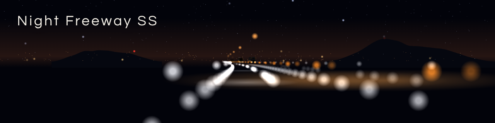

# Night Freeway SS

夜の高速道路を光の点で描く、Windows用のスクリーンセーバー。mhatta氏の[nightfreeway](https://github.com/mhatta/nightfreeway)(ブラウザで動くアニメーション)を参考に、挙動と見た目を似せてRustで独自に実装している。本家とは別のプロジェクトである。

## 特徴

- カーブと起伏のある夜の高速道路を走り続ける。車線・デリネーター・街灯・路面の光、他車の尾灯と前照灯を描く
- 夜空には、またたく星・街明かり・流れ星・遠くの山並みが見える
- ときどきトンネルに入る。山あいと平野が入れ替わり、時刻に応じて交通量が変わる
- トラック(日本風・北米風)、他車の車体と影、速度計などを、設定画面で選べる
- スクリーンセーバーとしてではなく、ウィンドウや全画面でしばらく流しておくこともできる(`/window`・`/play`・`/minutes:<n>`)。流しているあいだは、速度の上げ下げ・一時停止などのキー操作もできる
- 設定画面は日本語と英語に対応している

## ダウンロードとインストール

1. [GitHub Releases](https://github.com/suchi/freeway-ss/releases)から、PCに合うzipを取得する。一般的なIntel/AMDのPCは`win-x64`、ARMベースのプロセッサのPCは`win-arm64`
2. zipを展開し、`NightFreewaySS.scr`を右クリックして「インストール」を選ぶ

動作環境はWindows 10 / 11。設定の項目・アンインストールの方法などは、zipに同梱の[説明書](packaging/README.md)(日本語と英語)にある。zipの整合性は、同じリリースの`SHA256SUMS.txt`で確かめられる。

## 開発者向けの情報

- [オンボーディング](docs/onboarding.md): 開発に加わるときに最初に読む文書。進め方と、最初の変更までの流れ
- [開発者向けガイド](docs/developers.md): 構成・ビルド・テスト・配布物の作り方・設定の保存先
- [実装計画](docs/plans/0001-screensaver-implementation-plan.md)(進捗表を含む)と[ADR](docs/adr/README.md)(技術判断の記録)
- AIコーディングエージェントへの指示は[AGENTS.md](AGENTS.md)にある

## 謝辞

本プロジェクトは、mhatta氏による[nightfreeway](https://github.com/mhatta/nightfreeway)(Copyright (c) 2026 Masayuki Hatta、MITライセンス)の挙動と見た目を参考にしている。コードは移植せず独自に実装している。

nightfreewayの謝辞にならい、原作のFreeWayの作者であるFKS氏、Windows移植を手がけたYoshihiro Sugahara氏、nightfreewayが参考にしたsoyokaze2000.comのFreeWay再現版にも感謝する。

## ライセンス

[MIT](LICENSE)

## 免責事項

本ソフトウェアは、AIコーディングエージェントにコードの作成の大部分を任せる、いわゆるVibe Codingで開発した。作者は設計の判断と実機での動作確認を行っているが、すべてのコードを詳細に検証しているわけではない。

そのため、作者は本ソフトウェアの品質・安全性・動作を保証せず、本ソフトウェアの利用によって生じた不具合・損害・トラブルについて責任を負わない。これは[MITライセンス](LICENSE)の無保証の条項を、改めて明示するものである。
