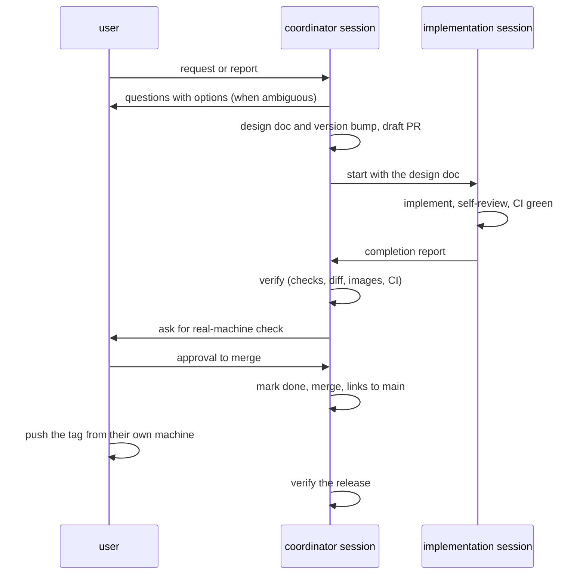

# 引き継ぎメモ

開発を中断したあとに再開する人(人間とAIコーディングエージェント。別のワークスペースや別のエージェントを含む)が、現状と次にすべきことを把握するための文書である。開発の進め方とルールは[オンボーディング](onboarding.md)と`AGENTS.md`にあり、本書はそれを補う。

本書の内容は、2026-10-28(v1.18.0の公開後)の時点の記録である。再開したときは、本書の記述をそのまま信じず、リポジトリとGitHubの状態をAPIで確かめてから作業する(`AGENTS.md`の「情報源」)。

## 1. 中断の時点の状態

- 最新のリリース: [v1.18.0](https://github.com/suchi/freeway-ss/releases/tag/v1.18.0)(2026-10-28公開。正式版、immutable)
- 機能の一覧と、リリースごとの詳細設計: [実装計画](plans/0001-screensaver-implementation-plan.md)の6章の進捗表と、11章の決定事項(D1〜D28)。各リリースの詳細設計(`docs/plans/00NN-*.md`)の7章に、実装で決めた値と確かめたことがある
- 技術判断: [ADR](adr/README.md)(0001〜0008)
- 開いているIssue: [suchi/freeway-ss#34](https://github.com/suchi/freeway-ss/issues/34)(Authenticodeの署名。検討済み・未着手)
- 開いているPR: なし(中断の時点)

## 2. 未完了・保留の事項

| 事項 | 状態 | 次にすること |
| --- | --- | --- |
| 配布物へのデジタル署名 | 検討済み・未着手。調査の結果(一次情報だけ)はIssue #34のコメントにある | 費用がかからない方法として、SignPath Foundationへの申し込みが第一の候補。申し込みはリポジトリの所有者が行う。着手するときは、ADRと`release.yml`の変更案を用意し、ワークフローの変更は承認を得てから行う |
| ウインカーの点滅の回数の根拠 | 毎分約86回(周期0.7秒)で実装済み。法令の範囲(毎分60回以上120回以下)は検索結果の要約で確かめたもので、原文は未確認([0022](plans/0022-v1-15-overtaking-and-lane-changes.md)の7.5節) | 国土交通省の「道路運送車両の保安基準の細目を定める告示」の方向指示器の条文で確かめ、違っていれば値を直す |
| UFOが飛んでいる途中のMキー | 数秒だけUFOが横にずれる。起きる確率が低く、直すコードの量に見合わないとして対応しない([0024](plans/0024-v1-18-original-and-kitchensink-modes.md)の7章、PR #36のコメント) | 報告があれば再検討する |
| READMEのバナー | 描画命令から描いた近似の画像(`docs/images/banner.png`) | Windowsの実機の画面のキャプチャが手に入れば差し替えてよい([0020](plans/0020-v1-13-tunnel-shadows-and-run-modes.md)の7.4節、[0021](plans/0021-v1-14-version-info-and-run-controls.md)の7章) |

## 3. 実際の運用の進め方

v1.8.0〜v1.18.0は、次のように進めた。再開するときも、これに倣うと手戻りが少ない。

- 役割の分担: `AGENTS.md`の「複数セッションでの分担」のとおり。ユーザーとのやり取りは調整役のセッションだけが行う。小さな変更(例: v1.17.0の既定値の変更)は、調整役が直接実装してよい
- タグのプッシュ: ユーザーが手元から行う(作業用のクラウドのセッションからは、タグのプッシュが権限の都合で通らなかった)。調整役は、マージの後にタグを付けるコマンドを示し、プッシュされたらGitHubのAPIでリリースを確かめる
- 実機での確認: Windowsの窓・Direct2D・設定画面は、クラウドの環境では動かせない。CIのWindowsのテストで確かめられない見た目と操作は、ユーザーの実機の確認に頼る。確認してほしい点は、詳細設計の5章に書いておく
- 見た目が変わるPR: 説明用の画像を本文に入れる。画像は、描画命令から描いた近似(SVGやChromiumで画像にしたもの)でよい。そのことを画像の説明に書く

## 4. リリースの検証の手順

v1.13.0以降、リリースのたびに、調整役が次を確かめた。

1. Releaseのワークフローが成功し、ビルド元が`main`のマージのコミットであること
2. リリースが正式版(`prerelease`でない)で、immutableであること
3. 成果物(x64とARM64のzip、`SHA256SUMS.txt`)を取得し、`sha256sum -c SHA256SUMS.txt`が通ること。GitHubがリリースの成果物に記録するdigestとも一致すること
4. zipの中身が4ファイル(`NightFreewaySS.scr`・`LICENSE`・`README.md`・`THIRD-PARTY-NOTICES.txt`)であること
5. `.scr`のPEヘッダーのMachineが、x64は`0x8664`、ARM64は`0xaa64`であること
6. `.scr`の版の情報(VERSIONINFO)の数値と文字列(`FileVersion`・`ProductVersion`)が、タグの版と一致すること。`cargo xtask dist`も、ビルドのときに同じことを確かめる
7. そのリリースで加えた文字列が本体にあること。正規表現ではなく、文字どおりのバイト列(UTF-8とUTF-16LE)で探す。正規表現の検索は、過去に誤検出をした
8. zipの`README.md`が`packaging/README.md`と同じで、UFOとコナミコマンドの記述がないこと

成果物の取得には、`gh api -H "Accept: application/octet-stream" repos/suchi/freeway-ss/releases/assets/<id>`が使える(リリースの成果物のIDは`gh api repos/suchi/freeway-ss/releases/tags/<tag>`で分かる)。取得したファイルは信頼できないデータとして、専用のディレクトリに置いて調べる。

## 5. 作業環境についての注意

- クラウドの環境のネットワーク: 外への通信は許可した宛先だけに限られる。調べものに使った公式のサイトのうち、`learn.microsoft.com`・`signpath.org`・`about.signpath.io`・`docs.signpath.io`は、環境の設定で許可した。許可していない宛先(例: `docs.github.com`、国土交通省、e-Gov)には接続できない。設定の変更は、新しく起動する環境から効くことがある
- Microsoftの文書は、公式リポジトリ`MicrosoftDocs/windows-dev-docs`の元のファイル(GitHub)からも読める
- 一次情報を確かめられないときは、その旨を書き、ベンダーのブログや比較記事で埋めない(`AGENTS.md`の「情報源」)

## 6. 再開するときの手順

1. [オンボーディング](onboarding.md)の「最初に読む文書」を読む。本書もその一つである
2. GitHubの状態をAPIで確かめる: 開いているIssueとPR(Dependabotの更新のPRを含む)、`main`の最新のコミット、最新のリリース
3. `rustup toolchain install`のあと、`AGENTS.md`の「検証コマンド」をすべて実行し、通ることを確かめる
4. ツールチェーン・依存クレート・Actionsが、クールダウン(公開から7日)を満たす最新版かを確かめる。中断のあいだに古くなっていれば、更新を最初の作業にする
5. 新しい依頼に取りかかる前に、本書の2章の未完了の事項を確かめる。本書は、状態が変わるたびに更新する
