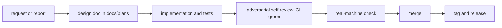

# オンボーディング

Night Freeway SSの開発に加わる人(人間とAIコーディングエージェント)が、最初に読む文書である。進め方の全体と、最初の変更をマージするまでの流れをまとめる。構成やコマンドの詳細は[開発者向けガイド](developers.md)にある。

## 最初に読む文書

| 順 | 文書 | 内容 |
| --- | --- | --- |
| 1 | [README](../README.md) | 何を作っているか |
| 2 | [AGENTS.md](../AGENTS.md) | 開発のルールの正本(進め方・言語・コミット・PR・リリース・セキュリティ)。人間にも当てはまる |
| 3 | [引き継ぎメモ](handoff.md) | 中断の時点の状態、未完了・保留の事項、実際の運用の進め方、リリースの検証の手順、再開するときの手順 |
| 4 | [実装計画](plans/0001-screensaver-implementation-plan.md) | 要件・アーキテクチャ・進捗表・決定事項。いまどこまで進んでいるかは、6章の進捗表で分かる |
| 5 | [ADR](adr/README.md) | 技術判断とその理由 |
| 6 | [開発者向けガイド](developers.md) | 構成・ビルド・テスト・配布物 |
| 7 | 作業に関係する詳細設計(`docs/plans/`) | フェーズ・リリースごとの設計と、実装で決めた値 |

## 最初の準備

1. [rustup](https://rustup.rs/)を入れ、リポジトリの直下で`rustup toolchain install`を実行する。`rust-toolchain.toml`のツールチェーンとWindowsのターゲットが入る
2. `cargo test --workspace`と、`AGENTS.md`の「検証コマンド」の残りを実行し、すべて通ることを確かめる
3. Windowsで動かすときは、[開発者向けガイド](developers.md)の「Windowsで試す」に従って`.scr`を作る

## 開発の進め方

人間が判断するAgentic Codingで進める(`AGENTS.md`の「進め方」)。

- 曖昧な点は、選択肢と長所・短所を示して確認する。破壊的な操作・設計の判断・マージ・タグのプッシュは、必ず承認を得てから行う
- 大きめの変更は、まず`docs/plans/`に詳細設計を書いて合意してから実装する。決めたことはADRや計画に残し、会話の中だけに置かない
- 複数のエージェントのセッションで分担するときは、ユーザーとのやり取りを1つのセッション(調整役)にまとめ、実装は別のセッションが行う(`AGENTS.md`の「複数セッションでの分担」)

## 最初の変更をマージするまで

1. `main`から作業用のブランチを作る(GitHub Flow。`main`への直接のプッシュは禁止)
2. 変更する。1コミットは1つの論理的な変更にし、コミットメッセージはConventional Commits(1行目は英語、本文は日本語)で書く
3. コミットの前に、`AGENTS.md`の「検証コマンド」をすべて実行する
4. ドラフトのPRを作る(タイトルは英語、本文は日本語)。CIは、LinuxとWindowsの`Check`、CodeQLが通る必要がある
5. 自分の差分を、敵対的なレビュアーとして見直し、指摘と対応をPRのコメントに残す
6. 見た目や動作が変わる変更は、Windowsの実機で確かめる
7. レビュー完了・CIのグリーン・承認がそろってからマージする。リリースは`AGENTS.md`の「リリース」の手順で行う

## 気をつけること

- ユーザーとの会話・ドキュメント・PRの本文は日本語で書く。コード・識別子・コード内のコメントは英語で書く(`AGENTS.md`の「言語ルール」)
- 依存を加えたり更新したりするときは、公開から7日以上たった版を使う(クールダウン)。`Cargo.lock`の各版の公開日を確かめる
- `.claude/settings.json`・`.claude/hooks/`・`.github/workflows/`・`.github/dependabot.yml`は、セキュリティに関わる設定である。変更する前に承認を得る
- 乱数の区別子などの名前に、暗号の用語(salt・key・nonceなど)を使わない。CodeQLが誤って検出したことがある
- 利用者向けの文書では、保証しないことは明示するが、利用者に行動や責任を求める書き方はしない
