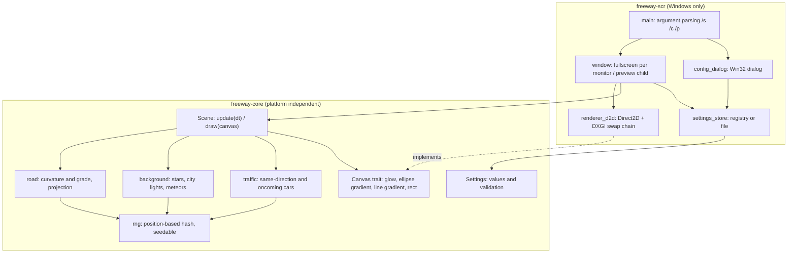
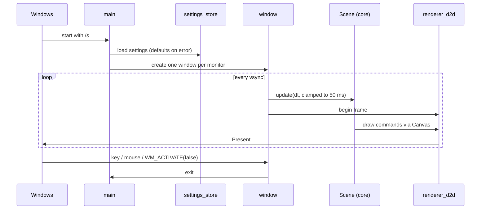
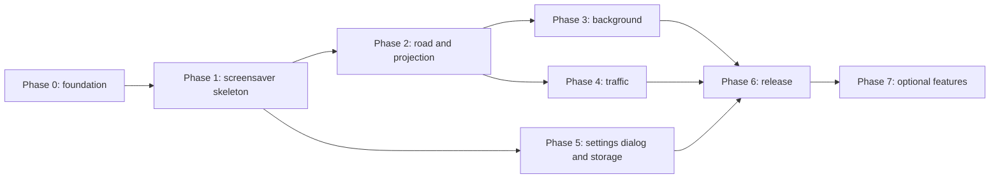

# 実装計画: Night Freeway SS(Windowsスクリーンセイバー)

- ステータス: 合意済み
- 日付: 2026-10-26
- 対象: 本リポジトリの初期実装(MVP)からリリースまで

本書はAGENTS.mdの「大きめの機能は計画(SOW)を`docs/plans/`に保存し、合意してから実装する」に基づく計画書である。技術選定などの決定事項は「11. 決定事項」にまとめ、主要な技術判断はADR(`docs/adr/`)に記録した。

## 1. 目的とスコープ

目的は、mhatta氏の[nightfreeway](https://github.com/mhatta/nightfreeway)(光の点で描いた夜の高速道路をブラウザで表示するアニメーション)と似た挙動・見た目のWindowsスクリーンセイバーを作ることである。

スコープ内:

- Windowsスクリーンセイバー(`.scr`)としての動作: 全画面表示、設定画面、コントロールパネルのプレビュー表示
- 本家masterに実装されている主要な描画要素の再現(後述の表で「MVP」としたもの)
- 本家で実行中にキー操作で変更できる項目のうち、スクリーンセイバーで意味があるものを設定画面から設定できるようにする
- 配布しやすいリリースバイナリの作成

スコープ外(後続フェーズで扱う):

- 設定値の時間的な変化(AGENTS.mdで「オプションであとで開発する」とされている)
- 本家READMEに記載はあるがmasterのコードに存在しない要素(2.3節)
- UIの多言語化(AGENTS.mdの言語ルールに従い、UIラベルは英語とする)

## 2. 参照元(nightfreeway)の調査結果

調査対象: `mhatta/nightfreeway` masterブランチ、コミット`7b98218`(2026-10-26 12:34 +0900)。MITライセンス。`index.html`1ファイル(763行)のCanvas 2Dアニメーションで、ビルド工程も外部依存(Webフォントを除く)もない。

### 2.1 描画要素

| 要素 | 本家の実装の概要 | 本計画での扱い |
| --- | --- | --- |
| 道路形状 | 区間(水平300m・鉛直450m)ごとに位置ハッシュで目標曲率を決め、区間の始めで滑らかに補間。600m先まで1m刻みで積分して横・縦のずれを求める | MVP |
| 透視投影 | 焦点距離は画面幅の半分(または高さの0.55倍の大きい方)。カメラは左車線・高さ1.2m | MVP |
| 光の表現 | 色ごとに放射グラデーションの小画像を1回だけ作り、拡大縮小して加算合成(`lighter`)で描く | MVP |
| 道路の光 | 車線の破線・外側線、デリネーター(白・橙)、中央分離帯の街灯(45m間隔)、路面の光だまり、自車ヘッドライトの照り返し | MVP |
| 背景 | 星1400個(またたき)、街明かり900個(一部点滅する赤色灯)、地平線の空の明るみ。進行方向の変化に合わせて360度分を横スクロール | MVP |
| 流れ星 | 15〜45秒に1回、0.5〜1.2秒間 | MVP |
| 他車 | 同方向10台(尾灯・ブレーキ灯、追越車線の車は自車を追い越す)、対向14台(防眩板越しにちらつく前照灯) | MVP |
| UFO | コナミコマンドまたは速度計の10回タップで出現するイースターエッグ | 後続フェーズで設定項目として実装(11章 D7) |
| 通行方向 | 左側/右側通行の切替(左右反転をなめらかに補間) | MVP(設定項目) |

### 2.2 実行中の操作とスクリーンセイバーでの扱い

スクリーンセイバーはキー入力・マウス操作で終了するため、本家の操作は実行中には使えない。AGENTS.mdの「実行中に変更できる項目はあらかじめスクリーンセイバー設定画面から設定できる」に従い、次のように対応させる。

| 本家の操作 | 内容 | 本計画での扱い |
| --- | --- | --- |
| ↑ / ↓ | 速度 8〜45 m/s(約29〜162 km/h)、初期値28 m/s(約101 km/h) | 設定項目「巡航速度」 |
| D | 左側/右側通行の切替 | 設定項目「通行方向」 |
| Space | 一時停止 | 対象外(スクリーンセイバーでは不要) |
| F | 全画面切替 | 対象外(常に全画面) |
| HUD | 速度計と操作ボタン | 設定項目「速度計を表示」(既定はオフ)として速度計のみ |
| コナミコマンド | UFO出現 | 後続フェーズで設定項目として実装(11章 D7) |

### 2.3 本家READMEとコードの差異

本家READMEには「トンネル(ナトリウム灯/LED照明)と坑口」「遠くの山並み」「マーカーランプ付きのトラック」「坂の頂上の向こうの光が隠れる」「地平線の傾き」が記載されているが、調査時点のmasterのコードには該当する実装が見当たらない(`tunnel`等の語はコード中に0件)。READMEが今後の実装を先行して記載している可能性がある。本計画のMVPはコードに実装済みの要素を対象とし、これらは後続フェーズの候補とする。本家の更新状況はフェーズ着手時に再確認する。

## 3. 要件

### 3.1 機能要件

- コマンドライン引数による動作モードの切替(Windowsのスクリーンセイバー規約)
  - `/s`: 全画面で実行する
  - `/c`または`/c:<HWND>`: 設定画面を表示する(引数なしで起動した場合も設定画面)
  - `/p <HWND>`または`/p:<HWND>`: 指定ウィンドウの子ウィンドウとしてプレビューを描画する
- 全画面実行中は、キー入力・マウスボタン・一定量以上のマウス移動で終了する(起動直後の微小なマウス移動イベントで終了しないようにしきい値を設ける)
- マルチモニタ対応: モニタごとに独立した場面を描画する([ADR-0003](../adr/0003-render-independent-scene-per-monitor.md))
- 設定画面で設定した値をレジストリ(`HKCU\Software\NightFreewaySS`)に保存し、次回起動時に反映する([ADR-0004](../adr/0004-store-settings-in-registry.md))

### 3.2 非機能要件

- 対応OS: Windows 10(22H2)およびWindows 11、x64とARM64
- 配布: 単一の`.scr`ファイルで動作し、ランタイムの別途インストールを必要としない
- 性能: 一般的な内蔵GPUで4K表示時に60fpsを維持し、CPU使用率を低く保つ
- 高DPI: モニタごとのDPI(Per-Monitor v2)に対応し、本家のCSSピクセル基準の大きさを物理ピクセルに換算する
- GPUデバイスの喪失(ドライバ更新・スリープ復帰など)から復旧できる
- テスト可能性: 描画以外のロジック(道路形状・投影・交通シミュレーション・乱数)はOSに依存せずユニットテストできる

## 4. 技術選定

決定: 案A(Rust + `windows`クレート + Direct2D)。[ADR-0001](../adr/0001-use-rust-windows-crate-and-direct2d.md)に記録した。

AGENTS.mdの方針「2026年10月現在で最も一般的かつオープンソースで誰でも利用可能なもの」「リリースバイナリは配布しやすい形」を評価軸にした。

| 案 | 構成 | 長所 | 短所 |
| --- | --- | --- | --- |
| A(採用) | Rust + `windows`クレート(Microsoft公式) + Direct2D | 言語・ツールチェーン・バインディングがすべてOSSで無償。ランタイム不要の単一exeを小さく作れる(CRT静的リンク)。Direct2Dが加算合成・放射/線形グラデーションを備え、本家のCanvas 2D描画と対応付けやすい。ロジックをOS非依存クレートに分けてLinuxでもテストできる | 設定画面をWin32 APIで作る必要があり、GUIフレームワークに比べてコード量が増える。Win32/COMの`unsafe`呼び出しが増える |
| B | C# / .NET 10(LTS) + Windows Forms(設定画面) + Direct2Dバインディング(Vortice.Windows等) | Windowsデスクトップ開発で最も一般的な構成の一つ。設定画面をWindows Formsで容易に作れる | ランタイム不要の単一ファイルは自己完結型の単一ファイル発行(`SelfContained`・`PublishSingleFile`・`IncludeNativeLibrariesForSelfExtract`)で作れる。ただしWindows FormsはNative AOT・トリミングに公式対応していないため、ランタイムとフレームワークライブラリを丸ごと含み配布サイズが大きくなる。またネイティブライブラリは初回起動時(または展開済みファイルの欠損時)に`%TEMP%\.net`配下へ展開され、以後は再利用される |
| C | C++ + Win32 + Direct2D | スクリーンセイバーの古典的な作り方で、Microsoftのサンプル・ドキュメントが最も多い | 標準的なツールチェーン(MSVC)はOSSではない。メモリ安全性・ビルド構成の管理コストが高い |
| D | WebView2/Electron等で本家HTMLを包む | 見た目を最も忠実に再現できる | 本家の実装をそのまま使うことになり、「アルゴリズムや実装方法は言語やエコシステムに合わせて独自に作成する」方針に合わない。プレビュー(`/p`)の子ウィンドウ描画・配布サイズに難がある |

採用理由(案A):

- 配布性: 案A・案Bとも「ランタイム不要の単一`.scr`」は作れる。ただし案Bは自己完結型の単一ファイル発行が前提で、トリミングできないため配布サイズが大きい。ネイティブライブラリのディスクへの展開は初回起動時と展開済みファイルの欠損時(一時フォルダの掃除後など)に限られ、通常は再利用される。一方、サイズ削減のためにアセンブリの圧縮(`EnableCompressionInSingleFile`)を有効にすると、起動のたびにメモリ上での展開が必要になる。配布サイズが小さく、一時フォルダへのファイル書き出しも起動時の展開も要らない案Aのほうが配布性で優ると判断した(付録の参照情報)。両案の具体的なサイズ・起動時間は未計測であり、案Bを選ぶ場合はPhase 0で計測する。
- 描画の対応関係: Direct2D 1.1の`D2D1_PRIMITIVE_BLEND_ADD`で加算合成ができ、本家の`globalCompositeOperation = 'lighter'`と同じ考え方で描ける。
- 一般性・入手性: Rustは2026年10月時点で安定版1.99.1が提供されており、Windows APIバインディングもMicrosoftが`microsoft/windows-rs`として公開・保守している(MIT OR Apache-2.0)。

案A内の描画APIの副選択肢として`wgpu`(クロスプラットフォームのGPU API)もあるが、2D中心の描画には抽象度が高すぎ、バイナリも大きくなるため、Direct2Dを採用する。

## 5. アーキテクチャ

### 5.1 構成

Cargoワークスペースを2クレートに分ける。

- `crates/freeway-core`: OS非依存のシーン計算と描画命令の生成。外部依存なしを目標にする
- `crates/freeway-scr`: Windows固有部分(引数解析、ウィンドウ、Direct2D描画、設定画面、設定の保存)。成果物は`.exe`を`.scr`にリネームして配布する

`Canvas`トレイトは描画に必要な最小限の命令(光点、楕円の放射グラデーション、線形グラデーションの線、矩形塗り)だけを持つ。`freeway-core`のテストでは命令を記録するテスト用実装を使い、Windowsでは`renderer_d2d`が実装する。

### 5.2 全画面実行時の処理の流れ

### 5.3 実装方針

本家と見た目・挙動を似せるが、コードの移植(写経)はしない。主な方針は次の通り。

- 時間管理: 可変フレーム時間で更新し、1フレームの経過時間に上限を設ける。表示はスワップチェーンの垂直同期に合わせる
- 乱数: 道路や配置など「位置から決まるもの」は位置ハッシュ、それ以外はシード付きの乱数生成器を使い、テストで再現できるようにする
- 道路形状: 区間ごとの目標曲率をなめらかにつなぐ考え方は踏襲するが、補間関数・区間長・積分方法はRustで独自に設計し、パラメータは見た目を比較しながら調整する
- 光の描画: 色ごとのグロー画像を起動時に生成し、加算合成で拡大描画する。描画数が多く性能が不足する場合は`ID2D1SpriteBatch`(Windows 10以降)へ切り替える
- スケーリング: 本家の寸法(CSSピクセル基準)を、モニタのDPIと解像度から求めた係数で物理ピクセルに換算する
- 設定画面: ダイアログテンプレート(`.rc`)をリソースとして埋め込む。アプリケーションマニフェスト(DPI対応・Common Controls v6)も同じ仕組みで埋め込む
- 文字列: UIラベル・エラーメッセージは英語(AGENTS.md言語ルール)

### 5.4 設定項目

| 項目 | 型・範囲 | 既定値 | 対象 |
| --- | --- | --- | --- |
| 巡航速度 | 30〜160 km/h | 100 km/h | MVP |
| 通行方向 | 左側 / 右側 | 左側 | MVP |
| 速度計を表示 | オン / オフ | オフ | MVP |
| UFOが時々現れる | オン / オフ | オフ | 後続(Phase 7) |
| 交通量 | 少 / 普通 / 多 | 普通 | 見送り(必要になったら追加) |
| 流れ星 | オン / オフ | オン | 見送り(必要になったら追加) |

MVPの項目は、本家の実行中の操作と表示(速度・通行方向・HUDの速度計)に対応する(11章 D6)。設定値の時間的な変化に後から対応できるよう、`Settings`は値の検証と既定値を`freeway-core`側に持たせるが、時間変化の仕組み自体は先回りして作らない。

## 6. フェーズ計画

各フェーズは1つ以上のPRに分け、AGENTS.mdのPR・レビュー手順に従う。

### Phase 0: 開発基盤

- 内容: `rust-toolchain.toml`、Cargoワークスペース、`rustfmt`/`clippy`の運用(既定設定を使い、CIで警告をエラーにする)、AGENTS.mdの検証コマンド表の記入、README更新、LICENSEと謝辞(本家・原作FreeWay)
- ユーザー承認が必要な変更: GitHub Actionsのワークフロー追加、`.github/dependabot.yml`への`cargo`エコシステム追加(いずれもAGENTS.mdのセキュリティ設定に該当)
- 完了条件: 空のワークスペースで検証コマンドがすべて成功し、CIがグリーン

### Phase 1: スクリーンセイバーの骨格

- 内容: 引数解析(`/s`・`/c`・`/p`、大文字小文字や`:`区切りの揺れを許容)、全画面ウィンドウ(モニタごと)、終了条件、プレビュー用子ウィンドウ、Direct2D初期化とデバイス喪失時の再作成、黒画面に簡単なテスト描画
- 完了条件: Windowsのスクリーンセイバー設定画面で選択・プレビュー・実行・終了ができる。引数解析はユニットテスト済み

### Phase 2: 道路と投影

- 内容: 道路形状の生成、透視投影、グロー描画、車線・デリネーター・街灯・路面の光だまり、通行方向の左右反転
- 完了条件: 本家と並べて見たときに道路の見え方が同等。道路形状の連続性・決定性、投影の境界条件のユニットテスト

### Phase 3: 背景

- 内容: 星・街明かり・空の明るみ・流れ星と、進行方向に応じた横スクロール
- 完了条件: カーブで背景が自然に流れる。生成数・寿命などのテスト

### Phase 4: 他車

- 内容: 同方向車(尾灯・ブレーキ灯、追い越し)と対向車(前照灯のちらつき・眩しさ)、画面外での再配置
- 完了条件: 長時間(例: 1時間相当のシミュレーション)で車が消失・密集しないことをテストで確認

### Phase 5: 設定画面と保存

- 内容: 設定ダイアログ、設定の保存・読み込み(不正値は既定値に戻す)、プレビューへの即時反映は行わず保存後の次回起動で反映
- 完了条件: 設定がすべて保存・反映される。値の検証のユニットテスト

### Phase 6: リリース

- 内容(フェーズごとのリリース): Phase 5までは手動実行のワークフロー`release.yml`で、x64の`.scr`を各フェーズの成果物としてプレリリースする(D9)。Phase 6では、これをタグのプッシュを契機とする自動リリースに仕上げ、ARM64を加えて最終リリースとする
- 内容: タグのプッシュを契機にGitHub Actionsでx64/ARM64の`.scr`をビルドし、`.scr`・LICENSE・READMEをzipにまとめ、SHA-256チェックサムとともにGitHub Releasesへ公開。READMEにインストール方法(`.scr`の右クリック「インストール」等)を記載
- 内容(開発時のビルド): ローカルのビルドでも`NightFreewaySS.scr`が直接得られるようにし、実行ファイルを手作業でコピー・改名する手順をなくす(Phase 1の実機確認で挙がった改善点。優先度は中)
- 完了条件: クリーンなWindows 10/11環境でzipを展開してインストール・実行できる。ローカルのビルド手順だけで`.scr`が得られる

### Phase 7: 任意機能(後続)

- 候補: UFO、設定値の時間的な変化、本家READMEにあるトンネル・山並み・トラック等(本家の実装状況を確認してから)、UIの多言語化
- 着手前に別途計画書を作成して合意を得る

## 7. テスト・検証方針

自動テスト(CIで実行):

- `freeway-core`のユニットテスト: 乱数・ハッシュの決定性、道路形状の連続性、投影、交通シミュレーションの不変条件、設定値の検証
- 引数解析のユニットテスト(`freeway-scr`内のOS非依存部分)
- `cargo fmt --check`、`cargo clippy -D warnings`
- Windowsランナーでのリリースビルド

手動テスト(PRごとに該当項目を実施し、PR本文に結果を記載):

- スクリーンセイバー設定画面でのプレビュー、設定ボタン、プレビューボタン
- 待機時間経過による起動と、キー・マウスでの終了
- マルチモニタ(解像度・DPIが異なる組み合わせ)、DPI 100%/150%/200%
- 「再開時にログオン画面に戻る」が有効な場合の動作
- スリープ復帰・ディスプレイドライバ更新後の再描画
- 4K表示時のフレームレートとCPU使用率

検証コマンド表(Phase 0でAGENTS.mdに記入する案):

| 用途 | コマンド |
| --- | --- |
| セットアップ | `rustup toolchain install`(`rust-toolchain.toml`のツールチェーンを導入) |
| テスト | `cargo test --workspace` |
| リント・フォーマット | `cargo fmt --all --check` と `cargo clippy --workspace --all-targets -- -D warnings` |
| 型チェック | `cargo check --workspace --all-targets` |
| ビルド | `cargo build --release -p freeway-scr` |

`freeway-scr`のWindows固有コードは`cfg(windows)`で分離し、Linux上でもワークスペース全体のコマンドが失敗しないようにする(Windows固有コードの検査はWindowsランナーのCIで行う)。

## 8. 配布形態

- 単一の`.scr`(実体は実行ファイル)。CRTを静的リンクし、Visual C++再頒布可能パッケージを不要にする
- アーキテクチャ別のzip(`x64`・`arm64`)に`.scr`・LICENSE・README(インストール手順)を同梱し、SHA-256チェックサムを併記する
- インストール方法: `.scr`の右クリックメニュー「インストール」、または`%WINDIR%\System32`へのコピー(管理者権限が必要)
- 未署名のためSmartScreenの警告が出る可能性がある。コード署名は本計画のスコープ外とし、必要になった時点で別途検討する

## 9. リスクと対策

| リスク | 対策 |
| --- | --- |
| プレビュー(`/p`)の親ウィンドウが先に破棄される | 親ウィンドウの存在を定期的に確認し、無ければ終了する |
| 起動直後のマウスイベントで即終了する | 初回位置を記録し、一定距離以上の移動でのみ終了する |
| GPUデバイス喪失 | `D2DERR_RECREATE_TARGET`等を検知してデバイス依存リソースを再作成する |
| 光点の描画数が多く性能が出ない | 画面外の早期除外、スプライトバッチ化、遠方の点の間引き |
| 未署名バイナリがウイルス対策ソフトに誤検知される | チェックサムの公開、再現可能なCIビルド。改善しない場合はコード署名を検討 |
| `windows`クレートの破壊的変更 | バージョンを固定し、Dependabotのcooldownを経て更新する |
| 本家の更新で見た目の基準が変わる | 基準とする本家のコミットを各フェーズのPRに明記する |

## 10. ライセンスと謝辞

本家はMITライセンスである。本プロジェクトはコードを移植せず独自に実装するが、挙動・見た目・パラメータ感を参考にするため、READMEに本家への謝辞と著作権表示を記載する(LICENSEは本プロジェクトのMITライセンス本文のみとする)。本家の謝辞にならい、原作FreeWayの作者FKS氏、Windows移植のYoshihiro Sugahara氏、soyokaze2000.comの再現版にも言及する。本リポジトリ自身のライセンスはMITとした([ADR-0002](../adr/0002-license-under-mit.md))。

## 11. 決定事項

2026-10-26にユーザーと合意した。D3はユーザーの指定、それ以外は計画時の推奨案を採用した。

| ID | 事項 | 決定 | 記録 |
| --- | --- | --- | --- |
| D1 | 言語・描画方式 | 案A(Rust + `windows`クレート + Direct2D) | [ADR-0001](../adr/0001-use-rust-windows-crate-and-direct2d.md) |
| D2 | 本リポジトリのライセンス | MIT | [ADR-0002](../adr/0002-license-under-mit.md) |
| D3 | スクリーンセイバーの表示名・ファイル名 | 表示名「Night Freeway SS」、ファイル名`NightFreewaySS.scr` | 本書 |
| D4 | マルチモニタ | モニタごとに独立した場面を描画する | [ADR-0003](../adr/0003-render-independent-scene-per-monitor.md) |
| D5 | 設定の保存先 | レジストリ`HKCU\Software\NightFreewaySS` | [ADR-0004](../adr/0004-store-settings-in-registry.md) |
| D6 | MVPの設定項目 | 巡航速度・通行方向・速度計の表示(5.4節) | 本書 |
| D7 | UFO(イースターエッグ) | 後続フェーズで設定項目として実装する | 本書 |
| D8 | 対応アーキテクチャ | x64とARM64。ARM64版の配布はVer.1.0から。それまでの各フェーズのリリースはx64のみ | 本書 |
| D9 | フェーズごとのリリース | Phase Nを`v0.N.0`のプレリリースとし、手動実行のワークフローで作成する(AGENTS.mdの「フェーズごとのリリース」) | 本書 |

検討時の選択肢:

- D3: 本家と同名の「Night Freeway」、本家と別物であると分かる独自名
- D6: MVPの設定項目を本家で実行中に変更できる項目のみにする案、交通量・流れ星の切替も含める案
- D7: 実装しない、後続で設定項目として実装、後続で低確率に自動出現
- D8: x64のみ、x64とARM64

D3の表示名は本家の名前を含むため、本家と別プロジェクトであることと本家への謝辞をREADMEに明記する(10章)。

## 付録: 参照情報

いずれも2026-10-26に確認した。

- [mhatta/nightfreeway](https://github.com/mhatta/nightfreeway): コミット`7b98218`の`index.html`・README・LICENSE
- [Handling Screen Savers (Microsoft Learn)](https://learn.microsoft.com/en-us/windows/win32/lwef/screen-saver-library): スクリーンセイバーの仕組みと終了条件(`WM_KEYDOWN`・`WM_MOUSEMOVE`・`WM_ACTIVATE`等)。ソースは[MicrosoftDocs/win32](https://github.com/MicrosoftDocs/win32/blob/docs/desktop-src/lwef/screen-saver-library.md)で確認
- [D2D1_PRIMITIVE_BLEND enumeration (Microsoft Learn)](https://learn.microsoft.com/en-us/windows/win32/api/d2d1_1/ne-d2d1_1-d2d1_primitive_blend): `D2D1_PRIMITIVE_BLEND_ADD`は「ソースとデスティネーションの和」、Windows 8以降。ソースは[MicrosoftDocs/sdk-api](https://github.com/MicrosoftDocs/sdk-api/blob/docs/sdk-api-src/content/d2d1_1/ne-d2d1_1-d2d1_primitive_blend.md)で確認
- [Rust stable channel manifest](https://static.rust-lang.org/dist/channel-rust-stable.toml): 安定版1.99.1(2026-10-13)
- [crates.io: windows](https://crates.io/crates/windows): 最新安定版0.62.2(2025-10-06公開)、MIT OR Apache-2.0、リポジトリ`microsoft/windows-rs`
- [dotnet/core releases-index.json](https://github.com/dotnet/core/blob/main/release-notes/releases-index.json): .NET 10はLTS(サポート終了2028-11-14)
- [Single-file deployment (dotnet/docs)](https://github.com/dotnet/docs/blob/main/docs/core/deploying/single-file/overview.md): 自己完結型でも単一ファイル発行が可能だが、ランタイムとフレームワークライブラリを含むためサイズが大きい。`IncludeNativeLibrariesForSelfExtract`使用時、Windowsでは`%TEMP%/.net`配下に展開される。`EnableCompressionInSingleFile`は起動時の展開コストを伴う
- [dotnet/runtime v10.0.0 `src/native/corehost/bundle/extractor.cpp`](https://github.com/dotnet/runtime/blob/v10.0.0/src/native/corehost/bundle/extractor.cpp): ディスクへの展開は初回起動時に行われ、以後の起動では展開済みファイルが再利用される(欠損したファイルは再展開される)
- [Known trimming incompatibilities (Microsoft Learn)](https://learn.microsoft.com/en-us/dotnet/core/deploying/trimming/incompatibilities)および[dotnet/winforms#9911](https://github.com/dotnet/winforms/issues/9911): Windows Formsはトリミング(Native AOTの前提)に公式対応していない。Microsoft Learnのページは本環境から直接取得できず検索結果の要約で確認したため、案B採用時は再確認が必要

スクリーンセイバーの引数(`/s`・`/c`・`/p`)の形式は、上記Microsoft Learnのページには明記がなく、古いサポート技術情報と広く知られた慣例に基づく。Phase 1で実機のスクリーンセイバー設定画面から渡される引数を記録して確認する。
