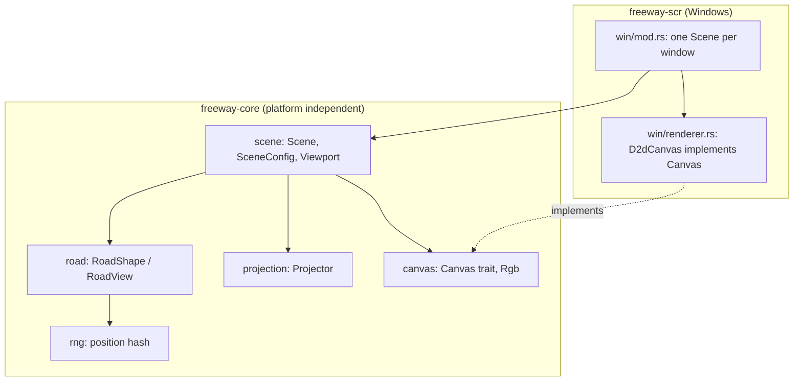

# Phase 2 詳細設計: 道路と投影

- ステータス: 完了(実機確認済み)
- 日付: 2026-10-26
- 親計画: [実装計画](0001-screensaver-implementation-plan.md)の6章 Phase 2

本書は、Phase 2を別のセッションや別の実装者が引き継げるように、設計と作業手順をまとめたものである。実装は本書とAGENTS.mdに従う。本書と実装が食い違った場合は、実装を変える前に本書の更新をユーザーに確認する。

## 1. 目的と完了条件

目的: Phase 1の動作確認用の描画(光の点が横切るだけ)を、本家nightfreewayに似た夜の高速道路の場面に置き換える。Phase 2では道路そのもの(形状・投影・道路の光)だけを扱い、背景(Phase 3)と他車(Phase 4)は扱わない。

完了条件:

- 全画面とプレビューで、カーブと起伏のある道路が光の点で描かれ、一定速度で前進して見える
- 車線の破線・外側線・デリネーター(白・橙)・中央分離帯の街灯・路面の光だまり・自車ヘッドライトの照り返しが描かれる
- 通行方向(左側/右側)を切り替えると道路の配置が左右反転する(設定画面はPhase 5のため、Phase 2では既定値の左側通行のみ。右側通行はテストで確認する)
- 道路形状の決定性・連続性、投影の境界条件、場面の描画命令のユニットテストがある
- ユーザーが実機で本家と見比べ、道路の見え方が同等と判断する

## 2. 前提(Phase 1までの状態)

- `crates/freeway-core`: 空(`#![forbid(unsafe_code)]`のみ)
- `crates/freeway-scr`: 引数解析(`args.rs`)、終了判定(`input.rs`)、Windows固有部分(`win/`)
  - `win/renderer.rs`: Direct2D描画。`Renderer::draw_test_frame`が動作確認用の描画を行う
  - `win/mod.rs`: メインループ。ウィンドウごとに`Target`を持ち、最後のウィンドウだけ垂直同期を待つ
  - `win/window.rs`: 全画面ウィンドウ(モニタごと)とプレビュー用子ウィンドウ
- 加算合成は`D2D1_PRIMITIVE_BLEND_ADD`、座標は物理ピクセル(`D2D1_UNIT_MODE_PIXELS`)
- WindowsランナーのCIで、非表示ウィンドウへの描画テスト(`win::tests::renders_and_resizes_a_hidden_window`)が動く

## 3. 設計

### 3.1 構成



`freeway-core`には外部依存を入れない。`freeway-scr`は`freeway-core`に依存する。

### 3.2 `freeway-core`のモジュール

rng(`rng.rs`):

- 位置(整数インデックス)と乱数列の区別子とシードから[0, 1)の値を返すハッシュ関数。整数ハッシュの混合関数は独自に選ぶ(本家の関数をそのまま使わない)
- 同じ入力には常に同じ値を返す。`Math.random`相当の非決定的な乱数はPhase 2では使わない

道路形状(`road.rs`):

- 水平方向の曲率と鉛直方向の勾配変化を、それぞれ一定長の区間ごとに目標値で決める。区間の先頭の一定割合で前の区間の目標値から滑らかに補間し、残りは目標値を保つ(区間の境界で連続になる)
- 区間ごとの目標値は位置ハッシュで決める。一定の確率で直線(曲率0)・平坦(勾配変化0)とし、それ以外は符号と大きさをハッシュで決める
- `RoadShape`(シードと形状パラメータを持つ)から、走行距離`track_s`の位置で前方`VIEW_DISTANCE`(600 m)までの横ずれと高さずれの表(`RoadView`、1 m刻み)を作る。表は曲率を2回積分したもので、`d = 0`で横ずれ・高さずれ・向きがすべて0になる(カメラは常に道路に沿う)
- 走行距離は長時間の実行で精度が落ちないよう`f64`で持つ

参考値(本家の見た目に合わせる出発点。実機で見比べて調整してよい):

| 項目 | 参考値 |
| --- | --- |
| 水平区間の長さ | 約300 m |
| 直線になる確率 | 約35〜40% |
| 曲率の大きさ | 0.001〜0.004 rad/m |
| 水平の補間区間 | 区間の先頭35〜40% |
| 鉛直区間の長さ | 約450 m |
| 平坦になる確率 | 約50% |
| 勾配変化の大きさ | 0.00004〜0.00016 /m |
| 鉛直の補間区間 | 区間の先頭40〜45% |

投影(`projection.rs`):

- 焦点距離は`max(画面幅 / 2, 画面高さ * 0.55)`(物理ピクセル)。画面中心が消失点
- カメラは左側通行の左車線中央(横位置 -1.75 m)、高さ1.2 m
- `project(d, lateral, height) -> Option<Projected { x, y, scale }>`。`d`が1 m未満または`VIEW_DISTANCE`以上なら`None`。`scale = focal / d`
- 通行方向は、カメラからの相対横位置`lateral - camera_x`の符号を反転して表す(右側通行では道路の配置全体がカメラを軸に左右反転する)。Phase 2では通行方向は起動時に固定し、実行中の切り替えアニメーションは作らない(YAGNI)

描画命令(`canvas.rs`):

```rust
pub struct Rgb { pub r: u8, pub g: u8, pub b: u8 }

pub trait Canvas {
    /// A point light: a bright core of `core_radius` pixels with a halo
    /// around it, added to what is already drawn.
    fn glow(&mut self, x: f32, y: f32, core_radius: f32, color: Rgb, alpha: f32);
    /// A soft elliptical pool of light lying on the road surface.
    fn light_pool(&mut self, x: f32, y: f32, radius_x: f32, radius_y: f32, color: Rgb, alpha: f32);
}
```

- 座標・半径は物理ピクセル。背景の塗りつぶしはレンダラーの役割
- 画面外の光の除外、極小の光の扱い(最小半径を設け、小さいほど暗くする)は`freeway-core`側で行い、レンダラーは渡された命令を描くだけにする

場面(`scene.rs`):

- `SceneConfig { speed_kmh: f32, left_hand_traffic: bool, seed: u64 }`。Phase 2の既定値は100 km/h・左側通行。設定画面と保存はPhase 5
- `Viewport { width: f32, height: f32, pixel_scale: f32 }`。`pixel_scale`はDPI / 96で、最小半径など画面上の大きさを決める値に掛ける
- `Scene::update(dt)`: `dt`を50 msで打ち切ってから走行距離を進める
- `Scene::draw(&self, viewport, canvas)`: 道路の光を奥から手前の順に描く(加算合成なので順序は見た目に影響しないが、テストを安定させるため順序を固定する)

道路の光(参考値。横位置はカメラの車線を左側通行の左車線としたときの値):

| 光 | 横位置 | 高さ | 間隔 | 見える距離 |
| --- | --- | --- | --- | --- |
| 車線の破線(白) | 0 m | 路面 | 破線部分に2〜3 m間隔 | 約150 m |
| 外側線(白) | -3.5 m、3.5 m | 路面 | 約3 m | 約110 m |
| 対向車線の破線(白、暗め) | 9.0 m | 路面 | 破線部分に2〜3 m間隔 | 約80 m |
| デリネーター(白) | -4.0 m | 0.9 m | 約12 m | 約420 m |
| デリネーター(橙) | 3.9 m | 0.9 m | 約12 m | 約420 m |
| 対向側のデリネーター(暗め) | 5.1 m(橙)、13.0 m(白) | 0.9 m | 約12 m | 約250 m |
| 中央分離帯の街灯(ナトリウム灯の橙) | 4.5 m | 10 m | 45 m | 600 m |
| 街灯の路面の光だまり(橙) | 2.0 m、7.0 m | 路面 | 45 m | 約350 m |
| 自車ヘッドライトの照り返し(白) | -1.75 m | 路面 | 14 m先と32 m先 | - |

- 破線の長さと間隔は、実在の高速道路の区画線(実線部分と間隔の比)を参考に独自に決める
- 明るさは距離に応じて線形に減衰させ、見える距離で0にする

### 3.3 `freeway-scr`の変更

- `Renderer::draw_test_frame`を`Renderer::draw_scene(target, scene)`に置き換える。`BeginDraw`・背景の塗りつぶし・加算合成の設定のあと、`Canvas`を実装した`D2dCanvas`を`Scene::draw`に渡す
- `D2dCanvas`は色ごとに放射グラデーションブラシをキャッシュする(グロー用と光だまり用の2種類)。描画のたびに変換行列(拡大と平行移動)とブラシの不透明度を設定して単位円を塗る
- グローのグラデーションは、中心を色より白に近づけ、外側へ急に暗くなる形にする。止め位置と不透明度は独自に決め、本家と見比べて調整する
- `win/mod.rs`はウィンドウごとに`Scene`を持つ(ADR-0003)。シードはウィンドウごとに変える(起動時刻とウィンドウ番号から作る)
- `pixel_scale`は`GetDpiForWindow`(`Win32_UI_HiDpi`)から求める
- 経過時間はフレームごとの`dt`で`Scene::update`に渡す
- デバイス喪失時はレンダラーとターゲットを作り直すが、`Scene`は作り直さない(場面が途切れない)

## 4. テスト

`freeway-core`(Linux・WindowsのCIで実行):

- rng: 同じ入力で同じ値、値の範囲が[0, 1)、シードが違えば値の並びが変わる
- 道路形状: 区間の境界の前後で曲率・勾配変化が連続する。`RoadView`の先頭が0で、隣り合う点の差(向き)が急に変わらない。同じシードと走行距離で同じ表になる
- 投影: カメラと同じ高さで真正面の点が画面中心に投影される。`d`が範囲外なら`None`。右側通行では左側通行と左右対称の位置に投影される
- 場面: テスト用の記録`Canvas`で描画命令を集め、命令が1件以上あること、座標・半径・不透明度がすべて有限で不透明度が(0, 1]に収まること、画面外の命令がないことを確認する。`update`が大きな`dt`を打ち切ること

`freeway-scr`(WindowsランナーのCIで実行):

- 既存の非表示ウィンドウのテストを、`Scene`を描画するように変える

## 5. 見た目の確認

- 開発中の確認: 本家の`index.html`をPlaywright(この環境に導入済み)で表示してスクリーンショットを撮り、`freeway-core`の描画命令をHTMLのcanvas(`globalCompositeOperation = 'lighter'`)で描いたものと見比べてよい。この確認用のスクリプトはリポジトリに入れない(作業用ディレクトリに置く)
- 最終確認: ユーザーが実機(Windows)で本家と見比べる。READMEの「Windowsで試す」の手順を使う

## 6. 作業手順

1. `freeway-core`に`rng`・`road`・`projection`・`canvas`・`scene`をテストとともに実装する
2. `freeway-scr`を`freeway-core`の場面を描くように変える
3. AGENTS.mdの検証コマンドをすべて実行する(Windowsターゲットのclippyも含む)
4. 1コミット1論理変更でコミットし、プッシュしてドラフトPRを作る
5. 敵対的セルフレビューを行い、指摘と対応をPRコメントに記録する(AGENTS.md「PR・レビュー・マージ」)
6. CIの成功を確認し、ユーザーに実機での見比べとマージの判断を依頼する
7. README(状態・構成)と実装計画の進捗表を更新する

## 7. 実装時の調整

設計からの差分と、実装で決めた細部。

- 光の核の半径に上限(100%スケールで7 px)を設けた。手前の光が大きなかたまりになるのを避けるため。本家との見比べで決めた
- 道路の光全体を奥から手前の順に並べ替えて描く(種類ごとではなく全体で並べる)
- 路面の光だまりの縦方向の半径は、横方向の半径に「カメラの高さ / 距離」を掛けて求める(地面を斜めに見たときの縮み)
- 路面の光だまりの半径は9 m、グローとプールのグラデーションの止め位置・不透明度は`win/renderer.rs`に定数で置いた。実機で本家と見比べて調整する
- 自車ヘッドライトの照り返しは、14 m先(半径3 m)と32 m先(半径4 m)に固定して描く
