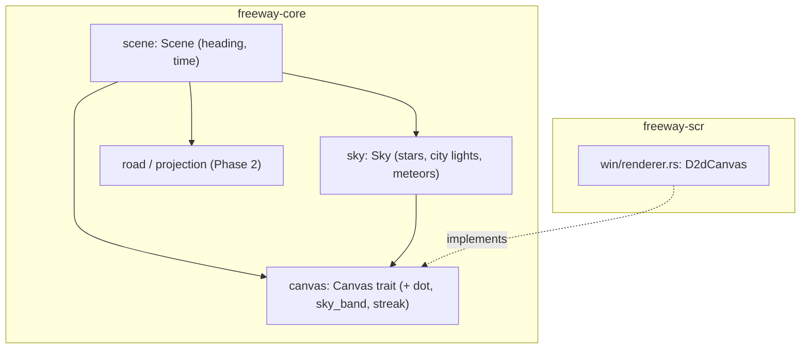

# Phase 3 詳細設計: 背景

- ステータス: 完了(実機確認済み)
- 日付: 2026-10-26
- 親計画: [実装計画](0001-screensaver-implementation-plan.md)の6章 Phase 3

本書は、Phase 3を別のセッションや別の実装者が引き継げるように、設計と作業手順をまとめたものである。実装は本書とAGENTS.mdに従う。本書と実装が食い違った場合は、実装を変える前に本書の更新をユーザーに確認する。

## 1. 目的と完了条件

目的: Phase 2の道路の場面に、本家nightfreewayに似た夜空と遠景(星・街明かり・地平線の空の明るみ・流れ星)を加える。他車(Phase 4)、UFO(Phase 7)、本家READMEにだけ記載のある山並み(実装計画2.3節)は扱わない。

完了条件:

- 星がまたたき、地平線近くに街明かりと空の明るみがあり、時々流れ星が流れる
- カーブを曲がると、背景が道路の曲がる向きと矛盾なく横に流れる(右側通行でも)
- 画面の解像度・縦横比・DPIが変わっても、背景の見え方(密度・高さ・大きさ)が大きく変わらない
- 背景の生成・横スクロール・流れ星の発生のユニットテストがある
- ユーザーが実機で本家と見比べ、背景の見え方が同等と判断する
- ワークスペースのバージョンが`0.3.0`になっている(AGENTS.md「フェーズごとのリリース」)

## 2. 前提(Phase 2までの状態)

- `freeway-core`: `rng`(`hash01(seed, salt, index)`)、`road`(`RoadShape::curvature_at(s)`など)、`projection`(`Projector`、焦点距離は`max(幅/2, 高さ*0.55)`、消失点は画面中心)、`canvas`(`Canvas`トレイト: `glow`・`light_pool`)、`scene`(`Scene`・`SceneConfig`・`Viewport`)
- `Scene`は走行距離`track_s`(`f64`)だけを状態に持つ。`update(dt)`は`dt`を50 msで打ち切る
- 道路の曲がりは横位置に足してから投影するため、右側通行ではカーブの向きも画面上で左右反転する(`Projector::project`の`side`)
- `freeway-scr`: `win/renderer.rs`の`D2dCanvas`が`Canvas`を実装する。色ごとに放射グラデーションブラシをキャッシュし、加算合成(`D2D1_PRIMITIVE_BLEND_ADD`)で描く
- ウィンドウごとに`Scene`を持ち、シードはウィンドウごとに異なる

## 3. 設計

### 3.1 構成



`freeway-core`には外部依存を入れない。新しいモジュール`sky.rs`に背景をまとめ、`Scene`から呼ぶ。

### 3.2 向き(heading)と横スクロール

- `Scene`に、累積の向き`heading`(ラジアン、`f64`)と経過時間`time`(秒、`f64`)を加える
- `update(dt)`で、`heading += curvature_at(track_s) * 進んだ距離`とする(進む前の位置の曲率でよい)
- 背景は360度ぶんの円筒に貼られていると考える。背景上の位置を角度の割合`u`(0以上1未満)で持ち、画面上のx座標は`中心 + 符号 * (u * 2π - heading の端数) * 焦点距離`を円周`2π * 焦点距離`で折り返して求める
- 符号は、道路の曲がる向きと背景の流れる向きが矛盾しないように決める。道路が画面の右へ曲がるとき、遠くの背景は画面の左へ流れる。右側通行では道路の曲がりが画面上で反転するので、背景の流れも反転させる。この関係をテストで確認する(4章)
- 背景は道路の起伏(勾配)では上下に動かさない。地平線は画面中心の高さに固定する

### 3.3 背景の要素(参考値)

大きさと高さは、画面の解像度に依存しないよう焦点距離に比例させる。参考値は焦点距離960 pxのときの値で、`焦点距離 / 960`を掛けて使う。点の最小の大きさなど画面上で決まる値には`pixel_scale`を掛ける。数・色・頻度は本家の見た目に合わせる出発点で、実機で見比べて調整してよい。

| 要素 | 参考値 |
| --- | --- |
| 星の数 | 1920 x 1080の画面に約450個。縦長の画面でも空が埋まるよう、焦点距離あたりの密度(約451個/焦点距離の2乗)で一定にし、360度全体で約2400個を生成する |
| 星の高さ | 地平線より上の空の範囲(画面上端から、地平線の約70 px上まで) |
| 星の明るさ | 約50〜220/255。青みのある白 |
| 星のまたたき | 明るさを0.75〜1.0倍で、周期約2.7秒の正弦波で揺らす。位相は星ごとに変える |
| 大きい星 | 約3%。グロー(コア半径約1 px)で描く |
| 街明かりの数 | 360度全体で約900個 |
| 街明かりの高さ | 地平線の約3〜41 px上。低いところほど多い(2乗の分布) |
| 街明かりの種類 | 約92%は小さな点(暖かい黄色・橙・青白い白を約45:25:30)、約5%は黄色の小さなグロー、約3%は点滅する赤い航空障害灯(1.5秒に約0.2秒点灯) |
| 地平線の空の明るみ | 地平線の約170 px上から約24 px下までの帯。橙(255, 130, 60)で、地平線のやや上で不透明度約0.14が最大、上下の端で0 |
| 流れ星 | 15〜45秒に1回。車の進行方向の前方(向きの前後約0.8ラジアン)に出す。寿命0.5〜1.2秒、速さ700〜1300 px/秒、下向きに20〜50度、左右どちら向きもある。長さ90〜210 px。明るさは約20%が強め。寿命の中で明るさを0から上げて0に戻す。地平線の約40 px上より下には出さない |

- 星と街明かりの配置・明るさ・位相は、シードから位置ハッシュで決める(シードが同じなら同じ空)。`Sky`の生成時に一度だけ作り、画面サイズに依存しない量(角度の割合、地平線からの高さの割合など)で持つ
- 流れ星の発生時刻と形も、シードと流れ星の通し番号のハッシュで決める(非決定的な乱数を使わない)。流れ星の位置は背景上の位置で持ち、カーブでは星と一緒に流れる
- 流れ星は、速く急なものほど地平線の約40 px上に達するのが早いため、その手前で寿命を打ち切る(開始の高さは焦点距離の0.25〜0.6倍)
- 道路より奥にあるので、背景を先に描き、道路の光をその上に描く(加算合成なので順序で色は変わらないが、テストを安定させるため順序を固定する)

### 3.4 `Canvas`への追加

背景には、グローでは描けない形があるため、`Canvas`に次の3つを加える。座標と大きさは物理ピクセルで、すべて加算で描く。

```rust
pub trait Canvas {
    // glow and light_pool: unchanged from Phase 2.

    /// A tiny solid point of `size` pixels, for stars and distant city lights.
    fn dot(&mut self, x: f32, y: f32, size: f32, color: Rgb, alpha: f32);
    /// A full-width horizontal band whose opacity rises from 0 at `top` to
    /// `alpha` at `peak` and falls back to 0 at `bottom`.
    fn sky_band(&mut self, top: f32, peak: f32, bottom: f32, color: Rgb, alpha: f32);
    /// A line of `width` pixels fading from transparent at the tail to
    /// `alpha` at the head, for shooting stars.
    fn streak(&mut self, tail: (f32, f32), head: (f32, f32), width: f32, color: Rgb, alpha: f32);
}
```

- 名前と引数は、実装時により良い形があれば変えてよい。その場合は本書を更新する
- 画面外の点の除外と、見えないほど暗いものの除外は、Phase 2と同じく`freeway-core`側で行う

### 3.5 `freeway-scr`の変更

- `D2dCanvas`に3つのメソッドを実装する
  - `dot`: 色ごとの単色ブラシ(キャッシュ)で、小さな矩形を塗る。ブラシの不透明度で`alpha`を表す
  - `sky_band`: 縦方向の線形グラデーションブラシで画面幅の矩形を塗る。1フレームに1回なので、毎回作ってよい
  - `streak`: 線形グラデーションブラシで線を引く。端は丸くする(ストロークスタイル)。1フレームに高々数本
- 星と街明かりで1フレームの描画数が数百増える。4Kで60 fpsを保てるか、実機確認でユーザーに見てもらう。不足する場合の対策(スプライトバッチなど)は、実装計画の9章のとおり、問題が確認されてから入れる

## 4. テスト

`freeway-core`(Linux・WindowsのCIで実行):

- 背景の生成: 同じシードで同じ星・街明かりになり、シードが違えば変わる。数が参考値どおり。すべての値が有限で、範囲内(角度の割合が0以上1未満、高さが地平線より上)
- 横スクロール: `heading`が一周(2π)増えると、星の画面上の位置が元に戻る
- 向きの整合: 一定の曲率で走らせたとき、道路の遠くの光が画面の右へ寄るなら、星は画面の左へ流れる。右側通行では両方が反転する
- 解像度への依存: 同じ縦横比の画面(1280 x 720と3840 x 2160)で、見える星の数がほぼ同じになる(星の密度が焦点距離に対するものなので、画素数ではなく見かけの密度が保たれる)
- 流れ星: 長い時間(例: 1時間)進めたとき、発生間隔が15〜45秒に収まる。同じシードで同じ時刻に発生する。寿命が終わると消える
- 描画命令: テスト用の記録`Canvas`で、背景の命令が道路の命令より先に出ること、すべての座標・大きさ・不透明度が有限で、不透明度が(0, 1]に収まること

`freeway-scr`(WindowsランナーのCIで実行):

- 既存の非表示ウィンドウのテストが、背景を含む場面で通ること(`dot`・`sky_band`・`streak`が実際に呼ばれる場面にする)

## 5. 見た目の確認

- 開発中の確認: 本家の`index.html`をPlaywright(この環境に導入済み)で表示してスクリーンショットを撮り、`freeway-core`の描画命令をHTMLのcanvas(`globalCompositeOperation = 'lighter'`)で描いたものと見比べてよい。確認用のスクリプトはリポジトリに入れない
- 最終確認: ユーザーが実機(Windows)で本家と見比べる。READMEの「Windowsで試す」の手順を使う

## 6. 作業手順

1. ワークスペースのバージョンを`0.3.0`に上げる(このPRの最初のコミットで実施済み)
2. `freeway-core`に`heading`・`time`、`sky.rs`、`Canvas`の追加メソッドをテストとともに実装する
3. `freeway-scr`の`D2dCanvas`に追加メソッドを実装する
4. AGENTS.mdの検証コマンドをすべて実行する(Windowsターゲットのclippyも含む)
5. 1コミット1論理変更でコミットし、プッシュしてドラフトPRを作る(またはこの設計書を含むPRに追加する)
6. 敵対的セルフレビューを行い、指摘と対応をPRコメントに記録する(AGENTS.md「PR・レビュー・マージ」)
7. CIの成功を確認し、ユーザーに実機での見比べとマージの判断を依頼する
8. README(状態・構成)と実装計画の進捗表を更新する
9. マージ後、ユーザーの承認を得てから`v0.3.0`をリリースする(AGENTS.md「フェーズごとのリリース」)
