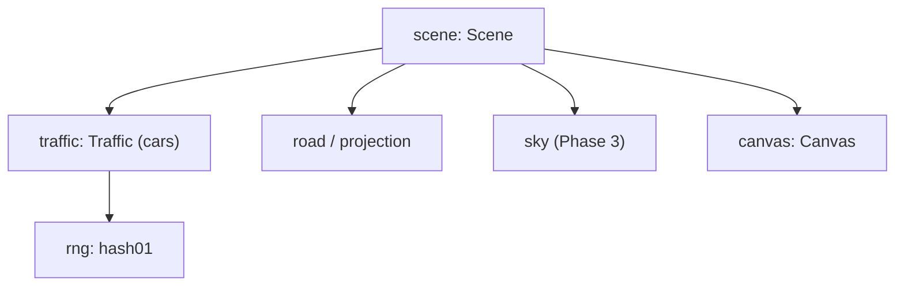

# Phase 4 詳細設計: 他車

- ステータス: 完了(実機確認済み)
- 日付: 2026-10-26
- 親計画: [実装計画](0001-screensaver-implementation-plan.md)の6章 Phase 4
- 着手条件: Phase 3(背景)のマージ後に着手する(2026-10-26のユーザー判断。Phase 3と同じファイルを変更するため、並行させない)。Phase 3は`v0.3.0`としてリリース済みで、条件は満たしている

本書は、Phase 4を別のセッションや別の実装者が引き継げるように、設計と作業手順をまとめたものである。実装は本書とAGENTS.mdに従う。本書と実装が食い違った場合は、実装を変える前に本書の更新をユーザーに確認する。

## 1. 目的と完了条件

目的: 道路に本家nightfreewayに似た他車の光を加える。同じ向きに走る車の尾灯・ブレーキ灯と、対向車線の車の前照灯を描く。本家READMEにだけ記載のある、マーカーランプ付きのトラック(実装計画2.3節)は扱わない。

完了条件:

- 自車線の前方に、自車より少し遅い車の尾灯が見え、時々ブレーキ灯が点く
- 追越車線を、後ろから来た車が自車を追い越していく
- 対向車線を前照灯が近づいてきて、近いほど眩しく見え、防眩板越しのようにちらつく
- 長時間走らせても、車が消えたり一か所に固まったりしない
- 右側通行でも車線の配置と追い越しの向きが正しく左右反転する
- 交通シミュレーションと描画命令のユニットテストがある
- ユーザーが実機で本家と見比べ、他車の見え方が同等と判断する
- ワークスペースのバージョンが`0.4.0`になっている(AGENTS.md「フェーズごとのリリース」。PRの最初のコミットで上げる)

## 2. 前提

- Phase 2の道路(`road`・`projection`・`scene`)と、Phase 3の背景(`sky`、`Canvas`の追加メソッド、`Scene`の`heading`・`time`)がマージ済みであること。着手時に`main`のコードと[Phase 3の詳細設計](0003-phase3-background.md)を読み、本書の記述と実装の差を確認する
- 道路の光は`scene.rs`の`Light`(距離・横位置・高さ・色・不透明度・種類)の一覧として作られ、奥から手前の順に投影して描かれる
- 横位置は、カメラが左側通行の左車線(-1.75 m)にいるときの値で表し、右側通行は`Projector`が画面上で左右反転する

## 3. 設計

### 3.1 構成

- 新しいモジュール`traffic.rs`に他車をまとめる。`Traffic::update(dt, own_speed)`で車を進め、`Traffic::lights()`で光の一覧を返す。車は自車からの相対位置で持つため、走行距離`track_s`は受け取らない(長時間でも精度が落ちない)
- `Scene::update`から`Traffic::update`を呼び、`Scene`の光の一覧に他車の光を加える。奥から手前の順の並べ替えは道路の光と一緒に行う
- `Canvas`への追加と`freeway-scr`の変更は不要だった。ただし前照灯の眩しさ(半径1.2 m)は、既存の光の最大半径(7 px)に抑えられて前照灯と区別できないため、`scene.rs`に`Kind::Glare`(最大半径28 px)を加えた

### 3.2 車の種類と動き(参考値)

参考値は本家の見た目に合わせる出発点で、実機で見比べて調整してよい。距離は自車から前方への道路沿いの距離(負なら後方)。

| 種類 | 台数 | 車線(横位置) | 速さ | 出現位置 |
| --- | --- | --- | --- | --- |
| 自車線の先行車 | 同じ向きの車の約45% | -1.75 m | 自車の85〜95% | 前方80〜530 m |
| 追越車線の車 | 同じ向きの車の約55% | 1.75 m | 自車+2〜10 m/s | 初期配置は前方20〜520 m、以後は後方30〜180 m(後ろから追い越してくる) |
| 対向車 | 約14台 | 7.25 mまたは10.75 m | 逆向きに24〜32 m/s | 初期配置は前方0〜600 m、以後は前方600〜1000 m |

- 同じ向きの車は約10台
- 自車線の先行車が45 m以内に近づき、自車より遅いときは、加速して車間を保つ(自車が追突しない)
- 同じ向きの車は、時々(平均約15秒に1回)0.8〜1.8秒ブレーキを踏む
- 前方に遠ざかりすぎた車(前方約680 m超)や、後方に置いていった車(後方約260 m超)は、出現位置に置き直す。対向車は自車を通り過ぎたら置き直す
- 車の出現位置・速さ・ブレーキの時期は、シードと車の番号・置き直しの回数から位置ハッシュで決める(非決定的な乱数を使わない)。同じシードなら同じ交通になる
- 自車の速さが設定(Phase 5)で変わっても破綻しないよう、同じ向きの車の速さは自車の速さに対する比と差で決める

### 3.3 光(参考値)

| 光 | 位置 | 大きさ(コア半径) | 色 | 明るさ |
| --- | --- | --- | --- | --- |
| 尾灯(左右一対) | 車線中央から±0.7 m、高さ0.8 m | 0.07 m(ブレーキ時0.09 m) | 赤(255, 35, 20) | 0.6(ブレーキ時1.0)。約650 mで0になるよう距離で減衰 |
| ハイマウントストップランプ | 車線中央、高さ1.15 m | 0.05 m | 尾灯と同じ赤 | ブレーキ時のみ1.0 |
| 前照灯(左右一対) | 車線中央から±0.7 m、高さ0.65 m | 0.13 m | 暖かい白(255, 245, 215) | 視野の端(600 m)で0になるよう減衰。防眩板越しのちらつきとして、距離に応じて0.75〜1.0倍で揺らす |
| 前照灯の眩しさ | 車線中央、高さ0.65 m | 1.2 m | 前照灯と同じ | 90 m以内で、近いほど強く(最大0.25) |

- 大きさは道路の光と同じく、遠くで最小半径より小さくなる光は暗くする(Phase 2の`Scene::draw`の扱いをそのまま使う)
- 自車より後方(距離が`NEAR_DISTANCE`未満)の車の光は描かない

## 4. テスト

`freeway-core`(Linux・WindowsのCIで実行):

- 決定性: 同じシードで同じ時間進めると、すべての車の位置・速さ・ブレーキ状態が一致する
- 長時間の安定: 1時間相当(例: 50 msで72000回)進めても、車の台数が一定で、すべての値が有限で、各車が置き直しの範囲内にいる。自車線の先行車は自車の後ろに回らず(自車が先行車を追い抜かない)、前方に車が見え続ける
- 追い越し: 追越車線の車が、後方から現れて前方へ抜けていく
- ブレーキ: 長時間のうちにブレーキが何度も起き、それぞれの長さが0.8〜1.8秒に収まる
- 描画命令: 他車の光が出ること、右側通行で横方向の位置が左右反転すること、すべての値が有限で不透明度が(0, 1]に収まること

`freeway-scr`(WindowsランナーのCIで実行):

- 既存の非表示ウィンドウのテストが、他車を含む場面で通ること

## 5. 見た目の確認

- 開発中の確認: 本家の`index.html`をPlaywright(この環境に導入済み)で表示してスクリーンショットを撮り、`freeway-core`の描画命令をHTMLのcanvas(`globalCompositeOperation = 'lighter'`)で描いたものと見比べてよい。確認用のスクリプトはリポジトリに入れない
- 最終確認: ユーザーが実機(Windows)で本家と見比べる

## 6. 作業手順

1. ワークスペースのバージョンを`0.4.0`に上げる(このPRの最初のコミットで実施済み)
2. `freeway-core`に`traffic.rs`をテストとともに実装し、`Scene`に組み込む
3. AGENTS.mdの検証コマンドをすべて実行する(Windowsターゲットのclippyも含む)
4. 1コミット1論理変更でコミットし、プッシュしてドラフトPRを作る
5. 敵対的セルフレビューを行い、指摘と対応をPRコメントに記録する(AGENTS.md「PR・レビュー・マージ」)
6. README(状態・構成)と実装計画の進捗表を更新する
7. CIの成功を確認したら、PRの監視を外して調整役のセッションに完了を報告する(AGENTS.md「複数セッションでの分担」)
8. 実機での見比べ・マージ・`v0.4.0`のリリースは、調整役がユーザーの承認を得て行う
