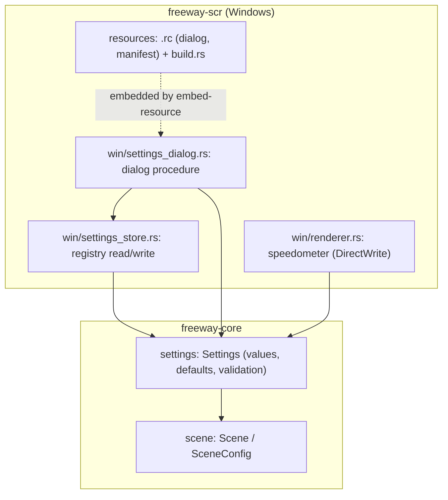

# Phase 5 詳細設計: 設定画面と保存

- ステータス: 完了(実機確認済み)
- 日付: 2026-10-26
- 親計画: [実装計画](0001-screensaver-implementation-plan.md)の6章 Phase 5
- 関連する決定: [ADR-0004](../adr/0004-store-settings-in-registry.md)(設定はレジストリに保存)、[ADR-0005](../adr/0005-embed-windows-resources-with-embed-resource.md)(リソースの埋め込みに`embed-resource`を使う。2026-10-26のユーザー判断)

本書は、Phase 5を別のセッションや別の実装者が引き継げるように、設計と作業手順をまとめたものである。実装は本書とAGENTS.mdに従う。本書と実装が食い違った場合は、実装を変える前に調整役のセッションに伝える(AGENTS.md「複数セッションでの分担」)。

## 1. 目的と完了条件

目的: スクリーンセイバーの設定画面(`/c`)から、実装計画5.4節のMVPの設定項目を設定・保存できるようにし、全画面(`/s`)とプレビュー(`/p`)の起動時に反映する。

完了条件:

- Windowsのスクリーンセイバー設定画面の「設定」ボタン(`/c`)、または`.scr`のダブルクリックで設定画面が開く
- 設定画面で次の3項目を変更でき、OKで保存、キャンセルで破棄される
  - 巡航速度: 30〜160 km/h、10 km/h刻み、既定値100 km/h
  - 通行方向: 左側通行 / 右側通行、既定値は左側通行
  - 速度計を表示: オン / オフ、既定値はオフ
- 設定は`HKCU\Software\NightFreewaySS`に保存され、次の起動(全画面・プレビュー)から反映される
- 保存値が欠けている・範囲外・型が違う場合は、その項目だけ既定値で動く
- 速度計がオンのとき、画面の左下に巡航速度(km/h)が表示される
- 設定画面がWindows標準の見た目(ビジュアルスタイル)で表示され、DPI 100%以外でも崩れない
- 設定値の検証、レジストリへの保存と読み込み、速度計の描画のテストがある
- ユーザーが実機で確認する
- ワークスペースのバージョンが`0.5.0`になっている(このPRの最初のコミットで実施済み)

## 2. 前提(Phase 4までの状態)

- `freeway-core`の`SceneConfig { speed_kmh, left_hand_traffic, seed }`で場面の設定を受け取る。`Default`は100 km/h・左側通行
- `freeway-scr`の`win/mod.rs`で、`/c`はメッセージボックスで案内を表示するだけ(Phase 1からの仮実装)。全画面・プレビューは`SceneConfig::default()`で場面を作る
- プロセスのDPI認識は、起動時に`SetProcessDpiAwarenessContext`(Per-Monitor v2)で設定している
- `freeway-scr`の依存は`freeway-core`・`windows`・`windows-numerics`のみ。ビルドスクリプト(`build.rs`)はない

## 3. 設計

### 3.1 構成

### 3.2 `freeway-core`: 設定値

- 新しいモジュール`settings.rs`に`Settings { speed_kmh, left_hand_traffic, show_speedometer }`を置く。既定値(`Default`)と、範囲・刻みの定数(30〜160 km/h、10 km/h刻み)を持つ
- 生の値から`Settings`を作る関数は、項目ごとに検証し、範囲外や刻みに合わない値は既定値または最も近い有効値に直す(どちらにするかを決め、テストで固定する)
- `SceneConfig`は`Settings`から作れるようにする(`seed`はウィンドウごとに別に与える)。速度計は場面ではなく画面の表示なので、`SceneConfig`には入れない
- 設定値の時間的な変化(AGENTS.mdのプロジェクト概要)は先回りして作らない

### 3.3 `freeway-scr`: 保存

- `win/settings_store.rs`で、`HKCU\Software\NightFreewaySS`の次のレジストリ値を読み書きする(すべて`REG_DWORD`)

| 値の名前 | 内容 |
| --- | --- |
| `SpeedKmh` | 巡航速度(km/h) |
| `LeftHandTraffic` | 左側通行なら1、右側通行なら0 |
| `ShowSpeedometer` | 表示するなら1、しないなら0 |

- 読み込みは、キーや値がない・型が違う・範囲外のとき、その項目を既定値にする(ADR-0004)。読み込みでエラーを表示しない
- 書き込みは設定画面のOKのときだけ行う。失敗したらエラーを表示する
- `windows`クレートのレジストリAPI(`Win32_System_Registry`)を使い、ほかの依存は追加しない
- テストでは、本番のキーを汚さないよう、テスト専用のサブキー(プロセスIDなどを含む名前)に書き、テストの最後に削除する。キーの場所を引数で受け取れるようにしておく

### 3.4 `freeway-scr`: 設定画面

- `.rc`のダイアログテンプレートで配置を定義し、`DialogBoxParamW`でモーダルに表示する。親ウィンドウは`/c:<hwnd>`のハンドル(なければ親なし)
- コントロール:
  - 巡航速度: トラックバー(30〜160、10刻み)と、現在値を表示するテキスト(例: `100 km/h`)
  - 通行方向: ラジオボタン2つ(`Left-hand traffic` / `Right-hand traffic`)
  - 速度計: チェックボックス(`Show speedometer`)
  - `OK` / `Cancel`
- UIラベルは英語(AGENTS.mdの言語ルール)。タイトルは`Night Freeway SS Settings`
- トラックバーの位置と速度の変換など、Windowsに依存しない計算は関数に分けてテストする
- ダイアログの初期値は保存値(なければ既定値)、OKで保存して閉じる
- トラックバーを使うため、起動時に`InitCommonControlsEx`を呼ぶ(`Win32_UI_Controls`)

### 3.5 `freeway-scr`: リソースとマニフェスト

- `crates/freeway-scr/`に`.rc`(ダイアログテンプレート、マニフェストの参照)とマニフェスト(XML)を置き、`build.rs`から`embed-resource`でコンパイルする(ADR-0005)
- マニフェストで指定するもの: Common Controls v6、DPI認識(Per-Monitor v2)、対応OS(Windows 10以降)。マニフェストでDPI認識を指定したあとも、起動時の`SetProcessDpiAwarenessContext`は残してよい(既に設定済みなら失敗するだけで、失敗は無視している)
- リソースのコンパイルはターゲットがWindowsのときだけ行う。Linux上の`cargo check --target x86_64-pc-windows-msvc`は、リソースコンパイラがなくても失敗しないようにする(その場合はリソースを埋め込まずに警告を出す、など)。この扱いはAGENTS.mdの検証コマンドが通ることで確認する
- 表示名(スクリーンセイバー一覧の文字列)とアイコンはPhase 6で追加する

### 3.6 速度計

- 速度計がオンのとき、各ウィンドウの左下に巡航速度を`100 km/h`の形で描く。本家の速度計(琥珀色の数字と小さな単位)に似せる
- 文字はDirectWrite(`Win32_Graphics_DirectWrite`)で描く。大きさは`pixel_scale`に比例させる
- 速度計は場面(`Scene`)ではなく、レンダラーが場面の上に重ねて描く。加算合成ではなく通常の合成で描く
- 巡航速度は実行中に変わらないので、表示する数字は一定でよい

### 3.7 実装での決定(設計書からの具体化)

- 検証の方針: 範囲外・刻みに合わない速度、0と1以外のフラグは、近い有効値に丸めずその項目の既定値に戻す。壊れた値や手で編集された値を、別の有効な値として扱わないため(ADR-0004の「その項目を既定値に戻す」に合わせた)
- トラックバーは0〜13の14段階とし、位置と速度の変換(`speed_to_position`・`position_to_speed`)は`freeway-core`の`settings.rs`に置いてLinuxでもテストする
- リソースは`crates/freeway-scr/`の`freeway.rc`と`resources/freeway.manifest`に置く(`.rc`をクレート直下に置くのは、`rc.exe`が相対パスを解決する基準に依存しないため)。`.rc`にWindowsヘッダーを`#include`しないため、スタイルやID以外の定数は`.rc`の先頭に数値で書いている(`embed-resource`は`rc.exe`に`/I`で出力先しか渡さず、`INCLUDE`環境変数が設定されているとは限らないため。Visual Studioの開発者コマンドプロンプト以外でもビルドできるようにする)
- `build.rs`は、Windowsで実行したときはリソースの埋め込みに失敗するとビルドを失敗させ(`manifest_required`)、Windows以外ではリソースを省略して警告を出す(`manifest_optional`)
- レジストリの読み書きは、キーを開く処理が不要な`RegGetValueW`(`RRF_RT_REG_DWORD`で型違いを検出)と`RegSetKeyValueW`(キーがなければ作成)で行う
- 速度計は、数字(56 px)と単位`km/h`(20 px)を琥珀色(#ffb000)で左下から28 pxの余白に描き、サイズと余白は`pixel_scale`に比例させる。2つの文字列は同じベースラインにそろえる

## 4. テスト

`freeway-core`(Linux・WindowsのCIで実行):

- 既定値が5.4節の表と一致する
- 範囲外・刻みに合わない値の扱い(既定値に戻すか、近い有効値にするか)がテストで固定されている
- `Settings`から`SceneConfig`を作ったとき、速度と通行方向が引き継がれる

`freeway-scr`(WindowsランナーのCIで実行):

- レジストリ: テスト専用のキーに書いて読み戻すと同じ値になる。値がない・型が違う・範囲外のときは既定値になる。テストの最後にキーを削除する
- 速度計: 既存の非表示ウィンドウのテストで、速度計オンの描画が失敗しない
- トラックバーの位置と速度の変換(Windowsに依存しない部分はLinuxでもテストする)
- 設定画面そのもの(ダイアログの表示と操作)は自動テストが難しいため、ユーザーの実機確認で見る

## 5. 実機での確認(ユーザーに依頼する項目)

- スクリーンセイバー設定画面の「設定」ボタンで設定画面が開き、Windows標準の見た目で表示される
- 3項目を変えてOKを押すと、プレビューと全画面に反映される(プレビューは設定画面を閉じた後に再起動されるか確認する)
- キャンセルでは変わらない
- DPI 150%などで設定画面が崩れない
- 速度計の位置・大きさ・見た目

## 6. 作業手順

1. ワークスペースのバージョンを`0.5.0`に上げる(このPRの最初のコミットで実施済み)
2. `freeway-core`に`settings.rs`をテストとともに実装する
3. `freeway-scr`に`build.rs`・`.rc`・マニフェストを追加し、Windowsでのビルドと、Linux上のWindowsターゲットの型チェックの両方が通ることを確かめる
4. 設定の保存と読み込み、設定画面、速度計を実装し、全画面・プレビューで保存値を使う
5. AGENTS.mdの検証コマンドをすべて実行する(Windowsターゲットのclippyも含む)
6. 1コミット1論理変更でコミットし、プッシュする
7. 敵対的セルフレビューを行い、指摘と対応をPRコメントに記録する
8. README(状態・構成・設定の説明)と実装計画の進捗表を更新する
9. CIの成功を確認したら、PRの監視を外して調整役のセッションに完了を報告する(AGENTS.md「複数セッションでの分担」)
10. 実機確認・マージ・`v0.5.0`のリリースは、調整役がユーザーの承認を得て行う
