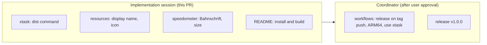

# Phase 6 詳細設計: リリース(Ver.1.0)

- ステータス: 完了(実機確認済み)
- 日付: 2026-10-26
- 親計画: [実装計画](0001-screensaver-implementation-plan.md)の6章 Phase 6

本書は、Phase 6を別のセッションや別の実装者が引き継げるように、設計と作業手順をまとめたものである。実装は本書とAGENTS.mdに従う。本書と実装が食い違った場合は、実装を変える前に調整役のセッションに伝える(AGENTS.md「複数セッションでの分担」)。

## 1. 目的と完了条件

目的: Phase 5までの成果を、誰でもインストールして使える正式版`v1.0.0`として公開する。あわせて、これまでの実機確認で挙がった改善点に対応する。

2026-10-26にユーザーと決めたこと:

- バージョン: Phase 6の成果物を正式版`v1.0.0`とする(プレリリースにしない)。x64とARM64を含む
- 速度計の書体: Bahnschrift(Windows 10 1709以降に標準で入っている書体)
- ローカルでの`.scr`の生成: リポジトリ内の補助コマンド`cargo xtask`で行う。リリース用ワークフローも同じコマンドを使う
- アイコン: 夜の道路と光の点をあしらった簡単なアイコンを、プログラムで生成して埋め込む

完了条件:

- `cargo xtask dist`で、`NightFreewaySS.scr`と配布用zip(`.scr`・LICENSE・第三者の著作権表示・利用者向けの説明書`README.md`)とSHA-256チェックサムが得られる。x64とARM64のどちらも指定できる
- スクリーンセイバーの一覧に「Night Freeway SS」と表示される(実行ファイルのファイル名ではなく、埋め込んだ表示名)
- エクスプローラーで`.scr`にアイコンが表示される
- 速度計がBahnschriftで描かれる。プレビューのような小さな画面でも、速度計が画面の大半を占めない
- READMEに、zipからのインストール手順と、`cargo xtask dist`による開発時のビルド手順が書かれている
- `v1.0.0`のタグで、x64とARM64のzipとチェックサムが正式版として公開される
- クリーンなWindows 10/11環境で、zipを展開してインストール・実行・設定・アンインストール(設定の削除を含む)ができることを、ユーザーが実機で確認する
- ワークスペースのバージョンが`1.0.0`になっている(このPRの最初のコミットで実施済み)

## 2. 前提(Phase 5までの状態)

- `crates/freeway-scr/freeway.rc`: 設定画面のダイアログ(ID 100)とマニフェスト(ID 1)。Windowsヘッダーをインクルードせず、定数を数値で書いている(ファイル冒頭の`Why:`コメント)
- `crates/freeway-scr/build.rs`: ターゲットがWindowsのときだけ`embed-resource`でリソースをコンパイルする(ADR-0005)
- `crates/freeway-scr/src/win/renderer.rs`: 速度計をDirectWriteの`Segoe UI`で描く。大きさは`pixel_scale`にだけ比例する
- `.github/workflows/release.yml`: 手動実行(`workflow_dispatch`)で、x64だけをビルドし、PowerShellで`.scr`へのコピーとzip化を行う
- `.github/workflows/ci.yml`: UbuntuとWindowsでfmt・clippy・test、UbuntuでWindowsターゲットの型チェック、Windowsでリリースビルド
- 実行ファイルの名前は`freeway-scr.exe`で、配布時に`NightFreewaySS.scr`へ改名している

## 3. 設計

### 3.1 分担

Phase 6はワークフロー(セキュリティ設定)の変更を含むため、AGENTS.md「複数セッションでの分担」に従って次のように分ける。

- 実装用セッション: 3.2〜3.5節(コードとドキュメント)
- 調整役: 3.6節(ワークフローの変更。YAMLをユーザーに提示して承認を得てから行う)と、`v1.0.0`のリリース

### 3.2 `cargo xtask dist`

- ワークスペースに`xtask`クレートを追加し、`.cargo/config.toml`にエイリアス`xtask = "run --package xtask --"`を加える(Rustの`cargo xtask`の慣例)。`xtask`には外部の依存を追加しない(標準ライブラリだけで書く)
- `cargo xtask dist [--target x86_64-pc-windows-msvc|aarch64-pc-windows-msvc]`(省略時はx64):
  1. `cargo build --release --locked -p freeway-scr --target <target>`を実行する
  2. `target/dist/<arch>/NightFreewaySS.scr`へコピーする
  3. `.scr`・LICENSE・第三者の著作権表示(`packaging/THIRD-PARTY-NOTICES.txt`)・利用者向けの説明書(`packaging/README.md`。zip内では`README.md`)をzipにまとめ、`target/dist/NightFreewaySS-v<version>-win-<arch>.zip`とする(`<version>`は`Cargo.toml`のワークスペースのバージョン)
  4. `target/dist/SHA256SUMS.txt`にzipのSHA-256を追記する
- zipの作成とSHA-256の計算は外部コマンドに頼らずに済む方法を選ぶ。標準ライブラリだけで書くのが難しい場合(zipの圧縮など)は、依存を追加する前に調整役に伝える(依存の追加はユーザーの判断が必要)。たとえば、zipは無圧縮(格納のみ)で書けば標準ライブラリとCRC-32の自前実装で作れる
- Windows以外では、`.scr`のビルドができない旨のエラーで終わってよい。ただし、パス・ファイル名・チェックサムなどOSに依存しない部分はLinuxでもテストする
- リリース用ワークフローは、このコマンドを呼ぶだけにする(3.6節)

### 3.3 表示名とアイコン

- `freeway.rc`に文字列テーブルを加え、ID 1に`Night Freeway SS`を入れる。Windowsのスクリーンセイバーの一覧は、この文字列を表示名として使う
- アイコン(`.ico`、16・32・48・256 pxを含む)を`crates/freeway-scr/resources/`に置き、`freeway.rc`で埋め込む
- アイコンは`cargo xtask icon`(など)でプログラムから生成し、生成したファイルをリポジトリに含める。図柄は、濃紺の背景に、遠近法で消失点へ向かう道路の光の点(白と橙)を並べた簡単なもの。生成の手順と図柄の意図を、コマンドのコメントに残す
- アイコンの生成でも依存は追加しない(BMP形式またはPNG形式の`.ico`を標準ライブラリで書く)

### 3.4 速度計

- 書体をBahnschriftに変える。DirectWriteは指定した書体がない環境(Windows 10 1709より前)では別の書体で代替するので、追加の対応は不要
- 数字と単位の太さ・字幅は、Bahnschriftの太さ(`DWRITE_FONT_WEIGHT`)と字幅(`DWRITE_FONT_STRETCH`)で、すっきりした印象になるよう選ぶ。数字は等幅(tabular)の字形を使い、桁が変わってもずれないようにする(巡航速度は実行中に変わらないが、設定の変更で桁数が変わる)
- 大きさは`pixel_scale`に加えて画面の大きさにも合わせ、プレビュー(約152 x 112 px)では画面の高さに比例して小さくする。全画面での大きさは今と同程度に保つ

### 3.5 README

- 「インストール」: GitHub Releasesからzipを取得し、展開した`NightFreewaySS.scr`を右クリックして「インストール」する手順。未署名のためSmartScreenの警告が出ることがあること。ARM64版の選び方
- 「アンインストール」: スクリーンセイバーの設定で別のものを選び、`.scr`を削除し、設定(レジストリ)を削除する手順
- 「開発」: `cargo xtask dist`の使い方。「Windowsで試す」の手作業のコピー手順は、このコマンドに置き換える
- 「免責事項」: READMEの末尾に、AIコーディングエージェントを主体に開発したことと、品質・動作を保証せず利用によるトラブルに責任を負わないこと(MITライセンスの無保証の明示)を書く(2026-10-26のユーザーの依頼)
- 配布用の説明書: zipには、開発者向けのリポジトリのREADMEではなく、利用者向けの説明書`packaging/README.md`(日本語と英語の併記。動作環境・同梱ファイル・インストール・設定・アンインストール・ライセンスと謝辞・免責事項)を`README.md`として入れる。開発の手順やリポジトリの構成は書かない(Phase 6の実機確認で挙がった改善点。2026-10-26のユーザー判断で言語は日本語と英語の併記、形式はMarkdown)

### 3.6 ワークフロー(調整役が行う)

- `release.yml`: タグ(`v*`)のプッシュでも動くようにし、x64とARM64をビルドして1つのリリースにまとめる。ビルドとzip化は`cargo xtask dist`を使う。手動実行(さかのぼってのリリース用)も残す。タグが`v1.0.0`以降ならプレリリースにしない
- `ci.yml`: ARM64のビルドを確認する(Windowsランナーで`cargo xtask dist --target aarch64-pc-windows-msvc`、またはリリースビルドのみ)
- AGENTS.md「フェーズごとのリリース」を、Ver.1.0以降の運用(タグのプッシュで正式版を公開する)に合わせて書き直す
- いずれも、変更内容(YAML全文)をユーザーに提示し、承認を得てから行う

### 3.7 実装での選択(実装後に追記)

- 配布物の作成と`.ico`生成の判断は[ADR-0006](../adr/0006-build-release-artifacts-with-cargo-xtask.md)に記録した。アイコンの図柄の生成コードは`xtask/src/icon.rs`にあり、`cargo test`がコミット済みの`.ico`との一致を確かめる
- 速度計の書体: 数字はBahnschriftのSemiLight(`DWRITE_FONT_WEIGHT_SEMI_LIGHT`)・標準の字幅・等幅の数字(`tnum`)、単位は標準の太さ。実機で見た目を確認して調整する余地がある
- 速度計の大きさ: `min(pixel_scale, 画面の高さ / 540)`(`crates/freeway-scr/src/speedometer.rs`)。論理540 px未満の高さでだけ高さに比例して小さくなり、それ以上は従来と同じ
- 表示名とアイコンの確認は、`crates/freeway-scr/tests/resources.rs`(Windowsの統合テスト)で、ビルドした実行ファイルから文字列ID 1とアイコングループを読み出して行う

### 3.8 リリース前の点検(2026-10-26)

ユーザーの依頼により、v1.0.0の前に、文書と実装の整合性・セキュリティ・使っている技術の新しさを点検した。点検の結果、見つかった問題はいずれも小さく、v1.0.0の前に直すことにした(修正が大きければv1.0.0を見送り、v1.1.0を最初の正式版にする方針だった)。

- 配布用の説明書: 実機確認で、zipにリポジトリの開発者向けREADMEが入っていると分かったため、利用者向けの`packaging/README.md`に替えた(3.5節)
- 整合性: 設計書のステータス・計画書の古い記述・コメントのずれを直した。リリース手順の記述は、ワークフローの変更と合わせて直す
- 技術の新しさ: ツールチェーン(1.99.1)・windowsクレート(0.62.2)・actions/checkout(v7.0.1)は、クールダウン(7日)を満たす最新版だった。ビルド依存のcc 1.10.0は公開から7日未満だったため、1.9.0に戻した。Dependabotのcooldownはローカルでの依存の解決には効かない
- セキュリティ(コード):
  - `.scr`の静的なDLLの読み込みをSystem32に限る(`/DEPENDENTLOADFLAG:0x800`。`build.rs`)。展開先のフォルダーに置かれたDLLを読み込まないため。偽の`dwrite.dll`を隣に置いても起動することを実機で確認した
  - マニフェストに`requestedExecutionLevel`(`asInvoker`)を明示した
  - `cargo xtask`のエイリアスに`--locked`を付け、`Cargo.lock`が書き換わらないようにした。内側のビルドには`--target-dir`を明示し、梱包元とずれないようにした
  - `.scr`に組み込まれる第三者のソフトウェア(windows-rs・Rustの標準ライブラリ)の著作権表示を`packaging/THIRD-PARTY-NOTICES.txt`にまとめ、zipに入れた(MITライセンスの表示の条件)
- セキュリティ(ワークフロー。3.6節の具体化で、ユーザーの承認を得て実施):
  - `release.yml`を、ビルドするジョブ(読み取り専用のトークン)と公開するジョブ(書き込み権限。リポジトリや依存のコードを実行しない)に分けた。成果物は`actions/upload-artifact`・`actions/download-artifact`(SHAで固定)で受け渡す。依存クレートのビルドスクリプトが乗っ取られても、書き込み権限のトークンに触れられないようにするため
  - 手動実行は既存のタグの再公開だけにした(タグとビルドするコミットがずれないため)。タグが`main`に含まれることと、`Cargo.toml`のバージョンとタグの一致を確かめる
  - リリースのランナーを`windows-2025`・`ubuntu-24.04`に固定した。CIは`-latest`のまま
  - `ci.yml`のWindowsジョブで、x64とARM64の`cargo xtask dist`を実行する
- リポジトリの設定(ユーザーが行う推奨事項): `main`の保護(PR必須・CI必須・force pushと削除の禁止)と、リリースの改ざん防止(release immutability)。リポジトリはprivateのまま公開する(2026-10-26のユーザー判断)。その後、リポジトリはpublicになった(2026-10-27にGitHubのAPIで確認)

## 4. テスト

- `xtask`: 出力先のパスとファイル名(バージョン・アーキテクチャを含む)、zipの中身(3ファイル)、SHA-256の書式をテストする。zipを自前で書く場合は、作ったzipを読み戻して中身が一致することもテストする
- 速度計: 文字の大きさの計算(全画面とプレビュー)をOSに依存しない関数に分けてテストする。既存の非表示ウィンドウの描画テストが、Bahnschriftで通ること
- リソース: WindowsランナーのCIで、ビルドした実行ファイルから文字列ID 1を読み出し、`Night Freeway SS`であることを確かめる(`LoadStringW`)
- 見た目(アイコン・速度計)と、インストールからアンインストールまでの流れは、ユーザーの実機確認で見る

## 5. 実機での確認(調整役がユーザーに依頼する項目)

- zipを展開し、`.scr`を右クリックして「インストール」できる。スクリーンセイバーの一覧に「Night Freeway SS」と出る
- エクスプローラーでアイコンが表示される
- 速度計(Bahnschrift)の見た目と、プレビューでの大きさ
- ARM64版(ARM64のPCがある場合)
- アンインストールの手順どおりに消せる

## 6. 作業手順

実装用セッション:

1. ワークスペースのバージョンを`1.0.0`に上げる(このPRの最初のコミットで実施済み)
2. `xtask`クレートと`cargo xtask dist`をテストとともに実装する
3. 表示名とアイコンを`freeway.rc`に加える(アイコンの生成コマンドと生成物を含む)
4. 速度計の書体と大きさを変える
5. READMEを更新する
6. AGENTS.mdの検証コマンドをすべて実行する。`cargo xtask dist`をLinuxで実行したときの振る舞い(Windows以外ではビルドできない旨のエラー)も確かめる
7. 1コミット1論理変更でコミットし、プッシュする。コミットの種類はAGENTS.mdの許可リスト(feat・fix・docs・test・refactor・chore・style・ci)から選ぶ
8. 敵対的セルフレビューを行い、指摘と対応をPRコメントに記録する
9. 実装計画の進捗表を更新する
10. CIの成功を確認したら、PRの監視を外して調整役のセッションに完了を報告する

調整役:

11. 3.6節のワークフローの変更をユーザーに提示し、承認を得てから同じPRに加える
12. ユーザーの実機確認とマージの承認を得て、マージし、`v1.0.0`のタグで正式版を公開する
