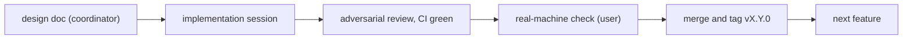

# Phase 7 計画: 任意機能

- ステータス: 作成済み(7.1 UFOに着手)
- 日付: 2026-10-26
- 親計画: [実装計画](0001-screensaver-implementation-plan.md)の6章 Phase 7

本書は、Phase 7で扱う任意機能の範囲・順序・リリースの単位をまとめたものである。機能ごとの詳細設計は、着手する前に別の文書として`docs/plans/`に置く。

## 1. 範囲と順序

2026-10-26にユーザーと決めたこと:

- 実装計画の6章に挙げた候補(UFO・設定画面の多言語化・トンネルと山並みとトラック・設定値の時間的な変化)をすべて扱う
- 1つの機能ごとに1つのPRとマイナーリリースにし、設計・実装・実機確認・リリースを終えてから次の機能に進む(並行して進めない)

| 順 | 機能 | バージョン | 詳細設計 | 状態 |
| --- | --- | --- | --- | --- |
| 7.1 | UFO | v1.1.0 | [0008](0008-phase7-1-ufo.md) | 完了(実機確認済み。[#16](https://github.com/suchi/freeway-ss/pull/16)) |
| 7.2 | 設定画面の多言語化(日本語・英語) | v1.2.0 | [0009](0009-phase7-2-localization.md) | 完了(実機確認済み。[#17](https://github.com/suchi/freeway-ss/pull/17)) |
| 7.3 | 遠くの山並み | v1.3.0 | 着手時に作成 | 未着手 |
| 7.4 | トラック(マーカーランプ) | v1.4.0 | 着手時に作成 | 未着手 |
| 7.5 | トンネル(照明と坑口) | v1.5.0 | 着手時に作成 | 未着手 |
| 7.6 | 設定値の時間的な変化 | v1.6.0 | 仕様をユーザーと決めてから作成 | 未着手 |

順序の理由:

- UFOは、本家に動きの手本があり、仕様がはっきりしている。実装計画の5.4節で、設定項目(既定はオフ)とすることを決めてある(D7)
- 多言語化は設定画面だけに閉じていて、場面の描画に影響しない
- 山並み・トラック・トンネルは、本家のREADMEに挙がっているが、本家のコードにはまだない(2026-10-26のコミット`7b98218`で、`index.html`に`tunnel`・`mountain`・`lorry`・`truck`はいずれも0件)。独自に設計するため、規模の小さい順(背景、他車、道路)に並べた。トンネルは道路・照明・視界のすべてに関わり、最も大きい
- 設定値の時間的な変化は、何をどう変えるかがまだ決まっていない。着手前に仕様をユーザーと決める

番号やバージョンは、途中の判断で変わりうる。変えた場合は本表を更新する。

## 2. 進め方

各機能は、Phase 6までと同じ流れで進める(AGENTS.md「複数セッションでの分担」「リリース」)。

- 調整役が詳細設計を書き、PRの最初のコミットでワークスペースのバージョンを上げる
- 実装用セッションが実装・セルフレビュー・CIのグリーン化までを行い、調整役に報告する
- ユーザーの実機確認と承認の後、調整役がマージする。タグはユーザーが手元からプッシュする(このセッションの環境からはタグをプッシュできないため)
- 正式版の前の点検(AGENTS.md「リリース」)は、機能ごとのリリースでも行う。規模に合わせて、差分にかかわる範囲を点検する
