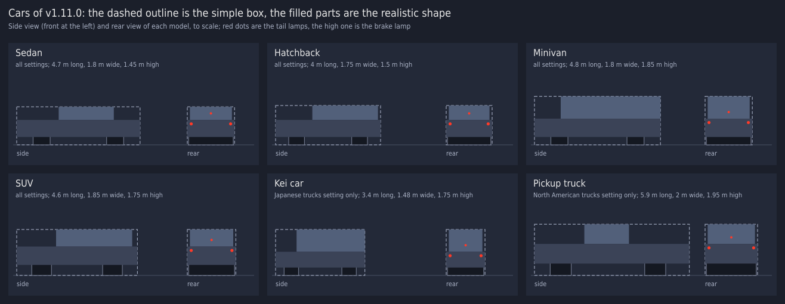

# v1.11.0 詳細設計: 他車の形と表示の選び方

- ステータス: 実装済み(CIと実機確認待ち。[#27](https://github.com/suchi/freeway-ss/pull/27))
- 日付: 2026-10-27
- 親計画: [実装計画](0001-screensaver-implementation-plan.md)の6章

本書は、v1.11.0の変更を別のセッションや別の実装者が引き継げるように、設計と作業手順をまとめたものである。実装は本書とAGENTS.mdに従う。本書と実装が食い違った場合は、実装を変える前に調整役のセッションに伝える(AGENTS.md「複数セッションでの分担」)。

## 1. 目的と完了条件

2026-10-27に、v1.9.0の実機確認の後、ユーザーから次の依頼を受けた。

- 普通車がただの箱なのは不自然なので、普通車も数種類の形で描く
- 車とトラックの描き方を、なし・シンプルな箱・それらしい形から選べるようにする

同日にユーザーと決めたこと:

- 設定を、形(なし・シンプルな箱・それらしい形)と色(半透明の黒・黒)の2つのドロップダウンに分ける。既定は今と同じく「なし」
- 普通車の形は、セダン・ハッチバック・ミニバン・SUVと、トラックの設定が日本風のときは軽自動車、北米風のときはピックアップトラック

完了条件:

- 設定画面の「他車の車体」が、形と色の2つのドロップダウンになり、OKで保存される(日本語と英語)
- 今の設定値(`CarBodies`)を引き継ぐ(3.1節)
- シンプルな箱では、普通車もトラックも1つの箱で描く(3.2節)
- それらしい形では、普通車を3.3節の形で、トラックをv1.9.0の4種類の形で描く
- 影と車間の制御は、形が「なし」以外のときに働く(今の「車体を描く設定のとき」と同じ)
- 普通車の灯火の位置が、形に合っている(3.4節)
- 形が「なし」のときの描画の命令の列は、v1.10.0と同じ
- 説明用の図を、PRの本文と本書の7章に載せる(AGENTS.md「PR・レビュー・マージ」)
- テストがある(4章)
- ユーザーが実機で確認する
- ワークスペースのバージョンが`1.11.0`になっている(このPRの最初のコミットで実施済み)

## 2. 前提(v1.10.0の状態)

- 設定`CarBodies`(透明・半透明の黒・黒)。レジストリ値`CarBodies`(0・1・2)。透明以外のとき、車体・影・車間の制御が働く
- 車体は箱の組み合わせ(`traffic.rs`の`BodyBox`)。普通車は1つの箱(長さ4.5 m・幅1.8 m・高さ1.45 m)、トラックは`TruckShape`の4種類(0016の7.1節)。面ごとの濃さ・光ごとの遮り・トンネルの視線の判定・影は、箱ごとに働く(0015・0016)
- 普通車の灯火: 尾灯は高さ0.8 m、前照灯は高さ0.65 m
- 乱数は`rng`の`hash01`で、用途ごとに区別子(`STREAM_*`)を分ける。名前に暗号用語(salt・key・nonceなど)を使わない

## 3. 設計

### 3.1 設定

- `freeway-core`の`CarBodies`を、形`CarShapes`(`None`・`Boxes`・`Detailed`。既定`None`)と色`CarColor`(`TranslucentBlack`・`Black`。既定`TranslucentBlack`)の2つに分ける。不透明度は今と同じ(0.9と1.0)
- レジストリ値: `CarShapes`(`REG_DWORD`。0: なし、1: シンプルな箱、2: それらしい形)と`CarColor`(0: 半透明の黒、1: 黒)。範囲外は既定値
- 引き継ぎ: `CarShapes`がないときは、`CarBodies`から読む。0(透明)ならなし、1(半透明の黒)ならそれらしい形と半透明の黒、2(黒)ならそれらしい形と黒。v1.9.0から、車体を描く設定ではトラックがそれらしい形になっていたので、それに近い方へ引き継ぐ
- 保存: `CarShapes`と`CarColor`を書き、`CarBodies`も書く(なしなら0、それ以外は色に応じて1か2)。前の版に戻したときにも、車体の有無が残るように
- 設定画面: 「他車の車体」のドロップダウンを形にし、その下に「車体の色」のドロップダウンを加える。形が「なし」のときは、色のドロップダウンを無効(灰色)にする

| キー | English | 日本語 |
| --- | --- | --- |
| 形のラベル | Car bodies: | 他車の車体: |
| なし | None (lights only) | なし(灯火だけ) |
| シンプルな箱 | Simple boxes | シンプルな箱 |
| それらしい形 | Realistic shapes | それらしい形 |
| 色のラベル | Body color: | 車体の色: |
| 半透明の黒 | Translucent black | 半透明の黒 |
| 黒 | Black | 黒 |

### 3.2 シンプルな箱

- 普通車もトラックも、その車の形(3.3節・0016の7.1節)を囲む1つの箱で描く(長さ・幅・高さはその形の最大)。車の種類の割合と車間はそれらしい形と同じにし、形の設定を切り替えても、車の並びは変わらないようにする
- 影も、その1つの箱から落とす

### 3.3 普通車の形

普通車を、車体の下部・客室・車輪の箱の組み合わせで表す。寸法は前端からの長さ(m)と路面からの高さ(m)で、目安である。見た目を見て実装で調整してよい。決めた値は本書の7章に書く。

| 形 | 全長 | 幅 | 下部(長さの範囲、高さ) | 客室(長さの範囲、高さ。幅は下部より左右0.1 m狭い) | 車輪の直径 |
| --- | --- | --- | --- | --- | --- |
| セダン | 4.7 | 1.8 | 0〜4.7、0.3〜0.95 | 1.6〜3.7、0.95〜1.45 | 0.65 |
| ハッチバック | 4.0 | 1.75 | 0〜4.0、0.3〜0.95 | 1.4〜3.9、0.95〜1.5 | 0.6 |
| ミニバン | 4.8 | 1.8 | 0〜4.8、0.3〜1.0 | 1.0〜4.8、1.0〜1.85 | 0.65 |
| SUV | 4.6 | 1.85 | 0〜4.6、0.4〜1.1 | 1.5〜4.4、1.1〜1.75 | 0.75 |
| 軽自動車(日本風) | 3.4 | 1.48 | 0〜3.4、0.3〜0.9 | 0.8〜3.4、0.9〜1.75 | 0.55 |
| ピックアップトラック(北米風) | 5.9 | 2.0 | 0〜5.9、0.45〜1.2 | 1.9〜3.6、1.2〜1.95 | 0.8 |

- 車輪: 前後の車軸ごとに、車体の幅から左右0.05 m狭い1つの箱(高さは路面から直径まで、前後の長さは直径)にしてよい。車体の下の、車輪と車輪の間のすき間から、奥の路面の光が見えるようにする
- 向き: 先行車と追い越し車は後ろが、対向車は前が自車に向く(トラックと同じ)
- 割合(トラック以外の車の中で):

| トラックの設定 | セダン | ハッチバック | ミニバン | SUV | 軽自動車 | ピックアップトラック |
| --- | --- | --- | --- | --- | --- | --- |
| 日本風 | 25% | 20% | 25% | 15% | 15% | - |
| 北米風 | 30% | 10% | 15% | 30% | - | 15% |
| なし | 30% | 25% | 25% | 20% | - | - |

- どの形にするかは、車ごとの乱数(新しい区別子`STREAM_*`)で決める。トラックの割合(約5台に1台)は変えない
- 長さが変わるので、車間の制御(0016の7.4節)には、その車の形の全長を使う

### 3.4 普通車の灯火

- 尾灯と前照灯は、下部の端の面に置く。高さは下部の高さの範囲の上寄り(例: 尾灯は上端から0.15 m下、前照灯は上端から0.25 m下)、横の位置は幅に合わせる(端から0.15 m内側)
- 形が「なし」のときは、今の灯火の位置(尾灯0.8 m・前照灯0.65 m・今の横の位置)のままにする。形の設定によって灯火の位置を変えるか、なしのときだけ今の位置にするかは、「なしのときの命令の列が変わらない」を満たす範囲で実装で決めてよい

### 3.5 性能

- それらしい形では、普通車1台が4〜5個の箱になる。視界の中の車は8〜22台なので、描画命令と遮りの判定が増える。v1.10.0の「車体あり」(トラックはそれらしい形、普通車は1つの箱)と比べて、描画の時間を記録する(目安として1.5倍以内)
- 遠くの車(例: 300 mより先)は、画面上で数ピクセルにしかならない。描画の時間が目安を超える場合は、遠くの車を1つの箱で描く(詳細度を下げる)ことを検討してよい。採った場合は本書の7章に書く

## 4. テスト

`freeway-core`:

- 設定: `CarShapes`と`CarColor`の既定値、値の対応、範囲外は既定値。`CarBodies`からの引き継ぎ(0・1・2と、値がない場合)
- 形: 6種類の普通車の箱が表の範囲に収まり、多角形の点がすべて有限。先行車と対向車で前後が正しい
- 割合: トラックの設定ごとの普通車の形の割合
- シンプルな箱: 普通車もトラックも1つの箱。形を切り替えても、車の並び(位置)が同じ
- 灯火: 普通車の灯火が、その形の箱の表面か、表面のすぐ外にある
- 車間: 同じ車線の車どうしの箱が重ならない(長い時間の走行で確かめる)
- なし: 描画の命令の列がv1.10.0と同じ
- 文字列の表のテストが、追加したキーでも通る

`freeway-scr`(WindowsランナーのCIで実行):

- レジストリ: `CarShapes`と`CarColor`の書き込みと読み戻し、`CarBodies`だけがあるときの引き継ぎ、範囲外の値
- 描画: 既存の非表示ウィンドウのテストで、形と色のどの組み合わせでも描画が失敗しない

## 5. 実機での確認(調整役がユーザーに依頼する項目)

- 6種類の普通車が、先行車・追い越し車・対向車として、それらしく見えるか
- シンプルな箱が、v1.8.0のような単純な箱に見えるか
- 灯火の位置が、形と合っているか
- 描画が重くなっていないか(マルチモニターを含む)
- 設定画面の2つのドロップダウン(日本語と英語)、形が「なし」のときに色が無効になるか、DPI 150%などでのレイアウト
- 前の版で車体を描く設定にしていた場合に、それらしい形として引き継がれるか

## 6. 作業手順

実装用セッション:

1. ワークスペースのバージョンを`1.11.0`に上げる(このPRの最初のコミットで実施済み)
2. 設定の分割(3.1節)を、レジストリ・設定画面・文字列の表・引き継ぎのテストとともに実装する
3. 普通車の形(3.3節)と灯火(3.4節)、シンプルな箱(3.2節)を、テストとともに実装する
4. 描画の時間を計測し、必要なら3.5節の詳細度の調整を行う
5. 説明用の図(6種類の普通車と、シンプルな箱・それらしい形の比較)を`docs/images/`に置く
6. `docs/developers.md`(設定の保存先の表)・利用者向けの説明書(`packaging/README.md`。日本語と英語)・0016の記述のうち古くなるもの・実装計画の進捗表を更新する。本書の7章に、実装で決めた値と図を書く
7. AGENTS.mdの検証コマンドをすべて実行する(Windowsターゲットのclippy、`ufo-demo`付きのclippyも含む)
8. 1コミット1論理変更でコミットし、プッシュする。コミットの種類はAGENTS.mdの許可リストから選ぶ
9. 敵対的セルフレビューを行い、指摘と対応をPRコメントに記録する
10. CIの成功を確認したら、PRの監視を外して調整役のセッションに完了を報告する

調整役:

11. ユーザーの実機確認とマージの承認を得て、マージする。`v1.11.0`のタグはユーザーが手元からプッシュする

## 7. 実装で決めた値

実装で決めた値と、設計からの補足。コードは`traffic.rs`(形・箱・灯火・車間)、`scene.rs`(影・描く順)、`settings.rs`(設定の引き継ぎ)、`freeway-scr`の`win/settings_store.rs`・`win/settings_dialog.rs`・`freeway.rc`(レジストリと設定画面)にある。

### 7.1 説明用の図

6種類の普通車を、横から見た形と後ろから見た形で、シンプルな箱(破線)とそれらしい形(塗り)を重ねて示す。実装の寸法の表から描いた説明用の図で、画面のキャプチャではない。

### 7.2 普通車の寸法

3.3節の表の寸法を、そのまま使った。表にないものは次のとおり足した。

- 車軸の位置(前端から、前・後): セダン 0.95 m・3.75 m、ハッチバック 0.8 m・3.2 m、ミニバン 0.95 m・3.85 m、SUV 0.95 m・3.65 m、軽自動車 0.6 m・2.8 m、ピックアップトラック 1.0 m・4.6 m
- 幅(半分): セダン 0.9 m、ハッチバック 0.875 m、ミニバン 0.9 m、SUV 0.925 m、軽自動車 0.74 m、ピックアップトラック 1.0 m
- 客室の幅: 下部より左右0.1 m狭い(`CABIN_INSET`)
- 車輪: 車軸ごとに左右2つの箱。幅0.22 m(`CAR_WHEEL_WIDTH`)で、下部の外側の縁から0.05 m内側(`CAR_WHEEL_INSET`)に立つ。高さは路面から直径まで、前後の長さは直径。前後の車軸の間と、左右の車輪の間から、路面の光が見える。最初の実装は車軸ごとの幅いっぱいの1つの箱だったが、後ろから見ると車体の下が黒い板になったため、調整役の依頼で左右に分けた
- 箱の数: 普通車1台がそれらしい形で6つ(下部・客室・車輪4つ)
- 下部の屋根: 下部の上面のうち客室の下の部分は描かない(`BodyBox::covered`)。描くと、客室より後に描かれて客室の下の部分を覆うため。上面は、客室の前と後ろの2枚に分けて描く。客室の下の、下部と客室の幅の差(左右0.1 m)の上面は描かない
- 割合・区別子: 3.3節の表のとおり。区別子は`STREAM_MODEL`(20)。トラックの割合(約5台に1台)は変わらず、トラックの形の選び方も変わらない

### 7.3 シンプルな箱

- 普通車: その形の全長・幅・最大の高さ(客室の屋根)の1つの箱。路面から高さ0まで立つ
- トラック: 全長・幅2.5 m・全高の1つの箱。それらしい形の運転台・荷台・車輪・車台の箱は描かない
- 灯火: それらしい形と同じ位置に置く。シンプルな箱の車では、灯火が箱の内側に入ることがある(トラックの運転台の上の灯火など)。灯火は車自身の面より後に描くので、見える
- 位置: 形の設定を切り替えても、車の位置・速さ・ブレーキは同じ(テストで確かめた)

### 7.4 灯火

- 形のある車(シンプルな箱とそれらしい形)の普通車: 尾灯は下部の上端から0.15 m下、前照灯は0.25 m下、横の位置は幅の端から0.15 m内側(`LAMP_INSET`)。尾灯は後ろ向きの車の後ろの端、前照灯は対向車の前の端に立つ。ブレーキ灯は、客室の後ろの面(下部の上端から0.25 m上)の中央に置く。まぶしい光(対向車の近く)は、前照灯と同じ高さの中央に置く
- 形がなしのとき: 従来の位置(尾灯0.8 m・前照灯0.65 m・横±0.7 m・ブレーキ灯1.15 m)のまま。これは形のなしの命令列がv1.10.0と同じであることから決まる
- 大きさ・明るさ・色: 従来のまま

### 7.5 影

- `BodyBox::shadow`: 影を落とす箱が、影を落とす高さの範囲(下と上)を持つ。トラックは今までどおり、高さ1.25 m(`LOW_BOX`)を超える箱が、その箱自身の高さで影を落とす。これまで`scene.rs`にあった`LOW_BOX`は`traffic.rs`に移した
- 普通車: 下部の箱だけが影を落とす。高さの範囲は路面から客室の屋根まで(車全体を囲む箱の影)。客室と車輪は影を落とさない。客室を別に落とすと、下部の影と重なって濃くなるため。車全体の箱の影は、実際より少し大きいが、車体のすぐそばなので目立たない
- シンプルな箱: 箱の影(路面から屋根まで)。トラックなしのとき、シンプルな箱とそれらしい形で、影の数は同じ(テストで確かめた)

### 7.6 確かめたこと

- 形がなしの命令列: トラックなし・日本風・北米風の各3シード(UFO・時刻に応じた交通量・景色の区間・巡航速度のゆらぎをすべてオン、開始は3時、900ステップ、150ステップおきに描画)で、命令列のハッシュがv1.10.0と一致した。色を黒にしても同じ。`scene.rs`の`without_car_bodies_the_commands_are_those_of_v1_10_0`に基準値がある
- 設定の引き継ぎ: コアの`settings.rs`と、レジストリの`settings_store.rs`のテストで、`CarBodies`だけがあるとき(0はなし、1はそれらしい形と半透明の黒、2はそれらしい形と黒)、新旧の値がそろっているとき(新しい値が勝つ)、範囲外の値(項目ごとに既定値)、書き込む`CarBodies`の値を確かめた
- 車間: 同じ車線の車の箱が、長い時間の走行(12,000ステップ、トラックなし・日本風・北米風)で重ならない。車間の最小は10 m以上(v1.9.0のテストが、普通車の長さの違いでも通る)
- 描画の時間(`Scene::draw`のCPU時間、1920×1080、4シード・各6000ステップを3ステップおきに描画、リリースビルド、Linux。v1.10.0と今を交互に3回ずつ測った平均):

| 設定 | v1.10.0の車体あり(マイクロ秒/フレーム) | v1.11.0のそれらしい形(マイクロ秒/フレーム) | 比 |
| --- | --- | --- | --- |
| 半透明の黒・日本風 | 258.4 | 360.0 | 1.39 |
| 半透明の黒・北米風 | 265.7 | 361.6 | 1.36 |
| 黒・日本風 | 242.4 | 326.9 | 1.35 |
| 黒・北米風 | 241.2 | 328.6 | 1.36 |

  目安(1.5倍以内)に収まった(車輪を左右に分ける前は、1.23〜1.33倍だった)。1フレームの描画命令の数は、916・929・861・875個から1,077・1,087・1,022・1,033個に増えた(約17〜19%)。シンプルな箱は、トラックも1つの箱になるので、v1.10.0の車体ありより軽かった(最初の1回の計測で約0.8倍)。3.5節の詳細度の調整(遠くの車を1つの箱で描く)は採らなかった
- 計測は、同じ条件で数回ばらつく(同じ設定で約10〜15%)。値は目安

### 7.7 設定画面とレジストリ

- ダイアログ: 「他車の車体」(ID 120)の下に「車体の色」(ラベルID 122・ドロップダウンID 123)を加えた。トラックより下の行を、これまでの20ダイアログ単位おきから18おきに詰め、高さを280から288にした。1366×768の画面で表示倍率150%のとき、縦に収まる余裕を残すため(行を詰めずに20おきにすると300になる)
- 無効にする: 形が「なし」のとき、色のラベルとドロップダウンを`EnableWindow`で無効にする。形を変えたとき(`CBN_SELCHANGE`)と、開いたときに更新する。無効のときも、選んでいる色はそのまま保存する
- 依存: `EnableWindow`のために、`windows`クレートのフィーチャー`Win32_UI_Input_KeyboardAndMouse`を加えた。クレートの版は変わらない
- レジストリ: `CarShapes`・`CarColor`を`REG_DWORD`で書く。`CarBodies`も書く(なしは0、それ以外は半透明の黒が1・黒が2)

### 7.8 実機で確認すること

5章のとおり。実機でしか確かめられないのは、設定画面のレイアウトと、色の項目が無効になる様子、それらしい形の見え方、描画の重さである。
