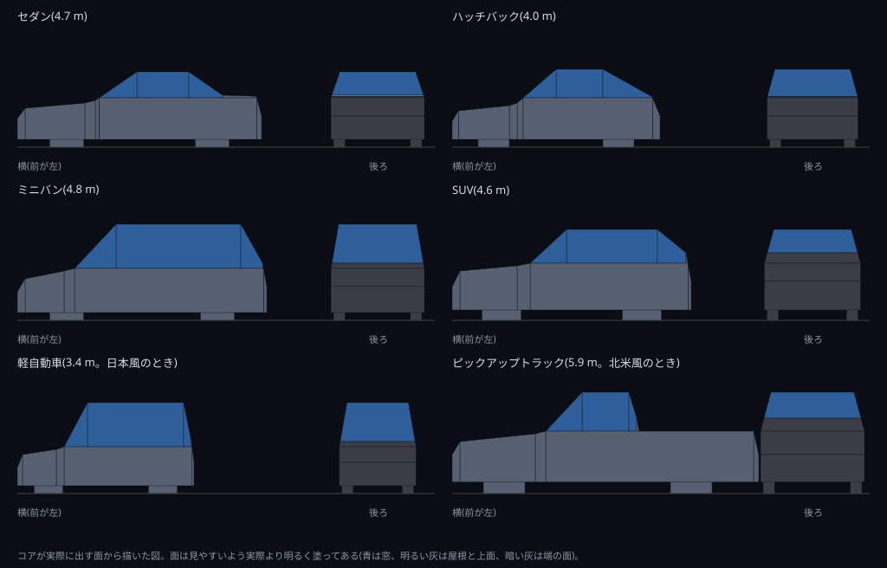
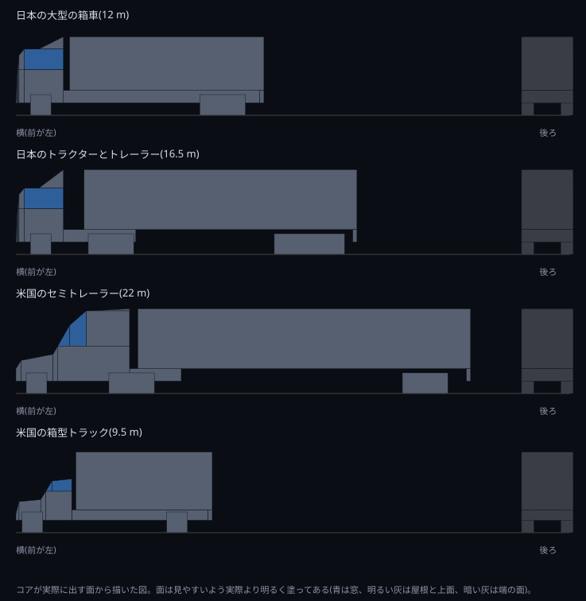

# v1.12.0 詳細設計: 他車の詳細な形と影

- ステータス: 実装済み(実機確認待ち。[#28](https://github.com/suchi/freeway-ss/pull/28))
- 日付: 2026-10-27
- 親計画: [実装計画](0001-screensaver-implementation-plan.md)の6章

本書は、v1.12.0の変更を別のセッションや別の実装者が引き継げるように、設計と作業手順をまとめたものである。実装は本書とAGENTS.mdに従う。本書と実装が食い違った場合は、実装を変える前に調整役のセッションに伝える(AGENTS.md「複数セッションでの分担」)。

## 1. 目的と完了条件

2026-10-27に、v1.11.0の実機確認の後、ユーザーから次の報告と依頼を受けた。

- 普通車の車体の下のすき間が大きすぎる(車体が浮いて見える)
- 箱の組み合わせでは、実際の車らしく見えない。代表的な車の形を、本当の車に近い輪郭で描きたい。今より詳細にできる選択肢を加えたい
- 追い越していく車の影が不自然で、夜の走行の雰囲気を損なう。周りの車の影を、もっと細やかにしたい

同日にユーザーと決めたこと:

- 車体の下のすき間を、実際の車に近い値に下げる
- 「他車の車体」の選択肢を4つにする: なし・シンプルな箱・ブロック(今の「それらしい形」)・詳細な形
- 詳細な形では、普通車に加えてトラックも作り直す

完了条件:

- 普通車の車体の下のすき間が、3.1節の値になる(ブロックと詳細な形の両方)
- 「他車の車体」に「詳細な形」が加わり、OKで保存される(日本語と英語)。今の「それらしい形」は「ブロック」と呼び名を変え、保存されている値はそのまま引き継ぐ
- 詳細な形で、6種類の普通車と4種類のトラックが、3.3節と3.4節のとおりに描かれる
- 影が、3.5節のとおり、それぞれの街灯の光だけをさえぎり、縁がやわらかく、急に現れたり消えたりしない
- 形が「なし」のときの描画の命令の列は、v1.11.0と同じ
- 説明用の図を、PRの本文と本書の7章に載せる。普通車とトラックの詳細な形、影の前後の比較がわかるもの(AGENTS.md「PR・レビュー・マージ」)
- テストがある(4章)
- ユーザーが実機で確認する
- ワークスペースのバージョンが`1.12.0`になっている(このPRの最初のコミットで実施済み)

## 2. 前提(v1.11.0の状態)

- 車体は、箱(`traffic.rs`の`BodyBox`)の組み合わせ。面は4つの角(`body.rs`の`Corners`)で表し、面ごとの濃さ、自車に向く面の判定(`faces_camera`)、画面の点での面の距離(`depth_at`)、光ごとの遮り、トンネルの視線の判定は、面か箱ごとに働く(0015・0016・0018)
- 普通車の寸法は0018の7.2節。車体の下部の下端は0.3〜0.45 m(SUVとピックアップ)で、直径0.55〜0.8 mの車輪が、車体の下に大きく見える
- 影(0016の7.3節): 中央分離帯の街灯(横4.5 m・高さ10 m・45 m間隔)から、車の箱を路面へ投影した凸包を、背景の色・不透明度0.8で塗る。車の中心から道路に沿って9 m+車の長さの半分以内の街灯だけを考える。街灯の路面の光の後、ほかの路面の光と車体の前に描く
- 描画の時間(0018の7章): 車体を描く設定で、v1.10.0の約1.35〜1.4倍

## 3. 設計

### 3.1 車体の下のすき間

普通車の下部の下端を、次の値に下げる。ブロックと詳細な形の両方に当てはめる。全体の高さ(屋根の高さ)は変えない。

| 形 | 今 | 新しい値 |
| --- | --- | --- |
| セダン・ハッチバック・ミニバン・軽自動車 | 0.3 m | 0.15 m |
| SUV | 0.4 m | 0.2 m |
| ピックアップトラック | 0.45 m | 0.22 m |

- 車輪は今の直径のまま、車体の下端より上の部分は車体に隠れる(車体の箱が車輪の箱の手前にある)。車体の下には、車輪の下の部分と、その間のすき間だけが見える
- 尾灯・前照灯の高さは、下部の上端からの位置(0018の3.4節)なので、下部の上端を変えない限り変わらない

### 3.2 設定

- `CarShapes`に`Detailed`(詳細な形)を加える。値は0: なし、1: シンプルな箱、2: ブロック、3: 詳細な形。既定はなしのまま。今の2(それらしい形)は、ブロックとしてそのまま引き継ぐ
- 文字列: 「それらしい形」(Realistic shapes)の呼び名を「ブロック」(Blocks)に変え、「詳細な形」(Detailed shapes)を加える

| キー | English | 日本語 |
| --- | --- | --- |
| ブロック | Blocks | ブロック |
| 詳細な形 | Detailed shapes | 詳細な形 |

### 3.3 普通車の詳細な形

車を、横から見た輪郭(前から後ろへの折れ線)を幅の方向に押し出した立体で表す。上の部分は、上へ行くほど幅が狭くなる(タンブルホーム)。面はすべて4つの角(または3つ)の平面に分け、今の面の仕組み(面ごとの濃さ・向きの判定・遮り・トンネルの視線)をそのまま使う。

- 輪郭: 前の端から後ろの端まで、路面からの高さの折れ線で表す。代表的な点は、前のバンパー・ボンネットの前端・ボンネットの後端・フロントガラスの上端(屋根の前端)・屋根の後端・リアガラスの下端・トランクの後端・後ろのバンパー
- 例(セダン、全長4.7 m): (0, 0.55)、(0.15, 0.75)、(1.3, 0.85)、(1.5, 0.9)、(2.3, 1.42)、(3.3, 1.43)、(3.95, 1.0)、(4.6, 0.98)、(4.7, 0.6)。下端は0.15 m。ほかの5種類も、実際の代表的な車の比率で決める(ハッチバックは屋根から後ろの端まで急に下がる、ミニバンと軽自動車は屋根が長く前が短い、SUVはボンネットが高く角ばる、ピックアップは運転台の後ろが荷台)
- 幅: 肩の線(例: 高さ0.95 m)までは車体の幅、そこから屋根までは左右0.15〜0.2 m狭くなるように、高さに応じて狭める
- 面: 輪郭の隣り合う2点ごとに、側面の下の部分(下端から肩の線まで。垂直)、側面の上の部分(肩の線から輪郭まで。内側に傾く)、上面(輪郭の2点を幅の方向に結ぶ)を作る。前と後ろの端の面も作る。平面でない四角形ができる場合は、三角形に分ける
- 窓: フロントガラス・リアガラス・側面の窓にあたる面は、車体より少し青みのある暗い色(例: (12, 14, 20))にして、形が読み取れるようにする。値は実機確認で調整する。窓の不透明度は車体と同じにする(窓越しに奥の光を透かすことは、本書の範囲外とする)
- 車輪: 今の左右の箱のままでよい。車体の下端より上は車体に隠れる
- 灯火: 0018の3.4節の位置のまま。輪郭の端の面に合うように、必要なら高さを調整する
- 詳細度: 遠くの車は画面上で数ピクセルにしかならないので、一定の距離(例: 150 m)より遠い車はブロックで描いてよい。その場合、切り替えで形が急に変わって見えないように、切り替えの距離を見た目で決める

### 3.4 トラックの詳細な形

v1.9.0の4種類の形(0016の7.1節)の寸法と灯火の位置はそのままにし、運転台を3.3節と同じ方法(輪郭の押し出し)で作り直す。荷台・コンテナ・トレーラーは箱のままでよい。

- 日本のキャブオーバー型(大型の箱車、トラクター): 前面は少し後ろへ傾き(上端で0.15 m程度)、屋根の前の縁と前面の縦の角を面取りする。屋根の上に、荷台の高さまで後ろ上がりに傾く風よけ(エアデフレクター)を付ける
- 米国のボンネット型(セミトレーラー、箱型トラック): ボンネットは前へ向かって低くなり、フロントガラスは後ろへ傾く。セミトレーラーの寝台の上には、トレーラーの高さまでの風よけを付ける
- 車輪と車台は今のままでよい

### 3.5 影

影の作り方を次のように改める。原因の仮説を先に再現して確かめ、本書の7章に書く。

原因の仮説(調整役がコードから推測した。未確認):

- 街灯ごとの範囲(車の中心から9 m+車の長さの半分)の内か外かで、影が急に現れたり消えたりする。追い越し車は自車の近くを通るので、画面の大きな範囲で目立つ
- 影が、背景の色を一様な濃さ(0.8)で、縁のはっきりした多角形として塗る。路面の光は中心から外へなだらかに暗くなるのに、影は光の弱い場所でも同じ濃さで、形の縁がくっきりする
- 影が、その街灯の光だけでなく、重なったほかの街灯の光や、先に描いた路面の光もまとめて暗くする
- 自車に近い車の影が、近い端(`NEAR_DISTANCE`)で切られて、形が不自然になる

新しい作り方:

- 影は、その街灯の路面の光だけをさえぎる。描画の命令に「影で欠けた路面の光」を加える。路面の光の楕円を描くときに、その街灯から落ちる影の多角形の部分を除いて描く(Direct2Dでは、影の多角形を合わせた図形を除くマスクを付けて描く。方法は実装で決めてよい)。影の濃さは、その場所の路面の光の明るさにそのまま従うので、光の弱い場所では影も薄く、光の外では影がない
- 縁をやわらかくする。影の縁に、車体から路面までの高さと街灯までの距離に応じた半影の幅を持たせる(例: 影の多角形を少しずつ広げたり狭めたりした数枚を、少ない不透明度で重ねる)。実装で方法を決めてよい
- 街灯ごとの範囲の外側で急に消えないように、路面の光の楕円と影の多角形が重なる限り、影を作る(重ならない影は作らなくてよい)
- 影の形は、詳細な形では車の輪郭(3.3節・3.4節)から、ブロックとシンプルな箱では今の箱から作る。普通車は、車全体の外形の影を1つにまとめてよい
- 透明(形が「なし」)のときは、今どおり影を描かない

### 3.6 性能

- 詳細な形では、面の数が増える。描画の時間を、v1.11.0のブロックと比べて記録する。目安は1.5倍以内。超える場合は、3.3節の詳細度(遠くの車をブロックで描く距離)で調整する
- 影の作り方の変更による時間の変化も、別に記録する

## 4. テスト

`freeway-core`:

- 車体の下のすき間: 6種類の普通車の下部の下端が3.1節の値
- 設定: `CarShapes`の0〜3の対応、範囲外は既定値、今の値(2)がブロックとして読まれる
- 詳細な形: 6種類の普通車と4種類のトラックの面がすべて平面(三角形を含む)で、点がすべて有限。輪郭が全長・全高の範囲に収まる。先行車と対向車で前後が正しい
- 影: 影で欠けた路面の光の命令が、その街灯の光にだけ付く。車が街灯の近くを通り過ぎる間、影の面積が連続して変わる(急に現れたり消えたりしない)。路面の光と重ならない影は作られない
- なし: 描画の命令の列がv1.11.0と同じ
- 文字列の表のテストが、追加・変更したキーでも通る

`freeway-scr`(WindowsランナーのCIで実行):

- レジストリ: `CarShapes`の3の書き込みと読み戻し
- 描画: 既存の非表示ウィンドウのテストで、4つの形と2つの色のどの組み合わせでも描画が失敗しない

## 5. 実機での確認(調整役がユーザーに依頼する項目)

- 普通車の車体が浮いて見えないか(ブロックと詳細な形)
- 詳細な形の6種類の普通車と4種類のトラックが、先行車・追い越し車・対向車として、本当の車らしく見えるか。窓の色の違いが適当か
- 追い越していく車の影が自然か。急に現れたり消えたりしないか。縁のやわらかさと濃さが適当か
- 描画が重くないか(マルチモニターを含む)。遠くの車をブロックに切り替える距離で、形が急に変わって見えないか
- 設定画面の4つの選択肢(日本語と英語)

## 6. 作業手順

実装用セッション:

1. ワークスペースのバージョンを`1.12.0`に上げる(このPRの最初のコミットで実施済み)
2. 車体の下のすき間(3.1節)を直す
3. 影(3.5節): 仮説を再現して確かめ、本書の7章に書いてから、新しい作り方を実装する
4. 設定(3.2節)と、普通車の詳細な形(3.3節)、トラックの詳細な形(3.4節)を、テストとともに実装する
5. 描画の時間を計測し、必要なら詳細度を調整する(3.6節)
6. 説明用の図を`docs/images/`に置く
7. `docs/developers.md`・利用者向けの説明書(`packaging/README.md`。日本語と英語)・0018の記述のうち古くなるもの・実装計画の進捗表を更新する。本書の7章に、実装で決めた値と図を書く
8. AGENTS.mdの検証コマンドをすべて実行する(Windowsターゲットのclippy、`ufo-demo`付きのclippyも含む)
9. 1コミット1論理変更でコミットし、プッシュする。コミットの種類はAGENTS.mdの許可リストから選ぶ
10. 敵対的セルフレビューを行い、指摘と対応をPRコメントに記録する
11. CIの成功を確認したら、PRの監視を外して調整役のセッションに完了を報告する

調整役:

12. ユーザーの実機確認とマージの承認を得て、マージする。`v1.12.0`のタグはユーザーが手元からプッシュする

## 7. 実装で決めた値

実装で決めた値と、設計からの補足を、実装の進行に合わせて書く。

### 7.1 影の原因の確認結果

3.5節の仮説を、v1.11.0の影の作り方のままで確かめた。4シード・各200秒(0.05秒刻み)の走行で、車体が「それらしい形」のとき、各フレームの影の多角形が路面の光(街灯の光だまり。半径9 m・中心の横位置2.0 mと7.0 m)から消す光の量を、画面上の見える大きさで重みを付けて数えた。画像でも、追い越し車とトラックが光だまりを横切る場面を確かめた。

| 仮説 | 結果 | 根拠 |
| --- | --- | --- |
| 街灯ごとの範囲で、影が急に現れたり消えたりする | ほぼ外れ | 影が出る範囲(車の前後の端から9 m以内の街灯)は、光だまりの半径(9 m)と同じ。影は光の消える縁から現れるので、出現時に消す光の量は、その影の最大の量の平均で3%(追い越し車は8%)。追い越し車の13%は出現時に2割を超えるが、車が自車の後ろから視界に入る瞬間(自車に近い)と重なる |
| 影が一様な濃さ・縁のはっきりした多角形である | 確認 | 画像で、橙色の光だまりの上に、縁のくっきりした暗いくさび形が、一様な濃さ(不透明度0.8)で落ちる。光の弱い縁でも同じ濃さで、車体の近くから遠くまで同じ硬さ |
| 重なったほかの街灯の光や、先に描いた光もまとめて暗くする | 外れ | 影が消す光のうち、ほかの街灯の光だまりのものは0.0%。影の前に描かれるのは街灯の光だまりだけ(`Light::layer`)で、隣の街灯とは45 m離れ、光だまりが重ならない |
| 自車に近い車の影が、近い端で切られて不自然になる | 部分的に確認 | 近い端(`NEAR_DISTANCE`)で切られる影は、影全体の1〜2%だが、消す光の見える量の約89%を占める。近くの光だまりは画面で大きく、近くを通る車の影が、画面の広い範囲を硬い縁で暗くする。切断そのものより、近くの大きな影の硬い縁が目立つ |

結論: 追い越し車の影の不自然さの主な原因は、縁の硬さと一様な濃さ(仮説2)と、自車に近い影が画面の広い範囲を占めること(仮説4の一部)である。範囲での出現・消失(仮説1)と、ほかの光を暗くすること(仮説3)は、主な原因ではない。3.5節の新しい作り方(その街灯の光だけをさえぎる・縁をやわらかくする)は、この結論と矛盾しない。範囲の下限は、光だまりと影の多角形が重なる限りとする(3.5節のとおり)。

### 7.2 影の新しい作り方

コードは`scene.rs`(影の形・層・描く順)、`canvas.rs`(命令)、`freeway-scr`の`win/renderer.rs`(Direct2D)にある。

- 命令: `Canvas::shaded_light_pool(x, y, 半径x, 半径y, 色, 不透明度, 影の多角形)`を加えた。路面の光の楕円を、影の多角形(画面の点)を除いて描く。既定の実装は影を無視して`light_pool`を呼ぶ(ほかのテスト用キャンバスを変えずに済む)。テスト用の`Recorder`は`Command::ShadedPool`として記録する
- Direct2D: 光だまりの楕円に外接する四角形(`CreateRectangleGeometry`)から、影の多角形を合わせた図形(`CreateGeometryGroup`・巻き数の規則)を`CombineWithGeometry`の`D2D1_COMBINE_MODE_EXCLUDE`で除いた図形を、その光だまりのブラシで塗る。ブラシは楕円の縁で透明になるので、楕円の代わりに四角形を塗っても見た目は同じで、四角形のほうが差の計算が軽い(楕円は多数の線分になる)。ブラシは単位円で、これまでは文脈の変換で大きさと位置を決めていたが、図形が画面の画素で与えられるので、ブラシ自身の変換に半径と位置を持たせ、塗った後に単位に戻す。失敗したときは、欠けない光だまりを描く(命令が1つ消えるより自然なため)。Linuxでは実行できず、型だけを確かめた(7.7)
- 影は光だまりの上に重ねる多角形ではなくなった。背景色で塗る方法をやめたので、空・山並み・ほかの街灯の光は暗くならない。`Kind::Shadow`と、描く順の「影」の層はなくなり、描く順は、街灯の光だまり(その街灯の影で欠ける)、路面のそのほかの光、車体と高さのある光になった
- 範囲: 影の多角形が、その街灯の2つの光だまり(横の位置2.0 mと7.0 m、半径9 m)の少なくとも一方に、半影の幅まで近づく街灯すべて(`Shadow::reaches_pools`)。光だまりの縁(光が0の所)から影が現れ、途中で急に現れたり消えたりしない。両方の光だまりに同じ影を付ける。街灯は、道路に沿った番号で、光だまりと影を結ぶ
- 半影: 街灯をランプの幅`LAMP_HEAD_RADIUS`(1.5 m)の面光源とみなし、縁の高さ`h`の半影の片側の幅を`1.5 × h / (10 - h)`とした(高さ1.45 mの車で約0.25 m、3.8 mのトラックで約0.9 m)。光だまりを`SHADOW_LAYERS`(5)枚に分け、各層の不透明度は光だまりの5分の1とする。k番目の層を欠く影は、元の多角形の縁を`半幅 × (2(k + 0.5)/5 - 1)`だけ動かした多角形で、小さい層から大きい層まで並ぶ。影の中は全部の層が欠け、縁の幅の中は欠ける層が1枚ずつ減り、外は欠けない。縁を動かす計算は、凸の多角形で、縮めるときは形が潰れない範囲(最も狭い幅の0.45倍)まで、鋭い角は動かす幅の2.5倍までに限る
- 3層では、近くの大きな影で段が見えた。5層で段がほぼ見えなくなった(画像で確かめた)。層を増やすと、影のある光だまり1つにつき、Direct2Dの図形の計算と塗りが増える
- 影の形: ブロックとシンプルな箱は、これまでと同じ箱の上下の角を街灯から路面へ投影した凸包。詳細な形は、輪郭の点(両側の幅つき)と足元(路面)を投影した凸包で、普通車は車全体で1つ、トラックは運転台・ボンネット・風よけがそれぞれ1つ、荷台・トレーラーは箱から落とす
- 近い端: 近い端(`NEAR_DISTANCE`)・遠い端で、影を切る(層ごとに、動かした後で切る)。切るだけで、近くを通る車の影が画面の広い範囲を覆うことは変わらないが、光だまりの中の、その街灯の光だけを、縁をやわらかく欠くので、7.1の問題は目立たなくなった
- 形が「なし」のとき: 影は作らず、光だまりは従来の`light_pool`のままで、命令の列はv1.11.0(v1.10.0)と同じ

### 7.3 車体の下のすき間

3.1節の値のとおり: セダン・ハッチバック・ミニバン・軽自動車0.15 m、SUV 0.2 m、ピックアップトラック0.22 m(`CarModel`の`body`の下端)。ブロックと詳細な形の両方に当てはまる(詳細な形では立体の下端)。車輪の直径、屋根の高さ、灯火の高さは変えていない。テスト`the_models_have_the_designed_sizes`が値を確かめる。

### 7.4 設定

- `CarShapes`: なし(0)・シンプルな箱(1)・ブロック(2)・詳細な形(3)。v1.11.0の「それらしい形」は値2のまま、ブロックと呼び名だけを変えた(コードの`Detailed`を`Blocks`に改め、新しい`Detailed`が3になった)。範囲外(4以上)は既定値(なし)。`CarBodies`からの引き継ぎは、これまでの1と2(ブロック)のまま
- 文字列: 「ブロック」(Blocks)と「詳細な形」(Detailed shapes)。設定画面のドロップダウンは4項目になり(4項目が収まるよう、リストの高さを60から70ダイアログ単位にした)、形が「なし」のときに色を無効にする動きは変わらない
- レジストリ: `CarShapes`の3の書き込みと読み戻しを、Windowsのテストの`CarShapes::ALL`の繰り返しが確かめる(CIで実行)

### 7.5 詳細な形

コードは`solid.rs`(立体の作り方)と`traffic.rs`(車種ごとの輪郭・トラックの運転台・灯火)にある。

- 立体: 輪郭(前から後ろへの、距離と高さの折れ線)を、幅の方向に押し出す。面は、輪郭の隣り合う2点ごとの上面の帯(左右対称の台形)、肩の線から下の垂直な側面(続く平らな部分は1枚にまとめる)、肩の線から輪郭までの内側に傾く側面、手前の端の面で、どれも平ら。輪郭が肩の線をまたぐ所では、またぐ点で分ける。幅は、肩の線までは車体の幅、そこから屋根まで`inset`だけ狭まる。トラックの運転台は、前の縦の角を`chamfer`だけ面取りする。面は4つの角で表し、三角形は角が2つ重なった四角形にする。手前の端と奥の端で、輪郭を切ってから面を作る(奥の端の面は作らない)
- 面の種類: 帯は、輪郭の部分が窓なら窓、そうでなければ、傾きに応じて屋根(上向き)か端(前後向き)の濃さ。側面は、窓の部分の肩の線より上が窓、それ以外は側面の濃さ。窓は`FacePart::Glass`で、色は設計の例(12, 14, 20)のまま。実機で調整する。不透明度は車体と同じ
- 側面の窓: 肩の線から屋根の線まで、窓の部分(フロントガラス・屋根・リアガラスに接する部分)は全部窓で、柱は作っていない。形が読み取れるのに十分と考えた
- 距離: 軸に平行な長方形の面は、これまでの二分法のまま。傾いた面や長方形でない面(ボンネットの下の側面など)は、画面上の角の三角形で、距離の逆数を画面の上で一様に補う(`body.rs`の`slanted_depth_at`)。長方形でない側面を長方形として扱うと、ボンネットの上の光まで隠してしまうので、判定を分けた。道路の曲がりと起伏は、角の位置に入っている
- 向き: 先行車・追い越し車は後ろが、対向車は前が、自車に向く端。輪郭は前から与え、先行車と追い越し車では向きを逆にして距離に写す。テストが、全部の面の向き(外側が向く側)と、端の面の高さを確かめる
- 詳細度: 手前の端が自車から150 m(`DETAIL_RANGE`)より遠い車は、詳細な形の設定でもブロックで描く。距離は設計の例のままにした。1台が数画素の大きさで、切り替えで形が急に変わって見えるかは、実機で確かめる。灯火の位置は、どちらでも同じ高さ(後ろの高いブレーキ灯だけ、輪郭の窓の上に置くので少し違う)
- 灯火: ブロックの位置(0018の3.4節)のままにした。尾灯・前照灯は、輪郭の端の面の近く(面の手前の数cm)にある。後ろの高いブレーキ灯は、輪郭のリアガラスの、屋根の線から5分の1だけ下に置く。トラックの屋根の前の縁の灯は、日本風は屋根の面取りの上(前から0.3 m・高さ3.1 m)、北米風は運転台の屋根の前の縁(セミトレーラーは前から2.6 m・高さ3.3 m、箱型は1.75 m・2.5 m)に置く。テストが、灯火が立体の内側にないことと、立体の表面の近くにあることを確かめる

普通車の輪郭(前端からの距離m、高さm)。いずれも肩の線は下部の上端(`body`の上端)、屋根の高さは`roof`(車の高さと同じ)。「窓」はその点から次の点までの部分がフロントガラスかリアガラス、「屋根」は屋根(側面の窓が付く)を表す。

| 形 | 全長 | 輪郭の点(距離, 高さ) | 屋根の幅の狭まり(片側) |
| --- | --- | --- | --- |
| セダン | 4.7 | (0, 0.55)、(0.15, 0.75)、(1.3, 0.85)、(1.5, 0.9)窓、(2.3, 1.45)屋根、(3.3, 1.45)窓、(3.95, 1.0)、(4.6, 0.98)、(4.7, 0.6) | 0.17 |
| ハッチバック | 4.0 | (0, 0.5)、(0.12, 0.7)、(1.1, 0.8)、(1.25, 0.85)窓、(2.0, 1.5)屋根、(2.9, 1.5)窓、(3.85, 0.97)、(4.0, 0.6) | 0.15 |
| ミニバン | 4.8 | (0, 0.55)、(0.15, 0.8)、(0.9, 0.95)、(1.1, 1.0)窓、(1.9, 1.85)屋根、(4.3, 1.85)窓、(4.72, 1.1)、(4.8, 0.65) | 0.15 |
| SUV | 4.6 | (0, 0.65)、(0.15, 0.95)、(1.25, 1.05)、(1.5, 1.1)窓、(2.2, 1.75)屋根、(3.95, 1.75)窓、(4.5, 1.3)、(4.6, 0.75) | 0.18 |
| 軽自動車 | 3.4 | (0, 0.5)、(0.1, 0.75)、(0.75, 0.85)、(0.9, 0.9)窓、(1.35, 1.75)屋根、(3.2, 1.75)窓、(3.35, 1.0)、(3.4, 0.6) | 0.15 |
| ピックアップトラック | 5.9 | (0, 0.75)、(0.15, 1.0)、(1.6, 1.15)、(1.8, 1.2)窓、(2.5, 1.95)屋根、(3.4, 1.95)窓、(3.55, 1.45)、(3.6, 1.2)、(5.8, 1.2)、(5.9, 0.75) | 0.2 |

セダンの例(設計の(2.3, 1.42)・(3.3, 1.43))は、屋根の高さを`roof`(1.45 m)に合わせて(2.3, 1.45)・(3.3, 1.45)とした。SUVも屋根を1.75 mに合わせた。ピックアップトラックは、運転台の後ろが荷台で、荷台の上の高さは1.2 m(下部の上端と同じ)の平らな面とした(荷台の中はない)。

トラックの運転台・ボンネット・風よけ(前端からの距離m、高さm。幅は運転台が片側1.25 m、ボンネットが1.0 m、風よけが1.1 m)。運転台とボンネットは、下端が0.6 m。

| 形 | 部品 | 輪郭の点 | 補足 |
| --- | --- | --- | --- |
| 日本の箱車・トラクターとトレーラー | 運転台(0〜2.3 m) | (0, 0.6)、(0.06, 1.9)窓、(0.15, 2.9)、(0.4, 3.2)屋根、(2.3, 3.2) | 前面が上端で0.15 m後ろへ傾き、縦の角を0.2 m面取り、屋根の前の縁を(0.15, 2.9)〜(0.4, 3.2)で面取りする。肩の線は2.2 mで、そこから屋根までが窓 |
| 日本の箱車 | 風よけ | (1.1, 3.2)、(2.3, 3.8) | 荷台の高さ(3.8 m)まで後ろ上がり |
| 日本のトラクターとトレーラー | 風よけ | (1.1, 3.2)、(2.3, 4.1) | トレーラーの高さ(4.1 m)まで |
| 米国のセミトレーラー | ボンネット(0〜1.8 m) | (0, 1.2)、(0.25, 1.6)、(1.8, 1.9) | 前へ向かって低くなる |
| 米国のセミトレーラー | 運転台と寝台(1.8〜5.5 m) | (1.8, 1.9)窓、(2.6, 3.3)屋根、(3.4, 4.0)、(5.5, 4.0) | フロントガラスは後ろへ傾く。肩の線は2.3 m |
| 米国のセミトレーラー | 風よけ | (3.6, 4.0)、(5.5, 4.1) | トレーラーの高さ(4.1 m)まで。寝台の屋根(4.0 m)との差は0.1 mで、ほとんど見えない |
| 米国の箱型トラック | ボンネット(0〜1.2 m) | (0, 0.9)、(0.15, 1.5)、(1.2, 1.6) | 前へ向かって低くなる |
| 米国の箱型トラック | 運転台(1.2〜2.7 m) | (1.2, 1.6)窓、(1.75, 2.5)屋根、(2.7, 2.6) | 肩の線は2.0 m |

運転台の窓は、運転台の肩の線から屋根までの全部で、ドアの窓にあたる。荷台・コンテナ・トレーラー・車台・車輪・後部のパネルは箱のまま。トラックの寸法(長さ・高さ・灯火の位置)は変えていない。箱で表していた運転台・ボンネットの箱は、詳細な形のとき描かない。

### 7.6 説明用の図

次の3つの図は、実装が出す面と描画命令から描いた説明用の図で、画面のキャプチャではない(作った道具はリポジトリに含めていない)。

- 6種類の普通車を、横から見た姿と後ろから見た姿で示す(面は見やすいよう実際より明るく塗っている)

- 4種類のトラックを、横から見た姿と後ろから見た姿で示す

- 影の前後の比較。追い越していく車の横で、同じ場面を、v1.11.0とv1.12.0で描いた(路面の光を2.5倍に強めてある)

### 7.7 確かめたこと

- テスト(`freeway-core`): 6種類の普通車と4種類のトラックの面が平らで有限であること、輪郭が全長・全高に収まること、手前の端の面が前(対向車)か後ろ(先行車・追い越し車)であること、窓と屋根があること、屋根が車体より狭いこと(`traffic.rs`)。立体の面の向き(全部の面で外側が向く側)・切り取り・面取り・影の点(`solid.rs`)。傾いた面と長方形でない面の距離(`body.rs`)。灯火が立体の内側になく、近くにあること。詳細な形で1時間走って面が有限であること。詳細な形での光の遮りの順(`scene.rs`)。影が車が街灯を通り過ぎる間に連続して変わること(見え隠れが2回、1フレームでの変化が最大の8%未満)、光だまりに届かない影は作らないこと、層が大きさの順に包み合うこと、層の不透明度が光だまりの合計になること。形が「なし」の命令の列がv1.10.0(v1.11.0)と同じこと(これまでの固定のハッシュのテスト。9つとも一致)
- 検証コマンド: `cargo fmt --all --check`、`cargo clippy --workspace --all-targets -- -D warnings`(Linux、Windowsターゲット、`ufo-demo`付き)、`cargo test --workspace`、`cargo check --workspace --all-targets`(Windowsターゲットも)
- 描画の時間(`Scene::draw`のCPU時間、1920×1080、4シード・各6000ステップを3ステップおきに描画、リリースビルド、Linux。v1.11.0と今を交互に3回ずつ測った平均、単位はマイクロ秒/フレーム):

| 設定 | v1.11.0のブロック | 今のブロック | 今の詳細な形 | 詳細な形 / v1.11.0 | 今のブロック / v1.11.0 |
| --- | --- | --- | --- | --- | --- |
| 半透明の黒・日本風 | 476.3 | 512.9 | 577.6 | 1.21 | 1.08 |
| 半透明の黒・北米風 | 466.3 | 505.1 | 563.9 | 1.21 | 1.08 |
| 黒・日本風 | 426.3 | 453.3 | 506.1 | 1.19 | 1.06 |
| 黒・北米風 | 438.9 | 461.4 | 526.5 | 1.20 | 1.05 |

  詳細な形は、v1.11.0のブロックの約1.2倍で、目安(1.5倍以内)に収まった。3.3節の詳細度の距離は、設計の例の150 mのままにした。影の作り方の変更だけによる増加(今のブロックとv1.11.0の比)は5〜8%。1フレームの描画命令の数は、v1.11.0のブロックの1,046〜1,107個から、今のブロックの1,052〜1,111個、今の詳細な形の1,089〜1,148個になった(設定により異なる)。この計測はシーンの計算と命令の生成の時間で、Direct2Dの描画の時間は含まない。影の作り方の変更は、影のある光だまり1つにつき、図形の計算と塗りが5回になるので、Direct2Dでの時間は実機で確かめる必要がある
- テストの時間: `freeway-core`のテストは、デバッグビルドで、光の遮りの順を調べる既存のテストが最も長い(v1.11.0で約104秒、今は約150秒。1フレームの命令を作る処理が、影と詳細な形の分だけ増えたため)。詳細な形で同じ確認をするテストは、ステップ数を減らして約90秒にした。テスト全体の時間は、最も長いテストで決まる
- Direct2Dの実装は、Linuxで実行できないため、Windowsターゲットの型検査とclippyだけを確かめた。実際の描画は、WindowsのCIの非表示ウィンドウのテスト(4つの形と2つの色のすべての組み合わせ)と、実機で確かめる

### 7.8 設計との違いと補足

- 設計の例のセダンの屋根の高さ(1.42 m・1.43 m)を、車の高さ(`roof`)に合わせて1.45 mにした(7.5節)
- セミトレーラーの風よけは、設計どおりトレーラーの高さまでにしたが、寝台の屋根(4.0 m)との差が0.1 mしかなく、ほとんど見えない
- 側面の窓は、柱を作らず、肩の線から屋根の線までの全部を窓にした
- 影の層は、設計の例の「数枚」を5枚にした
- 設計と食い違う変更は、なかった
