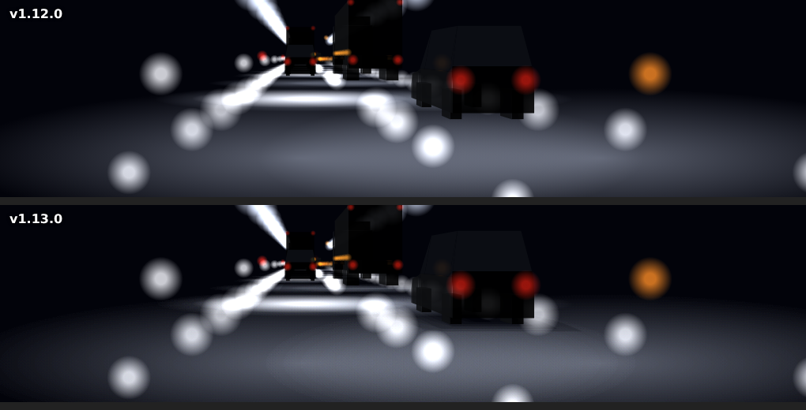
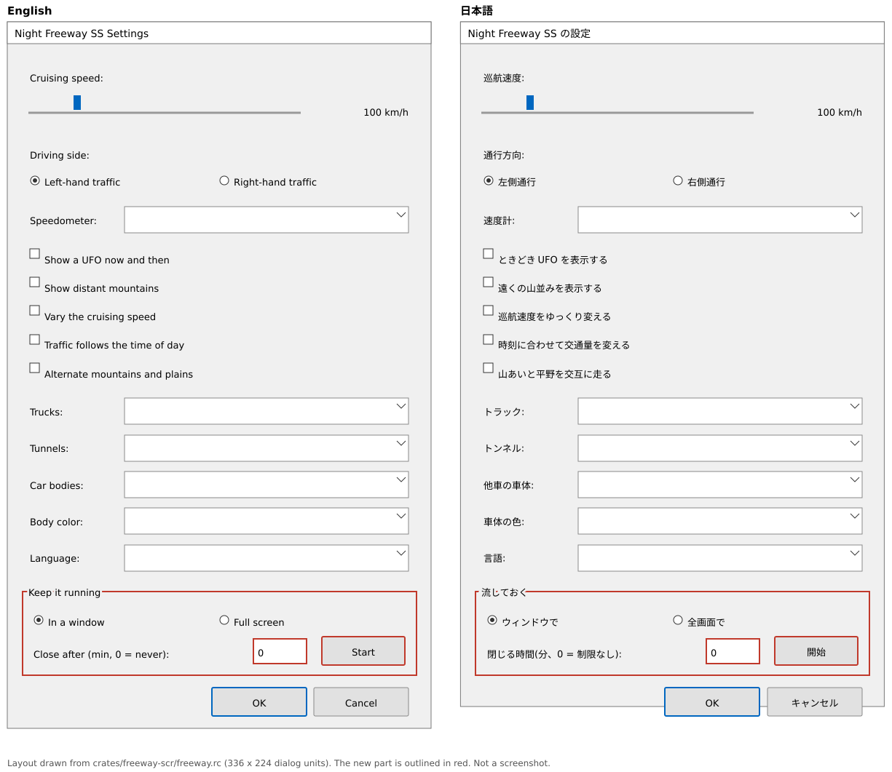

# v1.13.0 詳細設計: トンネルの影・街灯の間隔・文書・流し続けるモード

- ステータス: 完了(実機確認済み。[#29](https://github.com/suchi/freeway-ss/pull/29))
- 日付: 2026-10-27
- 親計画: [実装計画](0001-screensaver-implementation-plan.md)の6章

本書は、v1.13.0の変更を別のセッションや別の実装者が引き継げるように、設計と作業手順をまとめたものである。実装は本書とAGENTS.mdに従う。本書と実装が食い違った場合は、実装を変える前に調整役のセッションに伝える(AGENTS.md「複数セッションでの分担」)。

## 1. 目的と完了条件

2026-10-27に、v1.12.0の実機確認の後、ユーザーから次の報告と依頼を受けた。

- 白い照明のトンネルで、トラックも普通車も浮いて見える
- 中央分離帯の橙色の街灯は、もう少し間隔が離れていてよい
- UFOはイースターエッグなので、利用者向けの文書と、最初に目にする文書には書かない。開発者向けの文書には書いてよい
- READMEの最初に、バナーのような画像がほしい
- スクリーンセーバーとしてではなく、しばらく流しておけるモードがほしい(ずっと流す、n分後に閉じる)

同日にユーザーと決めたこと:

- 間隔を広げるのは、中央分離帯の街灯(とその路面の光)
- UFOは文書から外すだけにし、設定画面の項目は残す
- 流し続けるモードは、ウィンドウで流す・全画面で流し続ける・指定した分数で閉じるの3つ。設定画面からも、コマンドラインの引数からも始められる
- 5点をまとめてv1.13.0にする

完了条件:

- トンネルの中で、普通車とトラックが浮いて見えない(3.1節)
- 中央分離帯の街灯と路面の光の間隔が、3.2節の値になる
- README・利用者向けの説明書(`packaging/README.md`)から、UFOの記述がなくなる。`docs/developers.md`には残る(3.3節)
- READMEの先頭に、バナーの画像がある(3.4節)
- 3.5節の流し続けるモードが、コマンドラインと設定画面から使える(日本語と英語)
- 形が「なし」のとき、トンネルの外の描画の命令の列は、街灯の間隔の変更によるもの以外は変わらない
- 説明用の図(トンネルの影の前後、設定画面の新しい部分など)を、PRの本文と本書の7章に載せる
- テストがある(4章)
- ユーザーが実機で確認する
- ワークスペースのバージョンが`1.13.0`になっている(このPRの最初のコミットで実施済み)

## 2. 前提(v1.12.0の状態)

- 影(0019の3.5節・7章): 中央分離帯の街灯(`scene.rs`の`LAMP_SPACING`=45 m、高さ10 m)の路面の光だけを、`Canvas::shaded_light_pool`で影の形に欠いて描く。トンネルの中には、この街灯の光がない
- トンネルの照明(`scene.rs`の`tunnel_rows`): 壁の灯(横-4.6 mと5.1 m、高さ5 m、8 mおき)と、路面の光(横±1.75 m、半径4 m、8 mおき、不透明度0.16)。路面の光には影がない
- 起動の方法(`freeway-scr`の`args.rs`): `/s`(全画面。キー・クリック・マウスの移動で終わる)、`/p <hwnd>`(プレビュー)、`/c`(設定画面。引数なしも同じ)。最初の引数だけを読む

## 3. 設計

### 3.1 トンネルの中の影

不具合として扱う。まず再現し、原因を確かめてから直す。確かめた結果は本書の7章に書く。

- 原因の仮説(調整役がコードから推測。未確認): トンネルの照明の路面の光には影がない。車は明るい路面の光の上に、影なしで乗って見える。白い照明(LED)は路面とのコントラストが強いので目立つ
- 直し方: トンネルの照明の路面の光も、`shaded_light_pool`で、車の影の形に欠いて描く。光源は、その路面の光を照らす灯(同じ距離の壁の灯、またはその路面の光の真上の高さ5 mの点)とする。どちらにするかは、見た目と計算の量を見て実装で決めてよい
- 範囲: 形が「なし」以外のとき。影の半影・層の数は0019の7章と同じ仕組みを使う

### 3.2 中央分離帯の街灯の間隔

- `LAMP_SPACING`を45 mから70 mにする(値は実機確認で調整する)。路面の光と影の計算は、同じ定数を使っているので、一緒に変わる
- 路面の光の半径(9 m)は変えない。光と光の間に、暗い区間ができる

### 3.3 UFOの記述

- README(最上位)の「特徴」と、`packaging/README.md`の設定の表(日本語と英語)から、UFOの記述を外す
- `docs/developers.md`(設定の保存先の表・`ufo-demo`の説明)と、計画・ADRの記述は残す
- 設定画面の「UFOを時々表示」は残す(見つけた人だけが気づく)

### 3.4 READMEのバナー

- 横長の画像(例: 1280×320)を`docs/images/`に置き、READMEの見出しの直後に入れる
- 内容は、夜の高速道路の場面(道路の光・他車・街灯・山並み・夜空)。シーンの描画命令から描いた画像を使う(Windowsの実機の画面のキャプチャが手に入れば、後で差し替えてよい)
- 画像を作るための一時的なコードは、コミットしなくてよい。作り方を本書の7章に書く
- 画像の大きさは、PNGなら500 KB以下を目安にする

### 3.5 流し続けるモード

スクリーンセーバーとしての起動(`/s`)とは別に、入力では終わらず、しばらく流しておけるモードを加える。

コマンドライン(大文字と小文字は区別しない。`/`と`-`のどちらで始めてもよい):

| 引数 | 動き |
| --- | --- |
| `/window` | 大きさを変えられる普通のウィンドウで流す(既定の大きさは1280×720、画面の中央)。マウスやキーの入力では終わらない。閉じるボタン・Alt+F4・Escで終わる |
| `/play` | 全画面(すべてのモニター)で流す。マウスの移動・クリック・キーの入力では終わらない。Escか Alt+F4で終わる。マウスのカーソルは、動かしたときだけ少しの間見せる |
| `/minutes:<n>` | `/window`か`/play`と一緒に使う。n分(1〜1440)たったら閉じる。範囲外はエラーのメッセージを出す |

- 例: `NightFreewaySS.scr /window /minutes:30`
- `/s`・`/p`・`/c`の動きは変えない
- 流しているあいだは、ディスプレイが消えたりスリープしたりしないようにする(`SetThreadExecutionState`)。閉じたら元に戻す
- 設定画面: 「流しておく」の欄を加える。ウィンドウか全画面かの選択、分数(0は時間の制限なし)、「開始」ボタン。開始すると、設定画面の今の値を保存してから設定画面を閉じ、別のプロセスとして、自分自身を上の引数で起動する
- 文字列は`i18n.rs`の表に加える(英語と日本語)。文言は実装で決めてよい
- 利用者向けの説明書(`packaging/README.md`)に、ショートカットに引数を付けて起動する方法と、設定画面からの始め方を書く

## 4. テスト

`freeway-core`:

- トンネルの影: トンネルの中で、車の下の路面の光に影が付く(`shaded_light_pool`の命令に影がある)。形が「なし」のときは付かない
- 街灯の間隔: 街灯と路面の光と影の計算が、新しい間隔で一致する
- 文字列の表のテストが、追加したキーでも通る

`freeway-scr`:

- 引数(Linuxでも実行): `/window`・`/play`・`/minutes:<n>`の組み合わせ、大文字と小文字、`-`で始まる形、範囲外の分数、`/minutes`だけのとき、未知の引数。`/s`・`/p`・`/c`の動きが変わらない
- 描画と窓(Windowsのみ): 既存の非表示ウィンドウのテストに倣い、ウィンドウのモードで描画が失敗しない

見た目と操作は、ユーザーの実機確認で見る。

## 5. 実機での確認(調整役がユーザーに依頼する項目)

- 白い照明・橙の照明のトンネルで、車が浮いて見えないか
- 中央分離帯の街灯の間隔が適当か
- READMEのバナー(GitHubの画面)
- `/window`・`/play`・`/minutes:<n>`の動き。設定画面からの開始。マウスやキーで終わらず、決めた操作で終わるか。流しているあいだにディスプレイが消えないか
- 設定画面の新しい欄(日本語と英語、DPI 150%など)

## 6. 作業手順

実装用セッション:

1. ワークスペースのバージョンを`1.13.0`に上げる(このPRの最初のコミットで実施済み)
2. トンネルの影(3.1節): 再現し、原因を本書の7章に書いてから直す
3. 街灯の間隔(3.2節)
4. 流し続けるモード(3.5節): 引数・窓・設定画面・文字列を、テストとともに実装する
5. 文書(3.3節)と、バナー(3.4節)
6. 説明用の図を`docs/images/`に置く
7. `docs/developers.md`・利用者向けの説明書・実装計画の進捗表を更新する。本書の7章に、実装で決めた値と図を書く
8. AGENTS.mdの検証コマンドをすべて実行する(Windowsターゲットのclippy、`ufo-demo`付きのclippyも含む)
9. 1コミット1論理変更でコミットし、プッシュする
10. 敵対的セルフレビューを行い、指摘と対応をPRコメントに記録する
11. CIの成功を確認したら、PR本文のチェックリストをCIのグリーン化まで更新し、PRの監視を外して調整役のセッションに完了を報告する

調整役:

12. ユーザーの実機確認とマージの承認を得て、チェックリストを更新してからマージする。図のリンクを`main`に直す。`v1.13.0`のタグはユーザーが手元からプッシュする

## 7. 実装で決めた値

### 7.1 トンネルの影の原因の確認結果

3.1節の仮説は、そのとおりだった。

- 再現: シーンの描画命令をSVGにして、Chromiumで画像にする一時の道具(リポジトリには含めていない)で、v1.12.0のコードのままのトンネルの中(シード11・LED照明・形は「詳細な形」)を描いた。車が路面の光の上に影なしで乗り、車体の下に暗い部分がない。路面の光は不透明度0.16と弱いので、画像では2.5倍に強めた
- 原因: `scene.rs`の`tunnel_lights`が作るトンネルの路面の光は、`shadows`が常に空で、`shadows_by_lamp`の結果(街灯のキーで引く)は街灯の光にしか付かない。そのため`Canvas::light_pool`(影なし)で描かれ、`shaded_light_pool`は使われない。v1.12.0のテスト`there_are_no_shadows_inside_a_tunnel`は、この動きを正としていた
- 橙の照明(ナトリウム灯)も同じ仕組みで影がない。白(LED)は路面とのコントラストが強いので、報告のとおり目立つ

### 7.2 決めた値

| 項目 | 値 | 理由 |
| --- | --- | --- |
| トンネルの影の光源 | 路面の光の中心の真上、高さ5 m(壁の灯と同じ高さ、`TUNNEL_LAMP_HEIGHT`) | 壁の灯を光源にすると、1つの光だまりを2つの壁の灯が照らす分、影が2つになる。真上の1点にすると、計算が街灯と同じ形で済み、車の左右に対称な影になる |
| 影の作り方 | 街灯と同じ(5層・半影・`shaded_light_pool`)。灯の幅は`LAMP_HEAD_RADIUS`(1.5 m)のまま、半影は`1.5 × 高さ / (5 - 高さ)` | 0019の7.2節の仕組みを、光源の位置と高さを引数にして共用した(`Shadow::from_source`) |
| 影を試す範囲 | 光だまりの端から道路に沿って8 m(`TUNNEL_SHADOW_REACH`)以内の車 | 影は箱より光源から遠くに落ちるので、これより遠い車の影は光だまりに届かない。最も高いトラック(4.1 m)の半影(約6.8 m)と半径4 mの和より大きい |
| 高さが光源以上の箱 | 影を作らない | 5 mの灯より高い箱はない。除算を避ける |
| 街灯の間隔 | 70 m(`LAMP_SPACING`) | 設計の値のまま。実機で調整する |
| ウィンドウの既定の大きさ | 画面の作業領域(プライマリモニター)の中央に、中身が1280×720(96 DPI)。DPIに比例して大きくなり、作業領域の90%を超えるときは縦横比を保って縮む。最小は320×180(96 DPI) | `placement.rs`。純粋な関数にして、Linuxでもテストする |
| カーソル(`/play`) | マウスを動かしてから2秒。500 ミリ秒ごとのタイマーで、静止を調べて隠す | 静止を知らせるメッセージがない |
| `/minutes`の範囲 | 1〜1440。設定画面の欄は、0と空欄が制限なし、1440を超える値は1440にする | 設計のとおり |
| 設定画面の「流しておく」 | メインの設定画面には、OKの左に「流しておく...」(英語は「Keep running...」)のボタンを1つだけ置いた。高さはv1.12.0の288ダイアログ単位のまま。ボタンを押すと、別の小さなダイアログ(200×84ダイアログ単位、タイトルは「流しておく」)が開く。中身は、ウィンドウ/全画面のラジオボタン、分数の欄(数字だけ・4桁・既定0)、「開始」(既定のボタン)と「キャンセル」。開くたびに、ウィンドウ・0分から始まる。この選択は保存しない | 当初は同じ画面に欄を足し、336単位にしたが、1080pで150%の表示倍率だと作業領域を超えるため、調整役の指摘で別ダイアログに分けた。データ形式(レジストリ)を増やす判断は調整役に委ねるため、保存しない。調整役が望めば、後で`Settings`に加える |
| 開始 | 設定を保存し、2つのダイアログを閉じてから、`std::env::current_exe()`を、`Mode::arguments()`が作る引数で`spawn`する。保存に失敗したときは、起動しない | 引数は自分で作ったものだけで、外部の入力を渡さない |
| 引数の読み方 | `/window`・`/play`・`/minutes:<n>`だけが組み合わせられる。ほかの引数が混じるとエラー。`/window`と`/play`の併用、`/minutes`だけ、`/minutes`の値がないものもエラー。`/s`の後ろの引数は、これまでどおり無視する | 設計にない併用の扱いを決めた |
| 追加した`windows`のフィーチャー | `Win32_System_Power`(`SetThreadExecutionState`) | 新しい依存クレートはない |
| UFO | READMEと利用者向けの説明書から外した。`docs/developers.md`・設定画面・ADR・計画には残した | 3.3節のとおり |

### 7.3 形が「なし」のとき、トンネルの外の命令の列が変わらないこと

形が「なし」のとき、トンネルの影は作らず、光だまりは従来の`light_pool`のままである。これを、v1.10.0の固定ハッシュ(`without_car_bodies_the_commands_are_those_of_v1_10_0*`)で確かめた。

1. トンネルの影の変更だけを入れ、街灯の間隔を45 mのままにして、固定ハッシュを動かした。9つの構成すべてで、v1.10.0の値と一致した(トンネルを含む構成)
2. 街灯の間隔を70 mにすると、命令の列は、街灯の数の分だけ変わる。固定ハッシュを70 mの値に取り直した。テスト名に「間隔以外」を加え、手順を説明に書いた

つまり、命令の列が変わるのは、街灯の間隔によるものだけである。

### 7.4 バナーの作り方

`docs/images/banner.png`(1280×320、約100 KB)は、シーンの描画命令から描いた画像で、画面のキャプチャではない。

- シーンを、シード3・夜11時・日本風のトラック・詳細な形の車体・山あいと平野の区間をオンにして、14,000ステップ(700秒)走らせた後の1フレームを、1280×720の画面で描いた
- 描画命令(`Canvas`)をSVGの図形にする一時の道具(光はSVGの`mix-blend-mode: plus-lighter`で加算し、影の欠けは`mask`で表す)で、SVGにした。Direct2Dの描画とは、ぼかしの形などが少し違う
- ChromiumでPNGにして、地平線の上下の320画素を切り出し、左上に製品名を重ねた
- Windowsの実機のキャプチャが手に入れば、差し替えてよい

### 7.5 説明用の図

トンネルの影の前後。同じ場面を、v1.12.0(上)とv1.13.0(下)で描いた。路面の光を2.5倍に強めてある。右の車の下から後ろに、暗い影が落ちる。

設定画面の新しいボタンと、「流しておく」のダイアログの配置。`freeway.rc`の座標から描いた図で、画面のキャプチャではない。新しいボタンを赤で囲んである。

### 7.6 確かめたこと

- 検証コマンド: `cargo fmt --all --check`、`cargo clippy --workspace --all-targets -- -D warnings`(Linux・Windowsターゲット・`ufo-demo`付き)、`cargo test --workspace`、`cargo check --workspace --all-targets`(Windowsターゲットも)
- テスト(`freeway-core`): トンネルの中で影が付くこと、形が「なし」のとき付かないこと、トンネルの光源の真下の車の影の大きさ、遠い車・見えない車が影を作らないこと、街灯の間隔と影の計算が同じ定数であること、文字列の表(英語と日本語)
- テスト(`freeway-scr`、Linuxで実行): 引数のすべての組み合わせ、大文字小文字・`-`、範囲外、`/minutes`だけ、未知の引数、`/s`・`/p`・`/c`が変わらないこと、`Mode::arguments`が`parse`で読み戻せること、ウィンドウの大きさと位置(`placement.rs`)
- テスト(Windowsのみ、CIで実行): Escだけが`/window`・`/play`を終えること、入力がスクリーンセーバーを終え、プレビューは終えないこと、`/play`のカーソル、時間制限で`animate`が終わること、ディスプレイを維持する要求が解けること、`/window`の窓の作成と描画とサイズ変更
- Direct2Dの描画の時間は測っていない。トンネルの影は、車が光だまりに近いときだけ、1つの光だまりにつき図形の計算と塗りが5回増える。実機で確かめる

### 7.7 設計との違いと補足

- 設定画面の高さと配置が、設計(3.5節の「設定画面に欄を加える」)から変わった。実装後の調整役の指摘で、欄を別のダイアログに移した(7.2節)
- 高さが4.1 mのトラックの影は、5 mの灯に近いので、半影が約6.8 mと広く、光だまり全体が暗くなる。トラックの屋根が灯をさえぎるので、物理としては自然だが、見た目は実機で確かめる
- ウィンドウの最小化中は、描かずに待つ(時間制限は進む)。DPIの異なるモニターへ動かしたときのウィンドウの大きさの追従(`WM_DPICHANGED`)は、していない。描画は毎フレーム、そのときのDPIを読む
