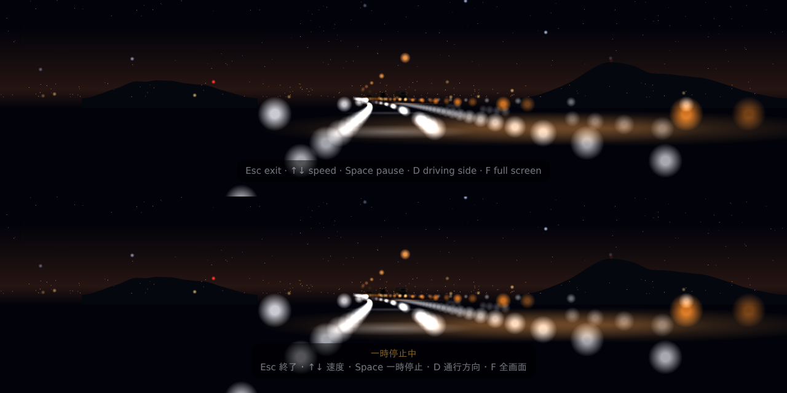

# v1.14.0 詳細設計: 版の情報・流しているあいだの操作・バナーの書体・速度の変化

- ステータス: 実装中
- 日付: 2026-10-27
- 親計画: [実装計画](0001-screensaver-implementation-plan.md)の6章

本書は、v1.14.0の変更を別のセッションや別の実装者が引き継げるように、設計と作業手順をまとめたものである。実装は本書とAGENTS.mdに従う。本書と実装が食い違った場合は、実装を変える前に調整役のセッションに伝える(AGENTS.md「複数セッションでの分担」)。

## 1. 目的と完了条件

2026-10-27に、v1.13.0のリリースの後、ユーザーから次の依頼を受けた。

- `.scr`に版の情報(VERSIONINFO)を埋め込む(v1.13.0のリリースの検証で、調整役が提案していたもの)
- 流しておくモード(`/play`)で、本家(mhatta/nightfreeway)の操作を使えるようにする
- 流しておくモード(`/play`)で、終わり方を画面に示す
- READMEのバナーの文字を、Century Gothicのような幾何学的な書体にする
- 自車が前の車に追いついたら、追い越し車線に出て抜き、元の車線に戻る
- 巡航速度のゆらぎの変化を、もう少し頻繁にする

同日にユーザーと決めたこと:

- 2つのリリースに分ける。本書のv1.14.0は、追い越し以外の5点。追い越し(自車の追い越しと、他車の車線変更。設定画面でオン・オフ)はv1.15.0で行い、別の詳細設計を置く
- 書体はQuestrial(SIL Open Font License 1.1)。Century Gothic自体は有償の書体なので使わない。調整役が作った候補の比較で、ユーザーが選んだ
- 本家の操作のうち、↑↓(速度)・Space(一時停止)・D(通行方向)・F(ウィンドウと全画面の切り替え)・コナミコマンド(UFO)のすべてを使えるようにする
- 操作は、`/play`だけでなく`/window`でも使えるようにする
- 操作による変更は、その回だけ有効にし、設定には保存しない

完了条件:

- エクスプローラーで`.scr`のプロパティの「詳細」を開くと、製品名・ファイルの説明・ファイルのバージョン・製品のバージョン・著作権が見える。バージョンは`Cargo.toml`の`workspace.package.version`と一致する(3.1節)
- `/window`と`/play`で、3.2節の操作が使える。`/s`(スクリーンセーバー)とプレビューの動きは変わらない
- `/window`と`/play`で、始めたときと、マウスを動かしたときやキーを押したときに、終わり方を含む操作の案内が画面に出る(3.3節)
- READMEのバナーの製品名が、Questrialで描かれている(3.4節)
- 巡航速度のゆらぎの目標が、3.5節の間隔で変わる
- 文字列は英語と日本語の両方がある(ADR-0007)
- 利用者向けの説明書に、操作と終わり方が書いてある。コナミコマンドとUFOは、利用者向けの文書には書かない(D23)

## 2. 前提(v1.13.0の状態)

- リソース(`crates/freeway-scr/freeway.rc`、`build.rs`): 表示名の文字列・アイコン・設定画面のダイアログ・マニフェストを、`embed-resource`(3.0.12)で埋め込む。VERSIONINFOはない
- 流しておくモード(`crates/freeway-scr/src/win/window.rs`の`Behavior::Window`・`Behavior::Play`): 入力では終わらず、Esc・Alt+F4(`/window`は閉じるボタンも)で終わる。`/play`はすべてのモニターに1つずつ全画面の窓を作り、モニターごとに独立した場面を描く(ADR-0003)。画面に操作の案内はない
- 巡航速度のゆらぎ(`crates/freeway-core/src/cruise.rs`): 選んだ速度の±20 km/hの範囲で、120〜300秒ごとに目標を選び直し、時定数30秒で追う。加速度は0.3 m/s²まで
- 本家の操作(調査は[実装計画](0001-screensaver-implementation-plan.md)の2.2節。本家は2026-10-27時点でも`7b98218`から更新がない):
  - ↑/↓: 押しているあいだ、8 m/s²で加速・減速する。速度は8〜45 m/s
  - Space: 一時停止と再開
  - D: 左側通行と右側通行を切り替える。左右の反転を、時定数約0.33秒(`side += (target - side) * min(1, dt * 3)`)で滑らかに補う
  - F: 全画面の切り替え
  - コナミコマンド(↑↑↓↓←→←→BA): UFOを呼ぶ。直近の10個のキーで判定する(押しっぱなしの繰り返しは数えない)
  - 操作の案内(「↑↓ 速度 ・ Space 停止 ・ D 通行方向 ・ F 全画面」)は、入力がないまま4秒たつと消え、マウスの移動かキーの入力でまた出る

## 3. 設計

### 3.1 版の情報(VERSIONINFO)

`freeway.rc`にVERSIONINFOのリソースを加える。

| 項目 | 値 |
| --- | --- |
| `FILEVERSION`・`PRODUCTVERSION` | `MAJOR,MINOR,PATCH,0`(例: `1,14,0,0`) |
| `FileVersion`・`ProductVersion` | `"1.14.0"` |
| `ProductName`・`FileDescription` | `"Night Freeway SS"` |
| `InternalName` | `"NightFreewaySS"` |
| `OriginalFilename` | `"NightFreewaySS.scr"` |
| `LegalCopyright` | `"Copyright (c) 2026 suchi"`(`LICENSE`と同じ) |
| 言語とコードページ | 英語(米国)・Unicode(`040904b0`、`Translation 0x0409, 1200`) |

- 版の数字は、`build.rs`で`CARGO_PKG_VERSION_MAJOR`・`_MINOR`・`_PATCH`・`CARGO_PKG_VERSION`から得て、`embed_resource::compile`のマクロとして`rc.exe`に渡す。`freeway.rc`に版の数字を直に書かない(上げ忘れを防ぐ)
- 版を上げたときに、ビルドスクリプトが再び実行されてリソースが作り直されることを確かめる(`rerun-if-changed`を指定しているため。必要なら`rerun-if-env-changed`を加える)。確かめた方法を7章に書く
- 文字列のマクロの渡し方(引用符を含む値をコマンドラインで渡すか、`#define`の文字列化を使うか)は、実装で決めてよい。`rc.exe`の公式ドキュメントで確かめた方法を使う
- テスト: Windowsのテスト(CIで実行)で、ビルドした実行ファイルの版の情報が読めて、`CARGO_PKG_VERSION`と一致することを確かめる。テストのバイナリにリソースが入らないなどで難しければ、`cargo xtask dist`での確認など別の方法を選び、7章に書く

### 3.2 流しているあいだの操作

`/window`と`/play`で、次のキーを受け付ける。`/s`(スクリーンセーバー)とプレビュー(`/p`)では受け付けない(`/s`はどのキーでも終わる)。

| キー | 動き |
| --- | --- |
| Esc | 終わる(今と同じ)。Alt+F4と、`/window`の閉じるボタンも今と同じ |
| ↑ / ↓ | 押しているあいだ、選んだ速度(ゆらぎの中心)を上げ下げする。速さは本家と同じ8 m/s²(28.8 km/h/秒)。範囲は設定画面と同じ30〜160 km/h。ゆらぎは、新しい中心のまわりで続ける |
| Space | 一時停止と再開。止めているあいだは、場面の時間(道路・他車・星のまたたき・流れ星・UFO)を進めない。`/minutes:<n>`の時間は止めずに数える |
| D | 左側通行と右側通行を切り替える。本家と同じく、時定数約0.33秒で滑らかに反転する |
| F | ウィンドウと全画面を切り替える(下記) |
| コナミコマンド | UFOを呼ぶ。設定の「UFOを時々表示」がオフでも現れる。判定は本家と同じく、直近の10個のキーで行い、キーの繰り返し(押しっぱなし)は数えない |

- 複数のモニター: 操作は、すべての窓の場面に同じように効かせる(速度・一時停止・通行方向・UFO)
- Fの切り替え:
  - `/window`のウィンドウでFを押すと、そのウィンドウがあるモニターの全画面になる(1つのモニターだけ)。全画面のあいだは、`/play`と同じくカーソルを隠す
  - `/play`でFを押すと、Fを受けた窓のモニターに、`/window`と同じ既定の大きさのウィンドウを1つ作り、ほかのモニターの窓は閉じる。もう一度Fを押すと、そのモニターだけの全画面になる
  - 切り替えても、場面(走った距離・他車・時刻)は続ける。作り直すなら、その理由を7章に書く
  - 実装の方法(窓のスタイルと位置を変える、窓を作り直すなど)は実装で決めてよい
- 状態の扱い: 速度・一時停止・通行方向は、その回だけ有効にし、レジストリには保存しない
- 速度計: 速度計を表示している設定なら、↑↓による速度の変化が速度計に出る
- 実装の場所: キーの判定(コナミコマンドの照合、キーと操作の対応)は、OSに依らない部分としてテストできる形にする(`freeway-scr`の`input.rs`など)。場面の状態の変更(選んだ速度・通行方向の補間・UFOを呼ぶ)は`freeway-core`に置き、テストを書く

### 3.3 操作の案内

`/window`と`/play`で、画面の下の中央に、操作の案内を1行で出す。

- 文言の例(実装で整えてよい):
  - 英語: `Esc exit · ↑↓ speed · Space pause · D driving side · F full screen`
  - 日本語: `Esc 終了 ・ ↑↓ 速度 ・ Space 一時停止 ・ D 通行方向 ・ F 全画面`
  - ウィンドウのときは、Fの説明を「全画面」、全画面のときは「ウィンドウ」にする
- 始めたときに出し、入力がないまま4秒たったら0.5秒ほどで消す(本家と同じ4秒)。マウスの移動(`/play`でカーソルを見せる条件と同じ)か、キーの入力でまた出す
- 一時停止のあいだは、案内を出したままにし、一時停止していることも示す(例: `Paused` / `一時停止中`)
- コナミコマンドは案内に書かない
- 見た目: 夜の場面を邪魔しない控えめな明るさの文字にする(速度計のダッシュボードの明るさ、0017の7章の`NIGHT_LEVEL`を参考にする)。DPIに合わせて大きさを変える
- 表示言語は設定の「表示言語」に従う(ADR-0007)。文字列は`i18n.rs`の表に加える
- 設定画面の「流しておく」のダイアログにも、終わり方(Escで終わること)を1行で書く。ダイアログの大きさが足りなければ広げてよいが、DPI 150%・1080pで画面からはみ出さないこと(0020の7章)

### 3.4 バナーの書体

`docs/images/banner.png`の製品名(左上の「Night Freeway SS」)を、Questrial(Regular 400)で描き直す。

- 書体: Questrial、SIL Open Font License 1.1。npmの`@fontsource/questrial`(5.3.0、2026-07-19公開)から得られる。書体のファイルはリポジトリに入れない
- 背景の場面は、今のバナーと同じもの(0020の7.4節の条件)を使う。描き直しが難しければ、今のバナーの空の部分から製品名を消してから重ねてもよい。どちらにしたかを7章に書く
- 文字の大きさ・字間・色は、今のバナーに近づける。比べた画像(今と新しいもの)をPRの本文に載せる
- READMEの画像の代替テキストは変えなくてよい
- 0020の7.4節は書き換えず、本書の7章に新しい作り方を書く(書体の名前・ライセンス・入手先を含める)

### 3.5 巡航速度のゆらぎ

ゆらぎの変化の頻度を、v1.13.0のおよそ2倍にする。

| 定数(`cruise.rs`) | v1.13.0 | v1.14.0 |
| --- | --- | --- |
| `RETARGET_SECONDS` | 120〜300秒 | 60〜150秒 |
| `FOLLOW_SECONDS` | 30秒 | 20秒 |
| `MAX_OFFSET_KMH` | 20 km/h | 変えない |
| `MAX_ACCELERATION_KMH_PER_S` | 0.3 m/s² | 変えない |

- 時定数を縮めると、加速度の上限にかかる時間が増える。急な加減速に見えないかを実機で確かめる項目に入れる
- 値を変えた理由がテストの名前や説明(「2〜5分ごと」など)に出ている箇所も直す
- 時間的な変化の3項目をすべてオフにしたときの動き(0013)は変えない

## 4. テスト

`freeway-core`:

- 選んだ速度の変更: 30〜160 km/hの外に出ない。ゆらぎを含めた速度も範囲の外に出ない。変更の速さが28.8 km/h/秒
- 一時停止: 止めているあいだ、場面の時間・道路の位置・他車が進まない
- 通行方向の補間: 切り替えた後、滑らかに反対側に移り、最後は今の右側通行・左側通行と同じ描画になる
- UFOを呼ぶ: 設定がオフでも現れる。現れているあいだに呼んでも壊れない
- ゆらぎ: 目標を選び直す間隔が60〜150秒。加速度の上限を超えない(既存のテストを新しい値で通す)
- 文字列の表のテストが、追加したキーでも通る

`freeway-scr`:

- キーの判定(Linuxでも実行): コナミコマンドの照合(余分なキーの後でも判定できる、キーの繰り返しは数えない、途中で違うキーが入ると成り立たない)。キーと操作の対応
- 窓(Windowsのみ): `/s`とプレビューでは操作のキーが効かず、`/s`はどのキーでも終わる。`/window`・`/play`で操作のキーでは終わらない。Fでの切り替えで窓の状態が変わる(既存の非表示ウィンドウのテストに倣う)
- 版の情報(3.1節)

見た目と操作は、ユーザーの実機確認で見る。

## 5. 実機での確認(調整役がユーザーに依頼する項目)

- `.scr`のプロパティの「詳細」に、版の情報が出るか
- `/window`と`/play`で、↑↓・Space・D・F・コナミコマンドが効くか。複数のモニターがあれば、すべてに効くか
- 操作の案内が、始めたときと入力のときに出て、しばらくすると消えるか。読みやすく、場面を邪魔しないか
- Fの切り替え(`/window`から全画面へ、`/play`からウィンドウへ、そして戻す)
- `/s`(スクリーンセーバー)とプレビューの動きが変わっていないか
- 設定画面の「流しておく」のダイアログ(日本語と英語、DPI 150%など)
- READMEのバナー(GitHubの画面)
- 巡航速度のゆらぎの頻度が適当か。急な加減速に見えないか

## 6. 作業手順

実装用セッション:

1. ワークスペースのバージョンを`1.14.0`に上げる(このPRの最初のコミットで実施済み)
2. 版の情報(3.1節)
3. 巡航速度のゆらぎ(3.5節)
4. 流しているあいだの操作(3.2節): `freeway-core`の場面の状態の変更、キーの判定、窓の処理を、テストとともに実装する
5. 操作の案内(3.3節)と、「流しておく」のダイアログの1行
6. バナーの書体(3.4節)
7. 説明用の図(操作の案内の見た目、バナーの前後)を`docs/images/`に置く
8. `docs/developers.md`(動かし方の節にキー操作とコナミコマンド。版の情報)・利用者向けの説明書(`packaging/README.md`。キー操作と終わり方。コナミコマンドとUFOは書かない)・最上位の`README.md`(必要なら1行)・実装計画の2.2節と進捗表を更新する。本書の7章に、実装で決めた値と図を書く
9. AGENTS.mdの検証コマンドをすべて実行する(Windowsターゲットのclippy、`ufo-demo`付きのclippyも含む)
10. 1コミット1論理変更でコミットし、プッシュする
11. 敵対的セルフレビューを行い、指摘と対応をPRコメントに記録する
12. CIの成功を確認したら、PR本文のチェックリストをCIのグリーン化まで更新し、PRの監視を外して調整役のセッションに完了を報告する

調整役:

13. ユーザーの実機確認とマージの承認を得て、チェックリストを更新してからマージする。図のリンクを`main`に直す。`v1.14.0`のタグはユーザーが手元からプッシュする

## 7. 実装で決めた値

### 7.1 版の情報(3.1節)

- `build.rs`が`CARGO_PKG_VERSION_MAJOR`・`_MINOR`・`_PATCH`・`CARGO_PKG_VERSION`から`VERSION_MAJOR=1`・`VERSION_MINOR=14`・`VERSION_PATCH=0`・`VERSION_TEXT="1.14.0"`を作り、`embed_resource::compile`のマクロとして`rc.exe`に渡す。引用符を含む値の渡し方は、embed-resourceのREADMEの例(`VERSION="0.5.0"`)に倣った
- `freeway.rc`の`1 VERSIONINFO`(`FILEVERSION`・`PRODUCTVERSION`は`MAJOR,MINOR,PATCH,0`)に、表の値(`FileDescription`・`FileVersion`・`InternalName`・`LegalCopyright`・`OriginalFilename`・`ProductName`・`ProductVersion`)を書いた。言語は`040904b0`、`Translation`は`0x0409, 1200`。表にない`CompanyName`は書いていない
- 版を上げたときにリソースが作り直されることは、`build.rs`に`cargo:rerun-if-env-changed=CARGO_PKG_VERSION`を加えて保証した(Cargoは版が変わると`CARGO_PKG_VERSION`の値も変わるので、ビルドスクリプトが再び実行される)
- テスト: `cargo test`が作るテスト用の実行ファイルには、`rustc-link-arg-bins`のリソースが入らない(埋め込まれるのは`bin`の実行ファイルだけ)。そこで設計が許した別の方法を選び、`cargo xtask dist`の`package`で、ビルドした実行ファイルのバイト列から`FileVersion`と`ProductVersion`の文字列(UTF-16。キーの後の0〜2バイトの詰め物の後に値が続く)を探し、`Cargo.toml`の版と一致しなければ配布物を作らない。CIは`cargo xtask dist`を両方のアーキテクチャで実行するので、版の不一致はCIで失敗する。検査の関数は、一致・不一致・片方だけ・詰め物の有無を`xtask`のテストで確かめた
- `llvm-rc`(LLVM)で`freeway.rc`を実際にコンパイルし、`.res`の中に`FileVersion`・`ProductVersion`が`1.14.0`として入り、検査の関数と同じ並び方(キー、詰め物、値)であることを確かめた。`rc.exe`での確認はCIの`cargo xtask dist`が行う

### 7.2 巡航速度のゆらぎ(3.5節)

- `RETARGET_SECONDS`を60〜150秒、`FOLLOW_SECONDS`を20秒にした。ほかの定数は変えていない
- `Drift::rebase`を加えた。↑↓で選んだ速度(中心)が動くと、中心のまわりで取れる範囲(±20 km/hと30〜160 km/hの共通部分)を作り直し、今の値と目標をその範囲に収める。中心が端に近づいたときは、速度が160(30)に張り付く形で連続になる。テストで、中心を28.8 km/h/秒で動かしても速度が跳ばず160を超えないことを確かめた
- 既存のテスト `the_speed_changes_slowly`(10秒間の変化が6 km/h未満)は、時定数を縮めると成り立たない(シード5で6.004)。臨界減衰のばねの最大の速さは「変化量 ÷ (時定数 × e)」で、40 km/hを20秒で追うと約0.74 km/h/秒、10秒で最大約7.4 km/hなので、しきい値を8 km/hにし、コメントにその式を書いた。名前と説明の「2〜5分」は「1〜2.5分」に直した
- `scene.rs`の描画命令のハッシュ(v1.13.0のLinuxで取った9つ)は、ゆらぎの定数が変わるため、すべて変わる。定数をv1.13.0の値に戻して、場面・投影・UFOの変更(7.3節)を入れたままでも従来のハッシュに一致することを確かめてから(つまり差はゆらぎだけ)、新しい値で取り直した

### 7.3 流しているあいだの操作(3.2節)

`freeway-core`(`Scene`):

- 選んだ速度: `Scene`が`base_kmh`を持ち(設定の値で始まる)、`change_speed(direction, dt)`が8 m/s²(28.8 km/h/秒。定数`SPEED_KEY_KMH_PER_S`)で動かす。`dt`は`MAX_STEP_SECONDS`で切る。30〜160 km/hの外に出ない。無効な値(NaN・負の`dt`)は何もしない
- 一時停止: `set_paused`。止めているあいだは`update`が時間(道路・他車・星・流れ星・UFO)を進めない。星のまたたきは時間から描くので止まる。通行方向の反転は、一時停止中も進む(Dを押した結果が見えるようにするため)
- 通行方向: `set_left_hand_traffic`で目標を替え、`update`が`side += (目標 - side) * min(1, dt / (1/3))`で`side`(1.0が左側通行、-1.0が右側通行)を動かす。本家の`min(1, dt * 3)`と同じ。差が0.001未満になったら目標の値に合わせるので、最後は始めからその側通行の場面と描画命令が同じになる(テストで確かめた)。`Projector`は`with_side(幅, 高さ, side)`を加え、`side`を実数で持つ。途中は絵が左右につぶれて反対側に開く。空とUFOの`side`にも同じ値を渡す
- UFO: `Ufo::call`が、今の場面の時間から1回の来訪を始める。設定がオフ(平均間隔なし)でも来る。来訪中に呼んでも何もしない。設定がオンのときは、呼んだ来訪が終わった後に、計画のとおり次の来訪の待ちが始まる。設定がオフのときは、終わった後は来ない

`freeway-scr`:

- `input.rs`: `Key`・`Command`・`Controls`(押しているキーと、直近の10個のキー)・`Hint`(案内を出す時間)。コナミコマンドは直近の10個のキーを`↑↑↓↓←→←→BA`と比べ、成り立ったら履歴を空にする。キーの繰り返し(押しっぱなし)は、トグルにも履歴にも数えない。↑↓の押している状態は繰り返しでも保つ。Space・D・Fは押したときに1回だけ
- `win/window.rs`: `/window`・`/play`のとき、`WM_KEYDOWN`・`WM_KEYUP`・`WM_KILLFOCUS`(押しているキーを離す)・`WM_MOUSEMOVE`を受け、`take_input()`で渡す。`/s`とプレビューでは何も記録しない
- 複数のモニター: コマンドは、すべての窓の場面に同じように与える。一時停止・通行方向は、ホストが1つの状態を持ち、毎フレーム全場面に与える。速度は全場面に同じ量を加える
- Fの切り替え: 窓を作り直さず、同じ窓のスタイル(`SetWindowLongPtrW`の`GWL_STYLE`・`GWL_EXSTYLE`)と位置・大きさ(`SetWindowPos`、`SWP_FRAMECHANGED`)を替える。スワップチェーンと場面はそのまま続き、サイズの変化は描画のときの`resize_if_needed`が拾う。作り直さないので、走った距離・他車・時刻は続く(テストで確かめた)
  - `/window`から: Fを受けた窓があるモニター全体(`rcMonitor`)の`WS_POPUP`・`WS_EX_TOPMOST`の窓にする。最大化は先に戻す。カーソルタイマーを始め、`Behavior`を`Play`にする
  - `/play`から: Fを受けた窓以外を、先にスワップチェーンを解放してから`DestroyWindow`する(その間は`WM_DESTROY`で終わらないよう`QUIT_ON_DESTROY`を切る)。残した窓を、そのモニターの作業領域(`rcWork`)に、`/window`と同じ既定の大きさ(`placement::window_rect`)の通常の窓にする。DPIは窓のDPI。`Behavior`を`Window`に戻す
  - 全画面のあいだのカーソルは、`/play`と同じく、マウスを動かして2秒で隠す

### 7.4 操作の案内(3.3節)

- 文字列(`i18n.rs`): `HintInWindow`(Fは「全画面」)・`HintFullscreen`(Fは「ウィンドウ」)・`Paused`・`RunEndNote`(「流しておく」のダイアログの1行)。英語は `Esc exit · ↑↓ speed · Space pause · D driving side · F full screen`、日本語は `Esc 終了 ・ ↑↓ 速度 ・ Space 一時停止 ・ D 通行方向 ・ F 全画面`。コナミコマンドは書かない(テストで、案内の文字列に`UFO`と`BA`がないことを確かめた)
- 時間(`input.rs`の`Hint`): 始めたときに出し、入力がないまま4秒(`HINT_SECONDS`)たつと0.5秒(`HINT_FADE_SECONDS`)で消す。キー・マウスの移動(`/window`でも`/play`でも)・↑↓を押しているあいだで、また出す。一時停止のあいだは出したままにし、案内の上に`Paused`を琥珀色で出す。案内の状態は、すべての窓で1つ
- 見た目(`win/hint.rs`): 画面の下の中央、下の端から24 px(倍率1のとき)の上に、角を丸めた黒(不透明度0.5)の板を敷き、その上に文字を描く。文字は大きさ15 px(倍率1のとき。倍率は`speedometer::scale`と同じで、DPIに合わせて大きくなる)、色は淡い白(0.88, 0.90, 0.95)、不透明度は0.85 × `NIGHT_LEVEL`(0.6)。書体は、英語が`Segoe UI`、日本語が`Yu Gothic UI`(矢印と日本語の字形がある書体。足りない字形はDirectWriteが別の書体で補う)。文字が窓の幅の92%に収まらないときは、収まる大きさまで縮める。6 px未満になったら描かない。文字の組み立ては、文字列・大きさ・言語で覚えておく
- 窓の幅が狭い、または作り込んだダッシュボードの速度計(左下)が大きいと、案内の板と速度計が重なることがある。案内は4秒で消えるので、重なりを避ける配置にはしていない
- 「流しておく」のダイアログ: 高さを84から98(ダイアログ単位)に広げ、「Esc ends the run.」の1行を、分数の欄と「開始」の間に置いた。ダイアログ単位で小さく、DPI 150%・1080pでもはみ出さない大きさだが、実機で確かめる

### 7.5 バナーの作り方(3.4節)

0020の7.4節の作り方を置き換える部分だけを書く。

- 書体: Questrial(Regular 400)。SIL Open Font License 1.1。入手先は、npmの`@fontsource/questrial@5.3.0`(2026-07-19公開。`files/questrial-latin-400-normal.woff2`)。書体のファイルは、リポジトリに入れていない
- 背景: 今のバナーの空から製品名を消して使った(描き直しは、一時の描画の道具が残っていないので選ばなかった)。製品名の周りの長方形(34〜424 × 28〜84画素)の各行を、同じ行の右の何も無い帯(x = 432〜600)の中央値で埋めた。この長方形の中の星は消えた(数個)
- 文字: 左上、大きさ37 px、字間0.125 em、色(243, 239, 230)(今のバナーの文字と同じ)。今のバナーに近づけた寸法は、文字の幅が47〜403画素(今は47〜406)、大文字の高さが42〜65画素(今は41〜65)。Questrialは太字がなく、今のバナーの太字より線が細い
- 描いた方法: Chromium(Playwright)で、背景の画像の上に`@font-face`でQuestrialを読み込んだ文字を重ねて、1280×320のPNGに保存した
- 0020の7.4節は書き換えていない

### 7.6 説明用の図

操作の案内の見た目。バナーの背景(製品名なし)の上に、案内の板と文字を、設計の値(板の不透明度0.5、文字の不透明度0.51、15 px、下の端から24 px)で重ねた図で、Direct2Dの描画でも、Windowsの書体でもない(HTMLで、Linuxの書体を使った)。上が英語、下が日本語で一時停止中。

バナーの製品名の前後(上が今まで、下がQuestrial)。2倍に拡大してある。

### 7.7 確かめたこと

- 検証コマンド(すべて成功): `cargo fmt --all --check`、`cargo clippy --workspace --all-targets -- -D warnings`(Linux・`x86_64-pc-windows-msvc`・`ufo-demo`付き)、`cargo test --workspace`(`freeway-core` 326、`freeway-scr` 61、`xtask` 31)、`cargo check --workspace --all-targets`(`x86_64-pc-windows-msvc`と`aarch64-pc-windows-msvc`)。Windowsのテストはこの環境では実行できないので、CIで実行される(下記)
- テスト(`freeway-core`): 選んだ速度の変更の速さ(8 m/s²)・範囲・ゆらぎとの組み合わせ、一時停止で何も動かないこと(描画命令も同じ)、通行方向の反転が滑らかで最後は始めからその側の場面と同じ描画になること、一時停止中も反転すること、UFOを呼ぶこと(設定オフでも来る・来訪中の呼び出し・計画した来訪の置き換えと続き)、ゆらぎの間隔(60〜150秒)と加速度の上限、中心を動かしたときの連続性、案内の文字列
- テスト(`freeway-scr`、Linuxで実行): コナミコマンド(余分なキーの後でも成り立つ・繰り返しは数えない・途中で違うキーが入ると成り立たない・成り立つと履歴が空になる)、キーと操作の対応、押している↑↓の向き、案内の時間(4秒・0.5秒・入力で戻る・一時停止で保つ)
- テスト(Windowsのみ、CIで実行): キーの対応、`/window`・`/play`でキーが入力になる(繰り返し・フォーカスを失ったときの解放)、マウスが入力になる、プレビューは操作のキーを無視する、意図して閉じた窓がプログラムを終えない、Fで窓と全画面が替わる(全画面はモニター全体、窓は作業領域の中)、Fを続けて押しても場面(走った距離)が続き描画できる、案内を英語・日本語・各強さ・狭い窓で描ける、既存のテスト(Esc以外では終わらない、`/s`はどのキーでも終わる)
- `llvm-rc`での`freeway.rc`のコンパイル(版の情報と、広げたダイアログ)。`rc.exe`でのコンパイルはCIで確認する
- 描画の時間・実機での見た目・操作感は確かめていない。5章の項目をユーザーの実機確認に回す。特に、案内の板と速度計の重なり、日本語の字形(`Yu Gothic UI`)、急な加減速に見えないか(時定数20秒)、Fの切り替えのちらつき

### 7.8 設計との違いと補足

- 設計との食い違いはない。設計で決めきれていなかった点は、7.1〜7.4節の値で決めた
- 通行方向の反転は、一時停止中も進める(設計は触れていない)
- DPIの異なるモニターへ窓を動かしたときの追従(`WM_DPICHANGED`)は、v1.13.0と同じく、していない。Fで窓にするときは、そのモニターのDPIで大きさを決める

