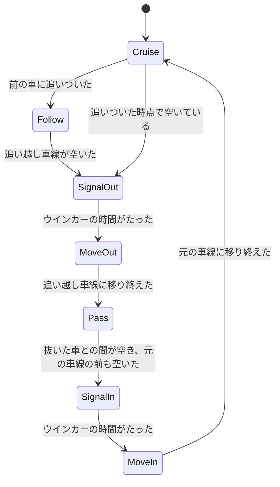
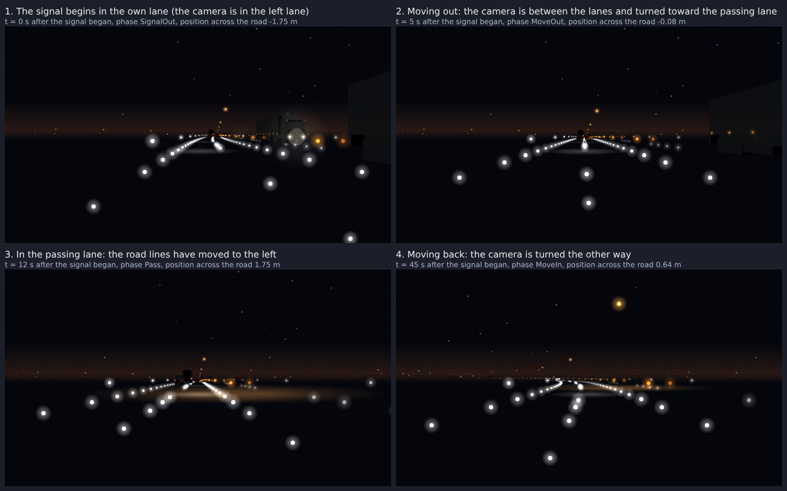
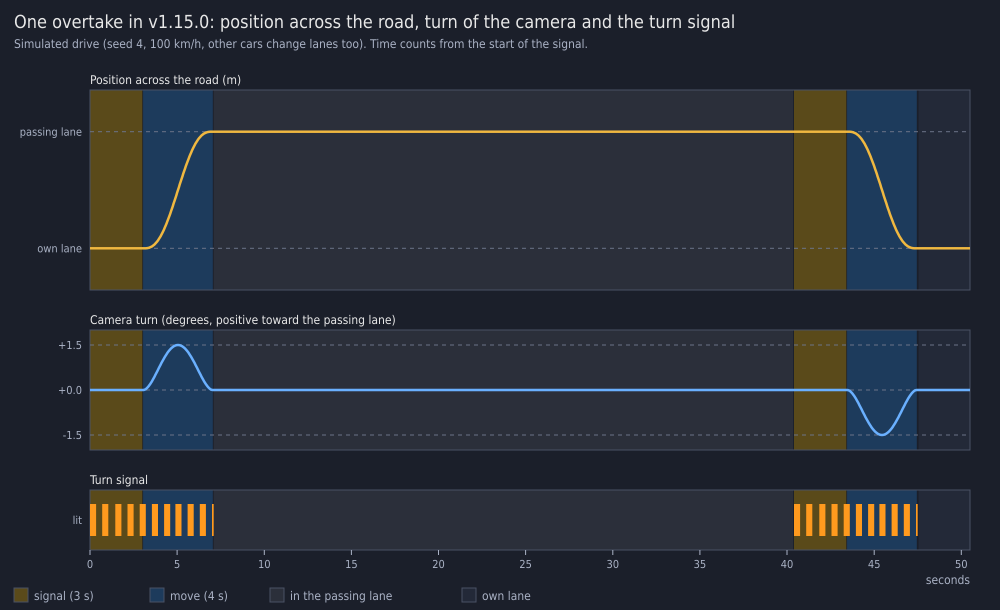
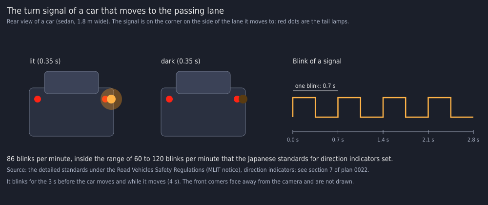

# v1.15.0 詳細設計: 自車の追い越しと他車の車線変更

- ステータス: 実装中
- 日付: 2026-10-27
- 親計画: [実装計画](0001-screensaver-implementation-plan.md)の6章

本書は、v1.15.0の変更を別のセッションや別の実装者が引き継げるように、設計と作業手順をまとめたものである。実装は本書とAGENTS.mdに従う。本書と実装が食い違った場合は、実装を変える前に調整役のセッションに伝える(AGENTS.md「複数セッションでの分担」)。

## 1. 目的と完了条件

2026-10-27に、ユーザーから次の依頼を受けた(v1.14.0と同じ依頼のうち、追い越しの部分。[0021](0021-v1-14-version-info-and-run-controls.md)の1章)。

- 自車が前を走る車に追いついたら、追い越し車線に入り、抜いて、元の車線に戻る

同日にユーザーと決めたこと:

- 自車の追い越しに加え、他車も車線を変える
- 設定画面に「車線変更」を加え、なし・自車だけ・自車と他車の3つから選ぶ。既定は自車と他車。なしは今(v1.14.0)の動き
- 車線を変える車は、ウインカー(方向指示器)を点滅させる
- トンネルの中では、自車も他車も車線を変えない
- 追い越し車線がふさがっていて抜けないときは、自車が減速して前の車の後ろを走り、空いたら追い越す。速度計にも出る
- 自車が車線を変えるとき、視点(カメラの向き)をわずかに進む方向へ振る

完了条件:

- 「車線変更」が「自車だけ」か「自車と他車」のとき、自車が3.2節の手順で追い越し、元の車線に戻る
- 「自車と他車」のとき、他車が3.3節のとおり車線を変える
- 車線を変える車は、変える前と変えているあいだ、ウインカーを点滅させる(3.4節)
- トンネルの中と、トンネルの入口の手前で車線を変え終えられない位置では、車線を変え始めない
- どの車も、同じ車線の前後の車(自車を含む)と重ならず、`LANE_GAP`より近づかない
- 「なし」のとき、描画の命令の列がv1.14.0と変わらない
- 右側通行でも、左右を反転した同じ動きになる
- 文字列は英語と日本語の両方がある(ADR-0007)

## 2. 前提(v1.14.0の状態)

- 自車の位置: 左車線の中央に固定。`projection.rs`の`CAMERA_LATERAL`(-1.75 m)を、`body.rs`(車体の面がカメラを向くか)と`tunnel.rs`(トンネルの壁が視線をさえぎるか)でも使う。右側通行は、投影で左右を反転する
- 他車(`traffic.rs`):
  - 同方向の車は、自車の車線の`Lead`(5台。自車の速さの割合`ratio`で走る)と、追い越し車線の`Passing`(6台。自車より`speed`だけ速い)。対向は14台
  - 車の横の位置`lateral`は、車線の中央の定数(`OWN_LANE`・`PASSING_LANE`・`ONCOMING_LANES`)のどれかで、変わらない
  - 自車が前の車に近づくと、前の車のほうが速くなって逃げる(`rel_velocity`の`FOLLOW_START`〜`FOLLOW_MIN`、`ESCAPE_RATIO`)
  - 車体を描くとき(`shapes.has_bodies()`)だけ、`match_speeds`と`push_apart`で同じ車線の車が重ならないようにする
- 自車の速さ: 選んだ速度(v1.14.0から↑↓で変えられる)に、巡航速度のゆらぎ(`cruise.rs`)を足したもの
- トンネル: `Scene::in_tunnel`・`Scene::tunnel_entrance_ahead`で、中にいるか、入口までの距離が分かる

## 3. 設計

### 3.1 設定

| 項目 | レジストリ値 | 値 | 既定値 |
| --- | --- | --- | --- |
| 車線変更 / Lane changes | `LaneChanges`(`REG_DWORD`) | なしは0、自車だけは1、自車と他車は2 | 2 |

- 値がない・範囲外のときは既定値で動く(ほかの項目と同じ)
- 設定画面にドロップダウンを1つ加える。今のダイアログの大きさで収まらなければ広げてよいが、DPI 150%・1080pで画面からはみ出さないこと(0020の7章)
- 前の版に戻したときは、この値が読まれないだけなので、移行の処理はいらない

### 3.2 自車の追い越し

自車に、走っている車線と、車線のあいだを移る状態を持たせる。

状態の移り変わり:

- Cruise: 自車の車線を、自分の速さ(選んだ速度とゆらぎ)で走る
- Follow: 前の車に追いついたが、追い越し車線がふさがっている、またはトンネルの中か手前である。前の車との間が一定(目安は速さの2秒分、最小20 m)になるように、減速して後ろを走る。減速の速さは、巡航速度のゆらぎの加速度の上限より大きくてよいが、急ブレーキに見えない値にする
- 追いついたことの判定: 前の車が自分の速さより遅く、間が目安の距離(例: 速さの4秒分)より近い
- 追い越し車線が空いていることの判定: 追い越し車線の、自車の前後の一定の範囲(目安は前40 m・後ろ60 m。後ろから速い車が来ているときは、その車が近づくまでの時間も見る)に車がいない
- SignalOut / SignalIn: 車線を変える前に、ウインカーを一定の時間(目安は3秒)点滅させる。自車のウインカーは画面には出ない(ダッシュボードの表示に矢印を出すのは任意。出すなら7章に書く)
- MoveOut / MoveIn: 横の位置を、隣の車線まで滑らかに(目安は4秒。加速度が始めと終わりで0になる曲線)動かす
- Pass: 追い越し車線を走る。前の車を抜くあいだは、自分の速さで走る。追い越し車線の前の車に追いついたら、その後ろを走る
- 元の車線に戻る判定: 抜いた車の前に、目安の距離(例: 30 m)以上の間がある。元の車線の前にも十分な間がある
- 視点の向き: 車線を移るあいだ、カメラの向きを進む方向へわずかに振る(目安は最大1.5度)。横の速さに比例させ、移り始めと移り終わりで0になるようにする。空・山並み・UFOなど遠くのものも同じ向きでずらす
- 速度計: 表示は自車の実際の速さ(Followで減速した速さ)
- トンネル: トンネルの中では、SignalOut・SignalIn・MoveOut・MoveInを始めない。トンネルの入口までの距離が、車線を変え終えるまでに進む距離より短いときも始めない。始めた後にトンネルに入ることはない
- 自車が追い越し車線にいるあいだにトンネルに入りそうなら、元の車線に戻ることを優先する。戻れないまま入ったときは、トンネルを出るまで追い越し車線を走る
- 乱数: 判定に使う乱数があるなら、ほかと同じくシードから決める(`rng.rs`)。同じシード・同じ操作なら同じ動きになる

自車の横の位置:

- `CAMERA_LATERAL`の定数を、場面の状態(自車の横の位置)に置き換える。`Projector`・`body.rs`・`tunnel.rs`などが、定数ではなく今の位置を使う
- 道路の光・トンネル・車体・影・照り返しなど、カメラからの見え方を計算するものは、すべて今の位置で計算する。自車のヘッドライトの照り返しは自車について動く
- 右側通行の反転(v1.14.0の滑らかな反転を含む)は、今の位置のまわりではなく、今までどおりの規則で行い、反転の途中でも破綻しないようにする

### 3.3 他車の車線変更(「自車と他車」のとき)

- 自車の車線の車(`Lead`): 前の車に追いつき、追い越し車線が空いていれば、ウインカーを出してから追い越し車線に移り、抜いた後に戻る。自車が後ろから追い越し車線を近づいているときは出ない
- 追い越し車線の車(`Passing`): 自車や自車の車線の車を抜いた後、元の車線(走行車線)の前が空いていれば、ウインカーを出して戻る。自車の前に戻るときは、自車との間が目安の距離(例: 30 m)以上あるときだけ戻る
- 頻度: 画面の中で、数十秒に1回ほど、どこかの車が車線を変えるくらいを目安にする。値は実装で決め、7章に書く
- 車線を変える車も、変えた先の車線の前後の車(自車を含む)と重ならないように、移る前に確かめる。移っているあいだは、両方の車線の車として扱う
- 対向車は車線を変えない
- トンネルの中と、入口の手前で移り終えられない位置では、移り始めない
- 車体がなし(灯火だけ)のときも、車線変更はする。重ならないための処理(`match_speeds`・`push_apart`)を、車線変更があるときは車体の有無にかかわらず使う。灯火だけのとき、「なし」の動きと命令の列は変わってよい

### 3.4 ウインカー

- 他車の後ろの角(尾灯の外側)と前の角に、橙の灯を点滅させる。周期は約0.7秒(毎分85回前後)。日本の法令が定める点滅の回数の範囲を一次情報で確かめ、その範囲に収め、根拠を7章に書く
- 車線を変える前の数秒(自車と同じく目安は3秒)と、移っているあいだ点滅させる
- 色は今のトラックの橙(`MARKER_AMBER`)を基にしてよい。明るさは尾灯と同じくらい
- 車体が見えるときは、車体の面に隠れる・隠れないを、今の灯と同じ規則で決める

### 3.5 「なし」のときの動き

- 「なし」のとき、自車の位置・他車の動き・描画の命令の列は、v1.14.0と変わらない。`scene.rs`の描画命令のハッシュのテストが、変えずに通ること
- 「自車だけ」のとき、他車は車線を変えないが、前の車が逃げる動き(`FOLLOW_START`・`ESCAPE_RATIO`)はやめ、自車が追い越すか後ろにつく。`Lead`の速さは、自車の実際の速さではなく、自車の目標の速さ(選んだ速度とゆらぎ)に対する割合で決める(自車が減速すると前の車も遅くなって、追いつけなくなるのを防ぐ)

## 4. テスト

`freeway-core`:

- 設定: `LaneChanges`の読み書き、範囲外・ないときの既定値
- 「なし」で、描画の命令の列のハッシュがv1.14.0と同じ
- 自車の追い越し: 遅い前の車に追いつくと追い越し車線に移り、抜いて、元の車線に戻る。追い越し車線がふさがっているときは、前の車との間を保って後ろを走り、空いてから移る
- 重ならないこと: 長い時間(数十分)走らせ、どの時点でも、同じ車線の車(自車を含む。移っている車は両方の車線)が`LANE_GAP`より近づかない。「自車だけ」と「自車と他車」、車体の形のすべて、トラックの種類、交通量の多い時刻で確かめる
- トンネル: トンネルの中で車線を変え始めない。入口の手前で移り終えられないときに始めない
- 視点の向き: 移っていないときは0、最大の値を超えない、移り始めと移り終わりで0
- ウインカー: 車線を変える前と移っているあいだだけ点滅し、周期が決めた値
- 右側通行: 左側通行と左右が反転した同じ動き
- 決定性: 同じシードと同じ時間の刻みで、同じ動きになる
- 文字列の表のテストが、追加したキーでも通る

`freeway-scr`:

- 設定画面と保存(Windowsのみ): 新しいドロップダウンの値が保存され、読み戻せる

見た目は、ユーザーの実機確認で見る。

## 5. 実機での確認(調整役がユーザーに依頼する項目)

- 自車の追い越しが自然に見えるか(追いつく・ウインカーの間・移る速さ・視点の振れ・抜いて戻る)。酔うような動きになっていないか
- 抜けないときに減速して後ろにつき、空いたら抜くか。速度計の表示
- 他車の車線変更の頻度と、ウインカーの見え方
- トンネルの中で車線を変えないか
- 車体の形(なし・シンプルな箱・ブロック・詳細な形)と、影・トンネルの見え方が、自車が追い越し車線にいるときも崩れないか
- 「なし」で、v1.14.0と同じ動きか
- 右側通行、`/window`・`/play`のD(通行方向の切り替え)を、追い越しの途中で押したとき
- 設定画面の新しい欄(日本語と英語、DPI 150%など)

## 6. 作業手順

実装用セッション:

1. ワークスペースのバージョンを`1.15.0`に上げる(このPRの最初のコミットで実施済み)
2. 設定(3.1節): `settings.rs`・レジストリ・設定画面・文字列
3. 自車の横の位置(3.2節の後半): `CAMERA_LATERAL`を場面の状態に置き換える。この段階では位置を変えず、描画の命令のハッシュが変わらないことを確かめる
4. 自車の追い越し(3.2節)と、「自車だけ」の前の車の動き(3.5節)
5. 視点の向き(3.2節)
6. 他車の車線変更(3.3節)とウインカー(3.4節)
7. 説明用の図(追い越しの様子を数コマ並べたもの、ウインカーなど)を`docs/images/`に置く
8. `docs/developers.md`(設定の保存先の表)・利用者向けの説明書(`packaging/README.md`。設定の表)・実装計画の進捗表と5.4節の設定項目を更新する。本書の7章に、実装で決めた値と図を書く
9. AGENTS.mdの検証コマンドをすべて実行する(Windowsターゲットのclippy、`ufo-demo`付きのclippyも含む)
10. 1コミット1論理変更でコミットし、プッシュする
11. 敵対的セルフレビューを行い、指摘と対応をPRコメントに記録する
12. CIの成功を確認したら、PR本文のチェックリストをCIのグリーン化まで更新し、PRの監視を外して調整役のセッションに完了を報告する

調整役:

13. ユーザーの実機確認とマージの承認を得て、チェックリストを更新してからマージする。図のリンクを`main`に直す。`v1.15.0`のタグはユーザーが手元からプッシュする
## 7. 実装で決めた値

実装用セッションが記入した。本書の1〜6章からの違いは7.3節にまとめた。

### 7.1 実装の構成

| ファイル | 内容 |
| --- | --- |
| `projection.rs` | `Projector`が、カメラの横の位置(`with_camera`)と視点の向き(yaw)を持つ。yawが0のときは、従来の式のまま計算する(描画の命令が1ビットも変わらない) |
| `ego.rs` | 自車の状態機械(`Phase`: Cruise・Follow・SignalOut・MoveOut・Pass・SignalIn・MoveIn)、速さの制御、横の位置と視点の向き |
| `traffic.rs` | 車線を移る車の状態(`Change`)、車線をまたぐ速度合わせ(`match_speeds_among_lanes`)と押し離し(`push_apart_among_lanes`)、近くの車の走査(`LaneScan`・`Traffic::scan`)、他車の車線変更の判断(`think_of_changes`)、ウインカー(`push_turn_signal`) |
| `scene.rs` | 自車の横の位置・yawを場面の状態にし、トンネルの区間・自車の車線を交通へ渡す。空の向きにyawを足す |
| `tunnel.rs`・`settings.rs`・`i18n.rs`・`freeway-scr`の設定画面とレジストリ | 視線の位置を引数にする。設定「車線変更」を加える |

作業は、自車の横の位置を場面の状態にする段階(描画の命令のハッシュが変わらないことを確かめて、別のコミットにした)、設定、追い越しと車線変更の順に進めた。

### 7.2 決めた値

自車と他車の共通(`traffic.rs`):

| 項目 | 値 |
| --- | --- |
| ウインカーを出す時間 | 3秒(`SIGNAL_SECONDS`) |
| 車線を移る時間 | 4秒(`MOVE_SECONDS`)。横の位置は`10t^3 - 15t^4 + 6t^5`の曲線で、始めと終わりの速さと加速度が0。横の速さの最大は、レーンの幅(3.5 m)の平均の速さの1.875倍(1.64 m/s) |
| ウインカーの周期 | 0.7秒(`BLINK_SECONDS`。点灯0.35秒・消灯0.35秒、点灯から始める)。毎分約86回 |
| 自車の長さ | 4.5 m(`EGO_LENGTH`。カメラは前端) |
| 移る先が空いているかの判定 | 前の車: 追い越しに出るときは、`(3 + 4 + 15)`秒のあいだに近づく分を引いた間が40 m以上。戻るときは、7秒に近づく分を引いた間が30 m以上。後ろの車: 間から7秒に近づく分を引いた値が、25 m(戻るときは抜いた車に30 m)と、近づく速さの2乗を6で割った値の和以上。移る直前にもう一度、間が20 m以上・4秒の先読みで確かめ、だめなら取りやめる(自車は5秒、他車は8秒、次を考えない) |
| 追い越しの時間の見積もり | 15秒(`PASS_SECONDS`) |
| 前の車が邪魔になる遅さ | 他車は1 m/s以上、自車は2 m/s以上遅い(自車は、差が小さいと追い越しに数分かかるので、追い越さずに後ろを走る) |
| トンネル | 移り始める位置から、`速さ x 7秒 x 1.3 + 50 m`の範囲に、トンネルの一部がかかるときは始めない。トンネルの情報は700 m先まで(`TUNNEL_HORIZON`)なので、そこを越える範囲では始めない |

自車(`ego.rs`):

| 項目 | 値 |
| --- | --- |
| 追いついたと見る距離 | 前の車との間が、速さの4秒分(最小40 m)より近く、前の車が2 m/s以上遅いとき。速さの6秒分より遠くなるか、前の車が速くなると、離す |
| 後ろを走る間 | 速さの2秒分(最小20 m)。速さは、前の車の速さ + 0.2 x (間 - 目標の間) |
| 前の車への安全な速さ | 前の車の速さ + `sqrt(2 x 2.5 x (間 - 11 m))`(2.5 m/s²で減速すれば、間が11 m(`LANE_GAP`+1 m)のときに前の車と同じ速さになる)。どの場面でも守る |
| 速さの変化の上限 | 減速は3 m/s²、加速は1.5 m/s²(速度キーで目標の速さが変わっているときは、その変化の速さを足す) |
| 追い越し車線に出てから戻れるまで | 3秒以上 |
| 戻る判定 | 抜いた車が30 m以上後ろ。元の車線の前の車は、7秒に近づく分を引いて30 m以上。元の車線の先に、速さの3秒分(最小40 m)より近い遅い車がいるあいだは戻らない(後ろ60 m以内に足止めされている車があるときは戻る) |
| トンネルの近く | トンネルが速さの30秒分 + 100 m以内にあるときは、戻る判定で抜いた車からの間を20 mに緩める。戻り始めても入口までに移り終えられないときは、トンネルを出るまで追い越し車線を走る |
| 視点の向き | 最大1.5度(`MAX_YAW`)。横の速さに比例し、移り始めと終わりで0。移るあいだだけ振れ、進む向きに向く。空・山並み・UFOの方向には、道路の曲がりの向き(heading)にyawを足して使う。UFOの遅れ(`lag`)は、本来のheadingだけで計算する |

他車(`traffic.rs`):

| 項目 | 値 |
| --- | --- |
| 車線を変える車の割合 | 車ごとに、置くたびに決め、8割(`CHANGER_SHARE`) |
| 考え始めるまで | 置いてから2〜20秒、車線を変えてから10〜30秒 |
| 車線を変える頻度 | 25台を30分走らせて、31〜63回(平均49回。8つのシード)。全体で約37秒に1回で、うち見えている車(カメラの前の600 m以内)は6割ほど |
| 判断を始める条件 | 走行車線の車は、速さの4秒分(最小40 m)より近くに、1 m/s以上遅い車がいるとき。追い越し車線の車は、元の車線に抜いた車が後ろにいて、元の車線の先に速さの4秒分より近い遅い車がいないとき |
| 「自車だけ」のとき | 他車は車線を変えない。走行車線の車は、自車の目標の速さ x 自分の比率で走る。追い越し車線の車は、目標の速さ + 自分の上乗せで走る(自車が減速しても、他車の速さは落ちない) |
| 前の車が逃げる動き(`FOLLOW_START`・`ESCAPE_RATIO`) | 「自車だけ」と「自車と他車」の両方でやめた(自車が自分で間を空けるので、逃げる必要がない) |
| 重ならないための処理 | 「自車だけ」と「自車と他車」では、車体がなしでも使う。走らない車(`active`でない車)は、速度合わせにも押し離しにも加えない |

### 7.3 設計との違い

- 追い越し車線が空いているかの判定: 3.2節の「前40 m・後ろ60 mの範囲」は、固定の範囲ではなく、近づく速さを見る式にした(7.2節)。後ろから速い車が来ているときに、その車が近づくまでの時間も見る、という3.2節の意図を式にしたもの
- 前の角のウインカー: 描かない。同じ向きに走る車の前の角は、カメラから見ると車体の向こう側にあり、車体がなしのときに灯だけが車体の奥から見えてしまうため。後ろの角には、尾灯の外側(車体の幅 - 0.05 m)に橙の灯を点滅させる
- 自車のウインカーのダッシュボードの表示: 出していない(任意の項目)
- 追い越しに出た後の戻る判定: 3.2節の判定に、「元の車線の先にまだ追いつく遅い車がいるあいだは戻らない」を加えた。これがないと、抜く前に戻って、また出ることを繰り返した。ただし、追い越し車線の後ろに足止めされた車がいるときは戻る
- 追い越すかどうか: 前の車との速さの差が2 m/s未満のときは、追い越さず、後ろを走る(設計にない)
- 「自車だけ」の前の車の動き(3.5節): 「自車と他車」でも同じにした
- 他車の車線変更の判断: 3.3節のLeadとPassingで分けず、どの車も同じ規則にした(走行車線の車は遅い車に追いついたら追い越し車線へ、追い越し車線の車は抜いたら走行車線へ)
- 重ならないことの確かめ方: 見えている車(カメラの前の車と、カメラの後ろでも自車と同じ車線の車)の組だけを数える。車を置き直した直後の1ステップだけ、カメラの後ろの見えない場所で、置き直した車が別の車に重なることがあり、次のステップで押し離される。従来(v1.14.0)の車体ありの動きにも同じことがあり、見えない
- 設定画面: ラベルの幅を48から56、ドロップダウンの左端を62から70、幅を150から142にし(英語の「Lane changes:」が入るように)、行を1つ加えて、ダイアログの高さを18単位広げた(288から306)

### 7.4 確かめたこと

`cargo test --workspace`(新しいテストを含む)と、次の長い実行で確かめた。

- どの組み合わせでも、同じ車線の車が`LANE_GAP`(10 m)より近づかない: 「自車だけ」「自車と他車」、車体の4つの形、トラックの3つの設定、夜中・朝・夕方の交通量で、6分ずつ(テスト)。さらに、60のシード x 2つの設定 x 3つの構成を1時間ずつ走らせ(速度キーの操作も混ぜた)、最小の間は9.99997 m(浮動小数点の丸めで、`LANE_GAP`と同じ)だった。1時間の長い実行は`#[ignore]`のテスト`cars_keep_clear_for_an_hour`にした
- トンネルの中と入口の手前では、自車も他車も車線を変え始めず、変えている車がトンネルの中にいない(上の長い実行と、20分のテスト)
- 「なし」のとき、描画の命令の列のハッシュがv1.14.0と同じ(`scene.rs`のテストを変えずに通る)。自車の横の位置を場面の状態にする段階でも、通ることを確かめてからコミットした
- 自車: 追い越して戻る一連の動き、前の車が遅いときの減速と後ろの走行、追い越し車線が空いたら追い越すこと、速さの差が小さい車を追い越さないこと、トンネルの中・手前・近くの扱い、視点の向きが移るあいだだけで最大1.5度になり滑らかなこと、横の位置の速さと躍度の上限
- 他車: 遅い車に追いついた車が、ウインカー・移る・抜く・戻るを順に行い、誰にも近づかないこと。ウインカーは車線を変えるあいだだけ点滅し、移る側の角にあり、周期が0.7秒であること。自車が使っている車線に移らないこと。「なし」と「自車だけ」で他車が車線を変えないこと
- 同じシードで同じ動きになること。右側通行は、左側通行と同じ動き(自車・他車の横の位置と状態が同じ)を鏡に映したものであること。車線を移るあいだに通行方向を切り替えても、描画が崩れない(数値が有限)こと
- 空とカメラの向きが、両方の通行方向で同じだけずれること

### 7.5 ウインカーの点滅の回数の根拠

周期は0.7秒(毎分約86回)にした。日本の法令の範囲は、国土交通省の「道路運送車両の保安基準の細目を定める告示」の方向指示器の条文(第41条第2項の告示)にある。

- 確認できたこと: 告示の第215条(方向指示器)と第137条(旧版)に、点滅式の方向指示器は「毎分60回以上120回以下の一定の周期で点滅するものであること」とある。ほかに、毎分50回以上120回以下(点滅式で、光度が増減するものを含む条文)と、平成17年12月31日以前に製作された一般原動機付自転車の毎分60回以上120回以下がある。毎分約86回は、どれの範囲にも入る
- 確認の方法と限界: 一次情報の国土交通省のPDF(`https://www.mlit.go.jp/jidosha/kijyun/saimokukokuji/saikoku_215_00.pdf`、`saikoku_137_00.pdf`)は、この実行環境のネットワークの方針で開けなかった(`www.mlit.go.jp`への接続が拒否される)。検索の結果の要約で、条文の番号と数値を確かめた。原文での確認は、調整役かユーザーに依頼する。国連の規則(UN R6)も同じ範囲(毎分90 +/- 30回)のはずだが、これは記憶による推測で、確認していない

### 7.6 説明用の図

実際の車線変更の描画(本書のシミュレーションで描いた画面を、描画命令からSVGにして、Chromiumで画像にしたもの。Direct2Dの描画とは、光のぼかしなどが少し違う。画面のキャプチャではない)。

1回の追い越しのあいだの、自車の横の位置・視点の向き・ウインカー(シードを4にして走らせた数値から描いた)。

ウインカーの点滅(車を後ろから見た図)。

### 7.7 実機で見てほしい点と調整のつまみ

5章の項目に加えて、次を見てほしい。気になる点があれば、次の定数で調整できる(`traffic.rs`と`ego.rs`の先頭)。

- 追い越し車線にいる時間が長い(30分のうち3〜5割): 前の車との速さの差が小さい(自車の速さの5〜15%)ためで、`MIN_PASS_CLOSING`・`PLATOON_SECONDS`・`RETURN_GAP`で変わる
- 後ろを走る時間が長い(1回に20〜40秒): 追い越し車線に速い車が続くため。`BEHIND_CLEAR`・`PASS_SECONDS`で変わる
- 他車の車線変更の頻度: `CHANGER_SHARE`・`FIRST_WAIT`・`NEXT_WAIT`
- 視点の振れ: `MAX_YAW`。移る時間と信号の時間: `MOVE_SECONDS`・`SIGNAL_SECONDS`
