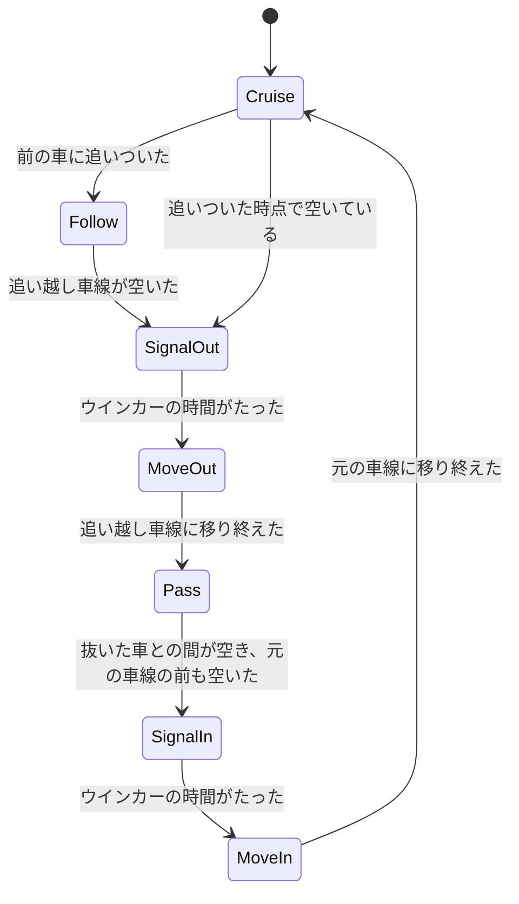

# v1.15.0 詳細設計: 自車の追い越しと他車の車線変更

- ステータス: 実装中
- 日付: 2026-10-27
- 親計画: [実装計画](0001-screensaver-implementation-plan.md)の6章

本書は、v1.15.0の変更を別のセッションや別の実装者が引き継げるように、設計と作業手順をまとめたものである。実装は本書とAGENTS.mdに従う。本書と実装が食い違った場合は、実装を変える前に調整役のセッションに伝える(AGENTS.md「複数セッションでの分担」)。

## 1. 目的と完了条件

2026-10-27に、ユーザーから次の依頼を受けた(v1.14.0と同じ依頼のうち、追い越しの部分。[0021](0021-v1-14-version-info-and-run-controls.md)の1章)。

- 自車が前を走る車に追いついたら、追い越し車線に入り、抜いて、元の車線に戻る

同日にユーザーと決めたこと:

- 自車の追い越しに加え、他車も車線を変える
- 設定画面に「車線変更」を加え、なし・自車だけ・自車と他車の3つから選ぶ。既定は自車と他車。なしは今(v1.14.0)の動き
- 車線を変える車は、ウインカー(方向指示器)を点滅させる
- トンネルの中では、自車も他車も車線を変えない
- 追い越し車線がふさがっていて抜けないときは、自車が減速して前の車の後ろを走り、空いたら追い越す。速度計にも出る
- 自車が車線を変えるとき、視点(カメラの向き)をわずかに進む方向へ振る

完了条件:

- 「車線変更」が「自車だけ」か「自車と他車」のとき、自車が3.2節の手順で追い越し、元の車線に戻る
- 「自車と他車」のとき、他車が3.3節のとおり車線を変える
- 車線を変える車は、変える前と変えているあいだ、ウインカーを点滅させる(3.4節)
- トンネルの中と、トンネルの入口の手前で車線を変え終えられない位置では、車線を変え始めない
- どの車も、同じ車線の前後の車(自車を含む)と重ならず、`LANE_GAP`より近づかない
- 「なし」のとき、描画の命令の列がv1.14.0と変わらない
- 右側通行でも、左右を反転した同じ動きになる
- 文字列は英語と日本語の両方がある(ADR-0007)

## 2. 前提(v1.14.0の状態)

- 自車の位置: 左車線の中央に固定。`projection.rs`の`CAMERA_LATERAL`(-1.75 m)を、`body.rs`(車体の面がカメラを向くか)と`tunnel.rs`(トンネルの壁が視線をさえぎるか)でも使う。右側通行は、投影で左右を反転する
- 他車(`traffic.rs`):
  - 同方向の車は、自車の車線の`Lead`(5台。自車の速さの割合`ratio`で走る)と、追い越し車線の`Passing`(6台。自車より`speed`だけ速い)。対向は14台
  - 車の横の位置`lateral`は、車線の中央の定数(`OWN_LANE`・`PASSING_LANE`・`ONCOMING_LANES`)のどれかで、変わらない
  - 自車が前の車に近づくと、前の車のほうが速くなって逃げる(`rel_velocity`の`FOLLOW_START`〜`FOLLOW_MIN`、`ESCAPE_RATIO`)
  - 車体を描くとき(`shapes.has_bodies()`)だけ、`match_speeds`と`push_apart`で同じ車線の車が重ならないようにする
- 自車の速さ: 選んだ速度(v1.14.0から↑↓で変えられる)に、巡航速度のゆらぎ(`cruise.rs`)を足したもの
- トンネル: `Scene::in_tunnel`・`Scene::tunnel_entrance_ahead`で、中にいるか、入口までの距離が分かる

## 3. 設計

### 3.1 設定

| 項目 | レジストリ値 | 値 | 既定値 |
| --- | --- | --- | --- |
| 車線変更 / Lane changes | `LaneChanges`(`REG_DWORD`) | なしは0、自車だけは1、自車と他車は2 | 2 |

- 値がない・範囲外のときは既定値で動く(ほかの項目と同じ)
- 設定画面にドロップダウンを1つ加える。今のダイアログの大きさで収まらなければ広げてよいが、DPI 150%・1080pで画面からはみ出さないこと(0020の7章)
- 前の版に戻したときは、この値が読まれないだけなので、移行の処理はいらない

### 3.2 自車の追い越し

自車に、走っている車線と、車線のあいだを移る状態を持たせる。

状態の移り変わり:

- Cruise: 自車の車線を、自分の速さ(選んだ速度とゆらぎ)で走る
- Follow: 前の車に追いついたが、追い越し車線がふさがっている、またはトンネルの中か手前である。前の車との間が一定(目安は速さの2秒分、最小20 m)になるように、減速して後ろを走る。減速の速さは、巡航速度のゆらぎの加速度の上限より大きくてよいが、急ブレーキに見えない値にする
- 追いついたことの判定: 前の車が自分の速さより遅く、間が目安の距離(例: 速さの4秒分)より近い
- 追い越し車線が空いていることの判定: 追い越し車線の、自車の前後の一定の範囲(目安は前40 m・後ろ60 m。後ろから速い車が来ているときは、その車が近づくまでの時間も見る)に車がいない
- SignalOut / SignalIn: 車線を変える前に、ウインカーを一定の時間(目安は3秒)点滅させる。自車のウインカーは画面には出ない(ダッシュボードの表示に矢印を出すのは任意。出すなら7章に書く)
- MoveOut / MoveIn: 横の位置を、隣の車線まで滑らかに(目安は4秒。加速度が始めと終わりで0になる曲線)動かす
- Pass: 追い越し車線を走る。前の車を抜くあいだは、自分の速さで走る。追い越し車線の前の車に追いついたら、その後ろを走る
- 元の車線に戻る判定: 抜いた車の前に、目安の距離(例: 30 m)以上の間がある。元の車線の前にも十分な間がある
- 視点の向き: 車線を移るあいだ、カメラの向きを進む方向へわずかに振る(目安は最大1.5度)。横の速さに比例させ、移り始めと移り終わりで0になるようにする。空・山並み・UFOなど遠くのものも同じ向きでずらす
- 速度計: 表示は自車の実際の速さ(Followで減速した速さ)
- トンネル: トンネルの中では、SignalOut・SignalIn・MoveOut・MoveInを始めない。トンネルの入口までの距離が、車線を変え終えるまでに進む距離より短いときも始めない。始めた後にトンネルに入ることはない
- 自車が追い越し車線にいるあいだにトンネルに入りそうなら、元の車線に戻ることを優先する。戻れないまま入ったときは、トンネルを出るまで追い越し車線を走る
- 乱数: 判定に使う乱数があるなら、ほかと同じくシードから決める(`rng.rs`)。同じシード・同じ操作なら同じ動きになる

自車の横の位置:

- `CAMERA_LATERAL`の定数を、場面の状態(自車の横の位置)に置き換える。`Projector`・`body.rs`・`tunnel.rs`などが、定数ではなく今の位置を使う
- 道路の光・トンネル・車体・影・照り返しなど、カメラからの見え方を計算するものは、すべて今の位置で計算する。自車のヘッドライトの照り返しは自車について動く
- 右側通行の反転(v1.14.0の滑らかな反転を含む)は、今の位置のまわりではなく、今までどおりの規則で行い、反転の途中でも破綻しないようにする

### 3.3 他車の車線変更(「自車と他車」のとき)

- 自車の車線の車(`Lead`): 前の車に追いつき、追い越し車線が空いていれば、ウインカーを出してから追い越し車線に移り、抜いた後に戻る。自車が後ろから追い越し車線を近づいているときは出ない
- 追い越し車線の車(`Passing`): 自車や自車の車線の車を抜いた後、元の車線(走行車線)の前が空いていれば、ウインカーを出して戻る。自車の前に戻るときは、自車との間が目安の距離(例: 30 m)以上あるときだけ戻る
- 頻度: 画面の中で、数十秒に1回ほど、どこかの車が車線を変えるくらいを目安にする。値は実装で決め、7章に書く
- 車線を変える車も、変えた先の車線の前後の車(自車を含む)と重ならないように、移る前に確かめる。移っているあいだは、両方の車線の車として扱う
- 対向車は車線を変えない
- トンネルの中と、入口の手前で移り終えられない位置では、移り始めない
- 車体がなし(灯火だけ)のときも、車線変更はする。重ならないための処理(`match_speeds`・`push_apart`)を、車線変更があるときは車体の有無にかかわらず使う。灯火だけのとき、「なし」の動きと命令の列は変わってよい

### 3.4 ウインカー

- 他車の後ろの角(尾灯の外側)と前の角に、橙の灯を点滅させる。周期は約0.7秒(毎分85回前後)。日本の法令が定める点滅の回数の範囲を一次情報で確かめ、その範囲に収め、根拠を7章に書く
- 車線を変える前の数秒(自車と同じく目安は3秒)と、移っているあいだ点滅させる
- 色は今のトラックの橙(`MARKER_AMBER`)を基にしてよい。明るさは尾灯と同じくらい
- 車体が見えるときは、車体の面に隠れる・隠れないを、今の灯と同じ規則で決める

### 3.5 「なし」のときの動き

- 「なし」のとき、自車の位置・他車の動き・描画の命令の列は、v1.14.0と変わらない。`scene.rs`の描画命令のハッシュのテストが、変えずに通ること
- 「自車だけ」のとき、他車は車線を変えないが、前の車が逃げる動き(`FOLLOW_START`・`ESCAPE_RATIO`)はやめ、自車が追い越すか後ろにつく。`Lead`の速さは、自車の実際の速さではなく、自車の目標の速さ(選んだ速度とゆらぎ)に対する割合で決める(自車が減速すると前の車も遅くなって、追いつけなくなるのを防ぐ)

## 4. テスト

`freeway-core`:

- 設定: `LaneChanges`の読み書き、範囲外・ないときの既定値
- 「なし」で、描画の命令の列のハッシュがv1.14.0と同じ
- 自車の追い越し: 遅い前の車に追いつくと追い越し車線に移り、抜いて、元の車線に戻る。追い越し車線がふさがっているときは、前の車との間を保って後ろを走り、空いてから移る
- 重ならないこと: 長い時間(数十分)走らせ、どの時点でも、同じ車線の車(自車を含む。移っている車は両方の車線)が`LANE_GAP`より近づかない。「自車だけ」と「自車と他車」、車体の形のすべて、トラックの種類、交通量の多い時刻で確かめる
- トンネル: トンネルの中で車線を変え始めない。入口の手前で移り終えられないときに始めない
- 視点の向き: 移っていないときは0、最大の値を超えない、移り始めと移り終わりで0
- ウインカー: 車線を変える前と移っているあいだだけ点滅し、周期が決めた値
- 右側通行: 左側通行と左右が反転した同じ動き
- 決定性: 同じシードと同じ時間の刻みで、同じ動きになる
- 文字列の表のテストが、追加したキーでも通る

`freeway-scr`:

- 設定画面と保存(Windowsのみ): 新しいドロップダウンの値が保存され、読み戻せる

見た目は、ユーザーの実機確認で見る。

## 5. 実機での確認(調整役がユーザーに依頼する項目)

- 自車の追い越しが自然に見えるか(追いつく・ウインカーの間・移る速さ・視点の振れ・抜いて戻る)。酔うような動きになっていないか
- 抜けないときに減速して後ろにつき、空いたら抜くか。速度計の表示
- 他車の車線変更の頻度と、ウインカーの見え方
- トンネルの中で車線を変えないか
- 車体の形(なし・シンプルな箱・ブロック・詳細な形)と、影・トンネルの見え方が、自車が追い越し車線にいるときも崩れないか
- 「なし」で、v1.14.0と同じ動きか
- 右側通行、`/window`・`/play`のD(通行方向の切り替え)を、追い越しの途中で押したとき
- 設定画面の新しい欄(日本語と英語、DPI 150%など)

## 6. 作業手順

実装用セッション:

1. ワークスペースのバージョンを`1.15.0`に上げる(このPRの最初のコミットで実施済み)
2. 設定(3.1節): `settings.rs`・レジストリ・設定画面・文字列
3. 自車の横の位置(3.2節の後半): `CAMERA_LATERAL`を場面の状態に置き換える。この段階では位置を変えず、描画の命令のハッシュが変わらないことを確かめる
4. 自車の追い越し(3.2節)と、「自車だけ」の前の車の動き(3.5節)
5. 視点の向き(3.2節)
6. 他車の車線変更(3.3節)とウインカー(3.4節)
7. 説明用の図(追い越しの様子を数コマ並べたもの、ウインカーなど)を`docs/images/`に置く
8. `docs/developers.md`(設定の保存先の表)・利用者向けの説明書(`packaging/README.md`。設定の表)・実装計画の進捗表と5.4節の設定項目を更新する。本書の7章に、実装で決めた値と図を書く
9. AGENTS.mdの検証コマンドをすべて実行する(Windowsターゲットのclippy、`ufo-demo`付きのclippyも含む)
10. 1コミット1論理変更でコミットし、プッシュする
11. 敵対的セルフレビューを行い、指摘と対応をPRコメントに記録する
12. CIの成功を確認したら、PR本文のチェックリストをCIのグリーン化まで更新し、PRの監視を外して調整役のセッションに完了を報告する

調整役:

13. ユーザーの実機確認とマージの承認を得て、チェックリストを更新してからマージする。図のリンクを`main`に直す。`v1.15.0`のタグはユーザーが手元からプッシュする

## 7. 実装で決めた値

(実装用セッションが記入する)
