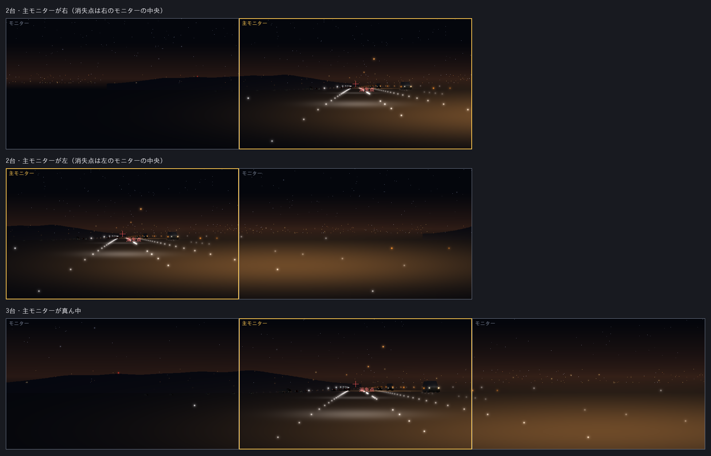

# v1.16.0 詳細設計: 複数のモニターを1つの画面として描く

- ステータス: 実装済み(実機確認待ち)
- 日付: 2026-10-27
- 親計画: [実装計画](0001-screensaver-implementation-plan.md)の6章

本書は、v1.16.0の変更を別のセッションや別の実装者が引き継げるように、設計と作業手順をまとめたものである。実装は本書とAGENTS.mdに従う。本書と実装が食い違った場合は、実装を変える前に調整役のセッションに伝える(AGENTS.md「複数セッションでの分担」)。

## 1. 目的と完了条件

2026-10-27に、ユーザーから次の依頼を受けた。

- 複数のモニターを1つの画面とみなすオプションがほしい。コマンドラインと設定画面の両方から選べるようにする

同日にユーザーと決めたこと:

- 景色は、すべてのモニターを1枚の大きな画面とみなして描く(1つの画面の絵を、全体に合わせて拡大したように見える)
- 消失点(道路の先)は、主モニター(Windowsの「メインディスプレイ」)の中央に置く
- 対象は、スクリーンセーバー(`/s`)と全画面で流す(`/play`)。設定画面の選択はこの両方に効き、コマンドラインの引数はその回だけ設定を上書きする
- 速度計と操作の案内は、主モニターにだけ、今の1画面と同じ位置と大きさで出す

完了条件:

- 設定画面の「複数のモニターを1つの画面として描く」をオンにすると、`/s`と`/play`で、すべてのモニターに1つの場面がつながって描かれる(3.2節)
- コマンドラインの`/span`・`/nospan`で、その回だけ設定を上書きできる(3.3節)
- オフのとき(既定)と、モニターが1台のときは、v1.15.0と同じ動き
- プレビュー(`/p`)と`/window`は変わらない
- 文字列は英語と日本語の両方がある(ADR-0007)

## 2. 前提(v1.15.0の状態)

- 複数のモニター([ADR-0003](../adr/0003-render-independent-scene-per-monitor.md)): `/s`と`/play`は、モニターごとに全画面の窓を作り、モニターごとに独立した場面(独立したシード・他車)を描く
- 投影(`projection.rs`の`Projector::new`): 焦点距離は`max(幅×0.5, 高さ×0.55)`、消失点は描く領域の中央
- 速度計(`speedometer.rs`・`win/dashboard.rs`)と操作の案内(`win/hint.rs`)は、窓ごとに描く
- `/play`のFキー([0021](0021-v1-14-version-info-and-run-controls.md)): 全画面からウィンドウにするときは、Fを受けた窓だけを残してほかを閉じる。ウィンドウから全画面に戻すときは、そのモニターだけの全画面になる

## 3. 設計

### 3.1 設定

| 項目 | レジストリ値 | 値 | 既定値 |
| --- | --- | --- | --- |
| 複数のモニターを1つの画面として描く / Span all monitors as one screen | `SpanMonitors`(`REG_DWORD`) | オンは1、オフは0 | 0 |

- 値がない・型が違う・範囲外のときは既定値(ほかの項目と同じ)
- 設定画面にチェックボックスを1つ加える。DPI 150%・1080pで画面からはみ出さないこと(0020の7章)
- 説明書には、モニターが1台のときは効かないことを書く

### 3.2 描き方

ADR-0003の「モニターごとに独立した場面」を、この設定がオンのときに限って変える。ADR-0003は書き換えず、新しいADR(0008)を起こす(`docs/adr/README.md`の運用ルール)。

- 場面は1つにする。窓はモニターごとに作り、それぞれの窓が、同じ場面のうち自分のモニターに当たる部分を描く(窓1つで仮想画面全体を覆う方法より、DPI・リフレッシュレート・モニターの間のすき間に強い)。ただし、実装で別の方法の方がよいと分かれば、理由をADRと7章に書いて選んでよい
- 投影: すべてのモニターを囲む長方形(仮想画面)を1つの画面とみなし、焦点距離をその大きさから今と同じ式で決める。消失点は、主モニターの中央に置く。各窓は、自分のモニターの位置だけずらして描く
- 主モニターが囲む長方形の端にあるときは、消失点から見て反対側の絵が広く、同じ側の絵は画面の外になる。これは決めたとおりの見え方である
- 場面の時間は1つにし、すべての窓が同じフレームの状態を描く。場面の更新(`Scene::update`)は1フレームに1回だけ行う
- モニターのDPIや大きさが違っても、絵が仮想画面の座標でつながるようにする(物理的な画素の座標で計算する)
- モニターの並びが長方形でない(L字など)とき、モニターのない部分は描かない
- 速度計と操作の案内は、主モニターの窓にだけ、今の1画面と同じ位置と大きさで出す
- 描く量: 1つの場面をモニターの数だけ描くことになる。見えない部分の描画を省けるなら省く。モニターが2〜3台で、1台のときと同じくらい滑らかに動くか、を実機の確認に入れる
- `/s`の終わり方(入力で終わる)と、`/play`の操作(0021の3.2節)は変えない。操作は1つの場面に効く
- `/play`のF: 全画面からウィンドウにするときは、今と同じくFを受けた窓だけを残す(場面はそのウィンドウの大きさの1画面として描く)。ウィンドウから全画面に戻すときは、設定(またはその回の引数)がオンなら、すべてのモニターの全画面に戻す
- 表示の構成の変更(モニターの抜き差し・解像度の変更)は、今の動きに合わせる。今が窓を作り直さないなら、作り直さなくてよい。対応した内容を7章に書く

### 3.3 コマンドライン

| 引数 | 動き |
| --- | --- |
| `/span` | その回だけ、設定にかかわらず、複数のモニターを1つの画面として描く |
| `/nospan` | その回だけ、設定にかかわらず、モニターごとに独立した場面を描く |

- `/s`か`/play`と一緒に使う(例: `NightFreewaySS.scr /play /span`、`NightFreewaySS.scr /s /nospan`)。順序は問わない。大文字と小文字は区別せず、`/`と`-`のどちらで始めてもよい(0020の3.5節と同じ)
- `/span`と`/nospan`の両方、`/window`・`/p`・`/c`との組み合わせ、`/span`だけは、エラーのメッセージを出す(今の引数の誤りと同じ扱い)
- Windowsがスクリーンセーバーを起動するときは`/s`だけを渡すので、そのときは設定が使われる
- 設定画面の「流しておく」のダイアログから始めるときは、設定画面の今の値を保存してから`/play`を起動するので、引数は足さなくてよい

## 4. テスト

`freeway-core`:

- 投影: 仮想画面の大きさと消失点の位置を与えると、隣り合うモニターの境目で、同じ点が同じ仮想画面の座標に投影される
- 1つの場面を、窓ごとのずらし方で描いたとき、各窓の命令の列が、全体を1度に描いたものの一部と一致する(または座標がずれていない)
- 文字列の表のテストが、追加したキーでも通る

`freeway-scr`:

- 引数(Linuxでも実行): `/span`・`/nospan`と`/s`・`/play`の組み合わせ、順序、大文字と小文字、`-`。エラーになる組み合わせ。今の引数の動きが変わらない
- 仮想画面と主モニターから、焦点距離・消失点・各窓のずらし方を計算する部分を、OSに依らない関数にしてテストする(`placement.rs`など)。主モニターが左・右・真ん中、上下に並ぶ、DPIの違うモニター、L字の並び
- 設定(Windowsのみ): `SpanMonitors`の読み書きと既定値

見た目は、ユーザーの実機確認で見る。

## 5. 実機での確認(調整役がユーザーに依頼する項目)

- 設定をオンにして、`/s`(スクリーンセーバーの待機時間の後)と`/play`で、絵がモニターをまたいでつながるか。消失点が主モニターの中央にあるか
- 速度計と操作の案内が、主モニターにだけ出るか
- 2台(または3台)で、1台のときと同じくらい滑らかに動くか
- `/play /span`・`/play /nospan`・`/s /nospan`が、設定にかかわらず効くか
- `/play`のFで、ウィンドウにして戻したとき
- オフのとき・モニターが1台のときに、今までと同じか
- 設定画面の新しい欄(日本語と英語、DPI 150%など)

ユーザーの環境にモニターが1台しかない場合は、その旨を記録し、確認できた範囲を書く。

## 6. 作業手順

実装用セッション:

1. ワークスペースのバージョンを`1.16.0`に上げる(このPRの最初のコミットで実施済み)
2. ADR-0008を起こす(3.2節。`adr`スキルを使ってよい)
3. 設定(3.1節): `settings.rs`・レジストリ・設定画面・文字列
4. 引数(3.3節)
5. 投影と窓の配置の計算(3.2節。OSに依らない部分)と、そのテスト
6. 窓と描画(3.2節。1つの場面を窓ごとに描く・速度計と案内は主モニターだけ・Fの切り替え)
7. 説明用の図(モニター2台・3台での見え方。描画命令から描いた近似でよい)を`docs/images/`に置く
8. `docs/developers.md`(動かし方・設定の保存先)・利用者向けの説明書(`packaging/README.md`。設定の表と引数)・実装計画の進捗表と5.4節を更新する。本書の7章に、実装で決めたことと図を書く
9. AGENTS.mdの検証コマンドをすべて実行する(Windowsターゲットのclippy、`ufo-demo`付きのclippyも含む)
10. 1コミット1論理変更でコミットし、プッシュする
11. 敵対的セルフレビューを行い、指摘と対応をPRコメントに記録する
12. CIの成功を確認したら、PR本文のチェックリストをCIのグリーン化まで更新し、PRの監視を外して調整役のセッションに完了を報告する

調整役:

13. ユーザーの実機確認とマージの承認を得て、チェックリストを更新してからマージする。図のリンクを`main`に直す。`v1.16.0`のタグはユーザーが手元からプッシュする

## 7. 実装で決めた値

### 7.1 決めたこと

| 項目 | 決めたこと | 理由 |
| --- | --- | --- |
| 設定 | `Settings::span_monitors`(既定はオフ)。レジストリ値`SpanMonitors`(`REG_DWORD`)は、0と1だけが有効で、ない・型が違う・範囲外は既定値。`Settings::from_raw`に17番目の引数を足さず、`with_span_monitors_raw`で読む | `from_raw`は16個の引数で、呼び出しが約40か所ある。引数を増やすと読みにくい |
| 設定画面 | チェックボックス(ID 133)を「景色の区間」の下に置き、その下の欄を14ダイアログ単位ずらした。高さは306から320ダイアログ単位。v1.13.0で336は1080p・150%で作業領域を超えたので、それより小さい値にした | 0020の7章の制約。実機での確認は5章の項目に入れる |
| 引数 | `Mode::Fullscreen { span: Option<bool> }`と`Mode::Play { minutes, span }`。`/span`と`/nospan`は、先に引数から抜き出し、残りを今までどおりに読む(順序・大文字小文字・`-`は問わない)。`/s`の後ろの余分な引数を無視する今の動きは変えない。`/span:1`のように値を付けると、未知のオプション | `/s`は「Windowsが渡す引数」なので、余分な引数を無視する動きを残した |
| エラー | `/span`と`/nospan`の両方は`ConflictingSpan`。`/s`・`/play`なしの`/span`・`/nospan`(`/window`・`/p`・`/c`との組み合わせ、単独)は`SpanWithoutRun`。`/p /span`のように、残りの引数が先に誤りになるものは、その誤り(`/p`の窓ハンドルがない)になる | 今の引数の誤りと同じ扱い |
| 描き方 | 窓はモニターごと。1つの場面を窓の数だけ`Scene::draw_span`で描く。`Span`は、仮想画面の大きさ・消失点・その窓が描く部分(`Clip`)を持つ。窓の部分の左上を原点とする座標に直すため、`ShiftCanvas`を通す(命令の座標を引くだけ) | 窓1つで仮想画面全体を覆う方法より、DPI・リフレッシュレート・すき間に強い(設計どおり。ADR-0008) |
| 投影 | 焦点距離は、仮想画面の幅と高さから`projection::focal_length`(`max(幅×0.5, 高さ×0.55)`。1画面のときと同じ式)で決める。消失点は主モニターの中央。`Projector::with_center`で動かす | 設計どおり |
| 光の大きさ | 光の最小の大きさなど、画面で決まる寸法の換算(`pixel_scale`)は、主モニターのDPI÷96を、すべての窓の場面に使う | 窓ごとに違うと、モニターの境目で同じ光の大きさが食い違う(ADR-0008) |
| 描く部分の外 | 光・路面の光・車体の面は、部分の外なら描かない。空の星・山並み・UFOも、部分で切る。山並みのシルエットは、部分の中の点と、その両隣の1点ずつを残すので、窓ごとに多角形の点の数が違う(形は同じ) | 見えない部分の描画を省く(3.2節) |
| 窓の配置 | 窓の位置は、窓を作ったときではなく、毎フレーム`GetWindowRect`から求める。主モニターの窓は`MonitorFromWindow`の`MONITORINFOF_PRIMARY`で決める(この定数は`windows`クレートにないので、値1を自前で定義した)。配置が求まらないとき(窓が閉じたなど)は、各窓が場面を1画面として描く | モニターの構成が変わっても絵がずれない |
| 速度計・案内 | 主モニターの窓にだけ、その窓の大きさで出す(今の1画面と同じ位置と大きさ) | 設計どおり |
| 垂直同期 | 今と同じ。最後の窓だけが待つ | 設計どおり |
| 場面の数 | 設定(または`/span`)がオンで、窓が2つ以上のとき、場面は1つ。窓が1つのときは、オンでも今までと同じ描き方 | モニターが1台のときは今と同じ |
| `/play`のF | 全画面からウィンドウにするときは、Fを受けた窓だけを残し、1つの場面を引き継ぐ。ウィンドウから全画面に戻すときは、起動のときにオンだったら、ほかのモニターに全画面の窓を作り直し、同じ場面がつながって続く。`/window`で起動したときは、設定がオンでも、そのモニターだけの全画面にする(`/window`は変わらない) | 3.2節と「プレビューと`/window`は変わらない」の両方を満たす読み方。調整役に連絡した |
| 表示の構成の変更 | 今は窓を作り直さないので、作り直さない。配置は毎フレーム実際の窓から求めるので、窓が動いたり大きさが変わったりすると、その分の絵になる | 3.2節 |

### 7.2 確かめたこと

Linuxで、AGENTS.mdの検証コマンドをすべて実行した(テスト・fmt・clippy・Windowsターゲットの型チェックとclippy・`ufo-demo`付きのclippy)。

- `freeway-core`: `scene.rs`の描画命令のハッシュのテストは、変えずに通る。`Span::whole`で描いた命令は、`Scene::draw`と同じ。2台のモニターの絵を窓ごとに描いたとき、各窓の命令が、全体の命令を窓の原点でずらしたものの一部(同じ順序・同じ数値)になり、窓の中に中心がある光はすべて描かれ、窓の外のものは省かれる(山並みのシルエットは7.1節のとおり)。消失点を動かすと、光・路面の光・点がその分だけ動き、大きさは変わらない。`ShiftCanvas`はすべての命令を動かす。`Clip`の判定、`Projector::with_center`、`focal_length`
- `freeway-scr`(OSに依らない): `span_layout`を、1台、主モニターが左・真ん中・右、上下の並び(主モニターが上・下)、解像度とDPIの違うモニター、L字の並び、作れない入力で試した。引数(`/s`・`/play`との組み合わせ、順序、大文字小文字、`-`、エラー、今の動きが変わらないこと、`Mode::arguments`との往復)
- `freeway-scr`(Windowsのみ。CIで確かめる): `SpanMonitors`の読み書きと既定値と範囲外、並べた窓の配置と描画(すべての速度計と案内を含む)、窓が閉じたときの描画、Fの切り替え(場面が続くこと)、`Spanning`の決め方

### 7.3 設計との違いと補足

- 4章の「各窓の命令の列が、全体を1度に描いたものの一部と一致する」は、山並みのシルエットだけ、窓ごとに点の数が違う(7.1節の「描く部分の外」)。形は同じで、隣り合う窓で境目につながる
- 3.2節の`/play`のFの、`/window`から始めたときの扱いを、7.1節のとおりに読んだ(「対象は`/s`と`/play`」「`/window`は変わらない」を優先)。`/play`で始め、Fでウィンドウにして、もう一度Fで全画面に戻したときだけ、すべてのモニターに広げる。調整役の了解を得た(2026-10-27)
- 配置を毎フレーム計算し直すこと、DPIの換算に主モニターの値を使うこと、設定画面の高さを320ダイアログ単位にすることは、調整役の了解を得た

### 7.4 説明用の図

2台・3台のモニターで、同じ場面が仮想画面にどう広がるかを、描画命令から描いた近似である(光は加算合成の近似で、影の切り抜き・車体の細部・ぼかしは省いている)。黄色の枠が主モニター、赤い十字が消失点である。上は主モニターが右の2台、中は主モニターが左の2台(消失点から遠い側の絵が広く、近い側の絵は画面の外になる)、下は主モニターが真ん中の3台。

### 7.5 実機でしか分からないこと

5章の項目のほか、次を確かめてほしい。

- 設定画面の高さ(320ダイアログ単位)が、1080pで150%のとき、作業領域に収まるか
- DPIの違うモニターの境目で、光の大きさと位置がつながるか(主モニターのDPIで換算している)
- 1つの場面を窓の数だけ描くので、モニターが3台のときの負荷(場面の光の列挙は窓の数だけ繰り返す。重ければ、列挙を1回にして窓ごとに振り分ける)
- `/play`で、Fでウィンドウにしてから、もう一度Fで全画面に戻したときに、ほかのモニターに窓が作り直され、絵がつながるか。作り直した窓にキーボードが渡ること
- 表示の構成を変えたとき(モニターの抜き差し・解像度の変更)の見え方
