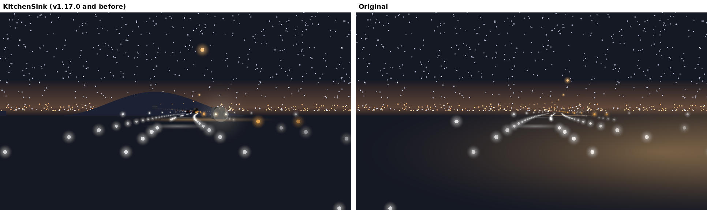
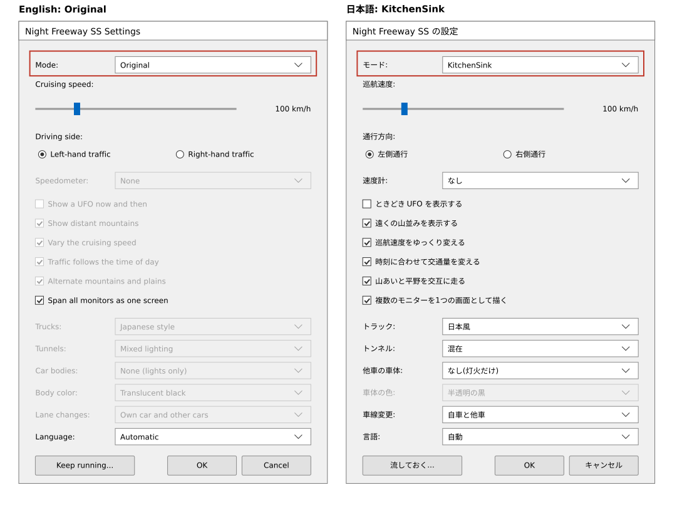

# v1.18.0 詳細設計: OriginalモードとKitchenSinkモード

- ステータス: 実装済み(実機確認待ち)
- 日付: 2026-10-28
- 親計画: [実装計画](0001-screensaver-implementation-plan.md)の6章

本書は、v1.18.0の変更を別のセッションや別の実装者が引き継げるように、設計と作業手順をまとめたものである。実装は本書とAGENTS.mdに従う。本書と実装が食い違った場合は、実装を変える前に調整役のセッションに伝える(AGENTS.md「複数セッションでの分担」)。

## 1. 目的と完了条件

2026-10-28に、ユーザーから次の依頼を受けた。

- 本家(mhatta/nightfreeway)の魅力は、大小の光点とその動きだけで、高速道路・遠くの街・空の星を表すところにある。追加した機能をすべてオフにすると、その状態になる
- この本家に近い状態(Originalモード)と、追加した機能を使う状態(KitchenSinkモード)を、一度に切り替えられるトップレベルの設定がほしい

同日にユーザーと決めたこと:

- モードは2つ。名前は英語で「Original」と「KitchenSink」。日本語の画面では「オリジナル」と「KitchenSink」(KitchenSinkは訳さない)
- 設定を保存していない人の既定は、KitchenSink(v1.17.0までと同じ見え方)
- Originalでは、追加した機能をすべてオフにし、さらに、中央分離帯の街灯の間隔を本家と同じ45 mに戻し、速度計を出さず、UFOを時々出さない
- 巡航速度・通行方向・表示言語・複数のモニターの扱いは、どちらのモードでも設定どおり
- 切り替えは、設定画面・コマンドライン・流しているあいだのキーの3か所でできる

完了条件:

- 設定画面の一番上で、モードを選べる。Originalのとき、追加した機能の欄は灰色になり、値は保存されたまま残る(3.2節)
- Originalのとき、3.1節の表のとおりに描く。KitchenSinkのとき、v1.17.0と同じに描く
- コマンドラインの`/original`・`/kitchensink`で、その回だけモードを上書きできる(3.3節)
- `/window`と`/play`で、キーでモードを切り替えられる。変更はその回だけ(3.4節)
- 文字列は英語と日本語の両方がある(ADR-0007)

## 2. 前提(v1.17.0の状態)

- 設定(`crates/freeway-core/src/settings.rs`の`Settings`、レジストリはすべて`REG_DWORD`。一覧は`docs/developers.md`の「設定の保存先」)
- 場面の構成(`scene.rs`の`SceneConfig`): 巡航速度・通行方向・UFOの間隔・山並み・トラック・トンネル・車体の形と色・車線変更・3つの時間的な変化・開始の時刻・シード
- 中央分離帯の街灯の間隔: `scene.rs`の`LAMP_SPACING`(70 m)。v1.13.0で45 mから広げた(0020の3.2節)。路面の光と影の計算も同じ定数を使う
- 速度計(`Speedometer`): なし・数字だけ・ダッシュボード2種
- 流しているあいだのキー(0021の3.2節): ↑↓・Space・D・F・コナミコマンド。画面の下の中央に案内を出す

## 3. 設計

### 3.1 2つのモード

| 項目 | Original | KitchenSink |
| --- | --- | --- |
| 巡航速度・通行方向・表示言語・複数のモニターを1つの画面として描く | 設定どおり | 設定どおり |
| 速度計 | なし | 設定どおり |
| UFOを時々表示 | オフ | 設定どおり |
| 遠くの山並み | オフ | 設定どおり |
| 巡航速度のゆらぎ・時刻に応じた交通量・景色の区間 | オフ | 設定どおり |
| トラック | なし | 設定どおり |
| トンネル | なし | 設定どおり |
| 他車の車体の形(影を含む) | なし(灯火だけ) | 設定どおり |
| 車線変更 | なし(v1.15.0より前と同じ動き) | 設定どおり |
| 中央分離帯の街灯の間隔 | 45 m | 70 m |

- 実装の方針: 設定(`Settings`)はそのまま持ち、場面の構成(`SceneConfig`)を作るところで、モードがOriginalなら上の表の値に置き換える。設定の値そのものは書き換えない
- 街灯の間隔は、`SceneConfig`に加える(定数の`LAMP_SPACING`を、構成の値にする)。路面の光と影の計算も、同じ値を使うこと(0020の3.2節と同じ制約)
- 本家の操作(`/window`・`/play`の↑↓・Space・D・F・コナミコマンド)は、Originalでも使える(本家にある操作のため)
- KitchenSinkのときの描画の命令の列は、v1.17.0と変わらない(`scene.rs`の描画命令のハッシュのテストを、変えずに通す)
- 将来、機能を加えるときは、Originalでオフになるように、上の表に行を加える(この規則を`docs/developers.md`に書く)

### 3.2 設定

| 項目 | レジストリ値 | 値 | 既定値 |
| --- | --- | --- | --- |
| モード / Mode | `Mode` | KitchenSinkは0、Originalは1 | 0 |

- 値がない・範囲外のときは既定値(KitchenSink)。v1.17.0までに保存した設定は、そのままKitchenSinkとして読まれ、見え方は変わらない
- 設定画面: 一番上に「モード」のドロップダウン(またはラジオボタン)を置く。選択肢は、英語で「Original」「KitchenSink」、日本語で「オリジナル」「KitchenSink」
- Originalを選んでいるあいだは、3.1節の表で「設定どおり」でない欄を、灰色(無効)にする。値は保持し、保存もする(KitchenSinkに戻すと、元の値で使える)
- ダイアログの大きさは、DPI 150%・1080pで画面からはみ出さないこと(0020の7章)
- 説明書には、2つのモードの違い(3.1節の表の要旨)を書く。OriginalのUFOについては、利用者向けの文書に書かない(D23)

### 3.3 コマンドライン

| 引数 | 動き |
| --- | --- |
| `/original` | その回だけ、設定にかかわらず、Originalで描く |
| `/kitchensink` | その回だけ、設定にかかわらず、KitchenSinkで描く |

- `/s`・`/window`・`/play`と一緒に使える。順序は問わない。大文字と小文字は区別せず、`/`と`-`のどちらで始めてもよい(0020の3.5節と同じ)
- `/original`と`/kitchensink`の両方、`/c`・`/p`との組み合わせ、どちらかだけを単独で指定は、エラーのメッセージを出す(今の引数の誤りと同じ扱い)
- 既存の引数(`/span`・`/nospan`・`/minutes:<n>`)と組み合わせられる

### 3.4 流しているあいだのキー

- `/window`と`/play`で、Mキーでモードを切り替える。変更はその回だけで、設定には保存しない
- 切り替えたときは、場面を作り直してよい(走った距離・時刻は続けるのが望ましい。作り直すなら、その理由を7章に書く)
- 操作の案内に、Mキーと今のモードを加える(例: `M KitchenSink` / `M Original`)。案内の幅が足りなければ、文言を整えてよい
- `/s`とプレビューでは、今までどおりキーで終わる

## 4. テスト

`freeway-core`:

- Originalの`SceneConfig`が3.1節の表のとおりになる(設定の値がどうであっても)。巡航速度・通行方向は設定どおり
- KitchenSinkでは、描画の命令のハッシュがv1.17.0と同じ
- Originalでは、街灯の路面の光と影の計算が45 mで一致する
- 設定: `Mode`の読み書き、範囲外・ないときの既定値
- 文字列の表のテストが、追加したキーでも通る

`freeway-scr`:

- 引数(Linuxでも実行): `/original`・`/kitchensink`の組み合わせ・順序・大文字と小文字・`-`。エラーになる組み合わせ。今の引数の動きが変わらない
- キー(Linuxでも実行): Mキーの判定
- 設定画面と保存(Windowsのみ): モードの値が保存され、読み戻せる

見た目は、ユーザーの実機確認で見る。

## 5. 実機での確認(調整役がユーザーに依頼する項目)

- Originalで、光点だけの本家に近い見え方になっているか(山並み・トンネル・トラック・車体・影・速度計がない、街灯が45 mおき)
- KitchenSinkで、v1.17.0と同じ見え方か
- 設定画面のモードの欄と、Originalのときに欄が灰色になること(日本語と英語、DPI 150%など)
- `/original`・`/kitchensink`の引数、`/window`・`/play`のMキー
- v1.17.0で保存した設定のまま更新したとき、KitchenSinkで今までどおりに動くか

## 6. 作業手順

実装用セッション:

1. ワークスペースのバージョンを`1.18.0`に上げる(このPRの最初のコミットで実施済み)
2. 設定(3.2節)と、モードから`SceneConfig`を作る部分(3.1節)。街灯の間隔を構成の値にする
3. 設定画面(3.2節)
4. 引数(3.3節)
5. キーと案内(3.4節)
6. 説明用の図(OriginalとKitchenSinkの同じ場面の比較、設定画面の新しい欄)を`docs/images/`に置く
7. `docs/developers.md`(設定の保存先・動かし方・3.1節の規則)・利用者向けの説明書(`packaging/README.md`)・最上位の`README.md`(必要なら1行)・実装計画の進捗表と5.4節を更新する。本書の7章に、実装で決めたことと図を書く
8. AGENTS.mdの検証コマンドをすべて実行する(Windowsターゲットのclippy、`ufo-demo`付きのclippyも含む)
9. 1コミット1論理変更でコミットし、プッシュする
10. 敵対的セルフレビューを行い、指摘と対応をPRコメントに記録する
11. CIの成功を確認したら、PR本文のチェックリストをCIのグリーン化まで更新し、PRの監視を外して調整役のセッションに完了を報告する

調整役:

12. ユーザーの実機確認とマージの承認を得て、チェックリストを更新してからマージする。図のリンクを`main`に直す。`v1.18.0`のタグはユーザーが手元からプッシュする

## 7. 実装で決めた値

設計(3章)と実装の食い違いはない。設計が決めていなかった点を、次のとおり決めた。

### 7.1 実装で決めたこと

- 型と名前: `freeway-core`の`SceneMode`(`KitchenSink`=0、`Original`=1。`ALL`・`from_raw`・`to_raw`・`toggled`)を、`Settings::mode`と`lib.rs`の公開に加えた。ホストの`args::Mode`(実行の形)と別の名前にするため、`SceneMode`とした。レジストリ値`Mode`は`Settings::with_mode_raw`で読む(`with_span_monitors_raw`と同じ形。`from_raw`の引数が増えるのを避けた)
- 場面の構成: `SceneConfig`に`lamp_spacing`(KitchenSinkは70 m、Originalは45 m)を加え、`SceneConfig::original`が3.1節の表の値に置き換える。`Settings::scene_config`がモードに応じて呼ぶ。設定の値そのものは書き換えない
- 街灯の間隔: 定数`LAMP_SPACING`をなくし、街灯の列と路面の光の列(`scene.rs`の`rows`。`const fn`で、場面ごとに持つ)と、影の計算(`shadows_by_lamp`)が、同じ`config.lamp_spacing`を使う。街灯の番号(影と光を結ぶ鍵)も、同じ間隔で決まる
- 速度計: `Settings::effective_speedometer`が、Originalでは`None`を返す。ホストの描画はこれを使う(設定の値は`speedometer`のまま残る)
- UFO: Originalでは`ufo_mean_interval`が`None`になり、時々は現れない。D(`CallUfo`)の操作は、本家にある操作として、Originalでも使える(3.1節)。`ufo-demo`のフィーチャーは、`None`のままにする
- 引数: `args::parse`が`CommandLine { mode, scene_mode }`を返す。`/original`・`/kitchensink`は、`/span`・`/nospan`と同じく、先に取り除いてから残りを今までどおり読む。両方の指定は`ConflictingSceneMode`、`/s`・`/window`・`/play`がないとき(単独、`/c`・`/p`と一緒)は`SceneModeWithoutRun`で、メッセージは英語である(今の引数の誤りと同じ扱い)。`Mode::arguments`(設定画面の「開始」が使う)は変えていない。「開始」は設定を保存してから起動するので、モードの引数は付けない
- Mキー: 流している`animate`が、モードをその回の設定に持ち(`settings.mode`。保存しない)、切り替えると`Scene::reconfigure`で場面を作り直す。モードの引数(`/original`など)は、起動のときにこの設定へ入れる
- 場面の作り直し(`Scene::reconfigure`): 走った距離・時刻・向き・選んだ速度・通行方向・一時停止は続ける。他車・トンネル・車線変更の状態・空(流れ星の予定)・UFOの予定は、設定の種(シード)から作り直す。理由は、他車の数や形、トンネルの有無、車線変更が、構成によって最初から違い、変換するより作り直すほうが、場面の内部の状態を保つ複雑さを避けられるため。そのため、切り替えの瞬間に、他車の並びが変わり、自車は元の車線に戻り、速度のゆらぎは選んだ速度からやり直す(切り替えの前後で見え方が違うのは、モードの違いでもあるので、不自然ではない)。複数のモニターを1つの画面として描くときも、場面は1つなので同じ
- 案内: 操作の案内の末尾に、` · M <今のモード>`を足す(英語は`M Original`・`M KitchenSink`、日本語は`M オリジナル`・`M KitchenSink`)。案内が長くなり、幅に収まらないときは、今までと同じ処理(幅の92%に収まる大きさまで文字を縮める)に任せた
- 設定画面: 一番上に「モード」のドロップダウン(KitchenSink・Original)を置いた。Originalのあいだ、灰色にするのは、速度計・UFO・山並み・巡航速度のゆらぎ・時刻に応じた交通量・景色の区間・トラック・トンネル・他車の車体・車体の色・車線変更の欄である(`settings_dialog.rs`の`ADDED_FEATURE_CONTROLS`と、車体の色)。巡航速度・通行方向・複数のモニターの扱い・言語は、灰色にしない。車体の色は、KitchenSinkで、車体の形がなしのときも灰色である(今までどおり)。灰色の欄の値も、読んで保存する
- ダイアログの大きさ: 高さを320から322(ダイアログ単位)にした。モードの行(16)を加え、ほかの行の間隔を18から16に詰めて、増えた分をほぼ打ち消した。DPI 150%・1080pでは、Segoe UI 9ptの1ダイアログ単位が約2.8画素なので、高さは約905画素と見積もる(作業領域は約1000画素)。実機での確認は、5章の項目に含まれる
- 将来の機能: Originalでオフにする規則を`docs/developers.md`の「モード」に書いた

### 7.2 確かめたこと

- `scene.rs`の描画命令のハッシュのテストは、変えずに通る(変えたテストは街灯の間隔のテストだけで、70 mと45 mの両方を確かめる形にした)
- Originalの構成が3.1節の表のとおりになり、巡航速度・通行方向・開始の時刻・シードが設定どおりであること(`freeway-core`のテスト)。設定の値がどうであっても同じであること(`settings.rs`のテスト)
- 街灯の路面の光と影が、70 mと45 mのどちらでも、同じ番号と間隔で一致し、影が実際に出ること
- `Scene::reconfigure`が、走った距離・時刻・向き・選んだ速度・通行方向・一時停止を保ち、トンネルのないOriginalへ移ったあとも走り続け、KitchenSinkへ戻ること
- `Mode`の読み書き(ないとき・範囲外は既定値のKitchenSink。v1.17.0までの設定がそのままKitchenSinkになる)。文字列の表(英語・日本語の両方に、KitchenSinkが訳されずに入っていること)
- 引数: `/original`・`/kitchensink`の組み合わせ・順序・大文字と小文字・`-`・誤りになる組み合わせと、今の引数の動きが変わらないこと。Mキーの判定
- Windowsでだけ動くテスト(`win/`のレジストリ・窓・描画)は、この環境では実行できない。型は`x86_64-pc-windows-msvc`で検査し、clippyも通した。差分を読み、既定値(KitchenSink)に依存する既存のテストが変わらないことを確かめた: `create_scenes`・`draw_frame`・`switch_fullscreen`のテストは、`Settings::default()`(KitchenSink)を使い、描画の内容は変わらない。`Run::keep`の引数が増えたので、そのテストを直した。新しいテストを足した(レジストリの`Mode`の読み戻し、モードに応じた場面の構成と作り直し、Mキーの判定を窓へ渡す部分)
- `cargo fmt --all --check`・`cargo clippy`(Linux、Windowsターゲット、`ufo-demo`付き)・`cargo test --workspace`・`cargo check`(Windowsターゲット)

### 7.3 図

OriginalとKitchenSinkの同じ場面(同じ位置、同じ時刻)を、描画命令から描いた近似の図である。実際の画面のキャプチャではなく、光のにじみや色は実機と違う。KitchenSinkでは、山並みとトンネルの入口の丘があり、街灯の間隔が広い。Originalでは、光の点だけになり、街灯が密になる。

設定画面の新しい欄。`freeway.rc`の座標から描いた図で、画面のキャプチャではない。新しい欄を赤で囲んである。Originalのあいだ(左、英語)は、追加した機能の欄が灰色になる。KitchenSink(右、日本語)では、今までどおり選べる。

